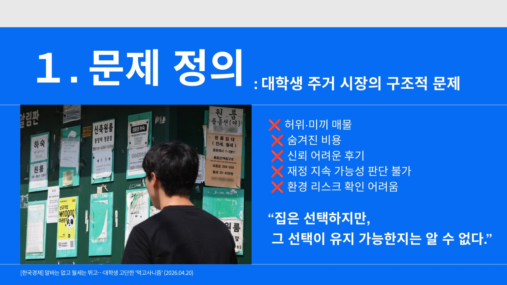
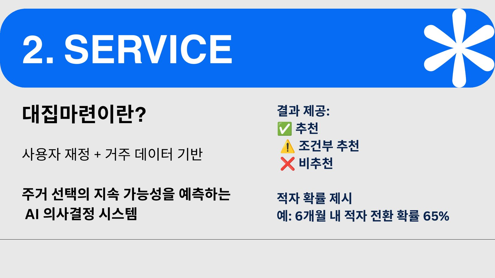
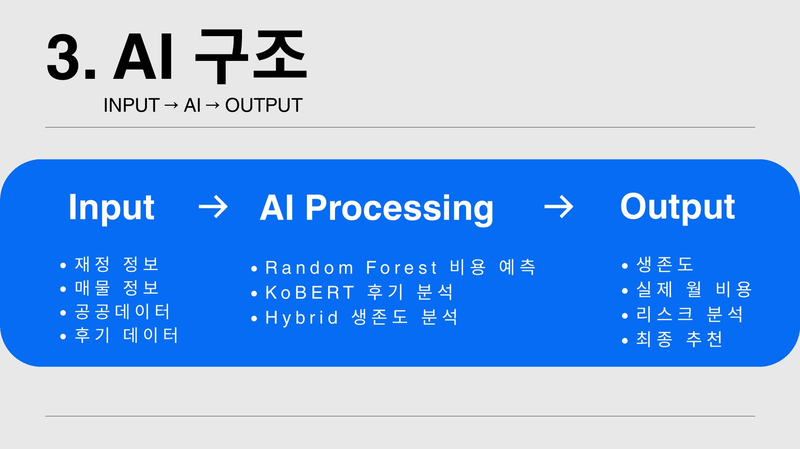
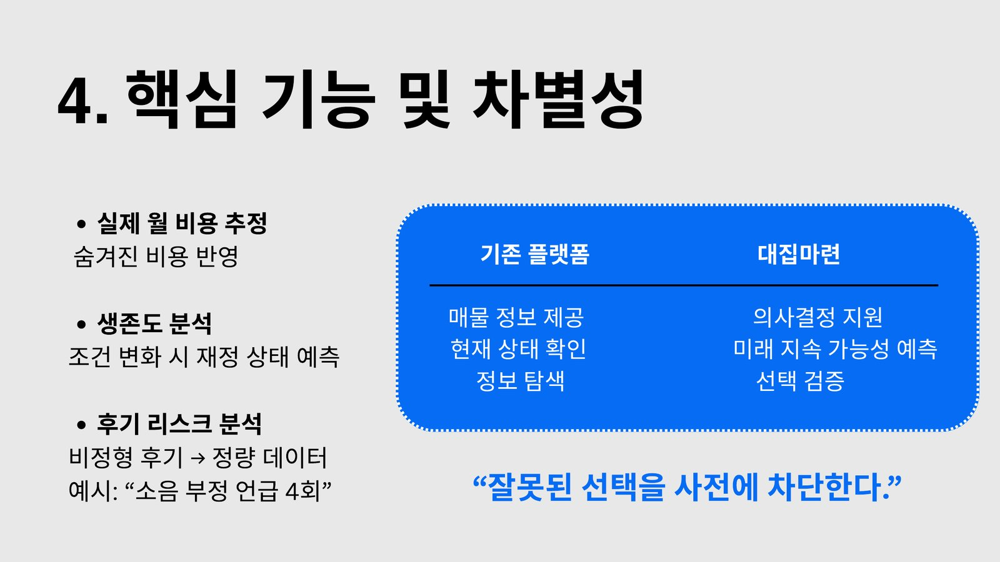
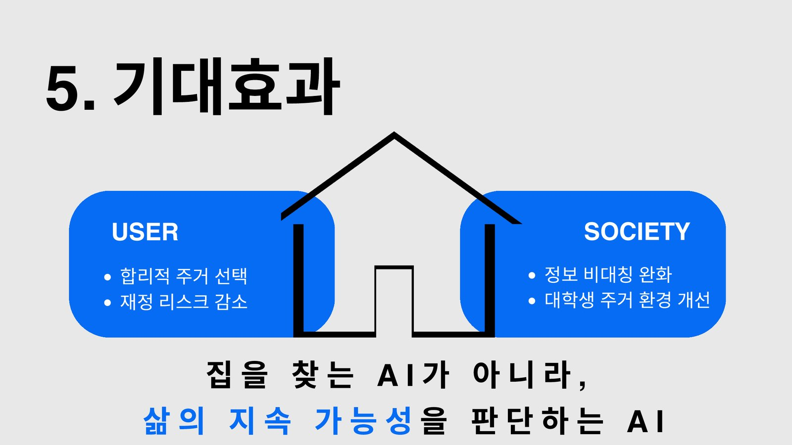

> 집을 찾는 AI가 아니라, 삶의 지속 가능성을 판단하는 AI

## Problem

허위·미끼 매물, 숨겨진 비용, 믿기 어려운 후기, 확인하기 어려운 환경 리스크. 대학생은 집을 고를 수는 있지만, 그 선택이 계속 유지 가능한지는 알 수 없습니다.

## Service

사용자의 재정 정보와 매물·공공·후기 데이터를 바탕으로 주거 선택의 지속 가능성을 예측합니다. 결과는 **추천 / 조건부 추천 / 비추천**으로 제시하고, "6개월 내 적자 전환 확률 65%"처럼 적자 확률을 함께 보여 줍니다.

## AI

- **Random Forest** — 숨겨진 비용까지 반영한 실제 월 비용 예측
- **KoBERT** — 비정형 후기를 정량 리스크로 변환 (예: "소음 부정 언급 4회")
- **Hybrid 생존도 분석** — 조건이 바뀌었을 때 재정 상태가 어떻게 변하는지 예측

## Difference

기존 플랫폼이 매물 정보와 현재 상태를 보여 준다면, 대집마련은 미래의 지속 가능성을 예측해 잘못된 선택을 미리 막습니다. 정보 탐색이 아니라 선택 검증을 돕는 서비스입니다.

## Impact

사용자에게는 합리적인 주거 선택과 재정 리스크 감소를, 사회적으로는 주거 시장의 정보 비대칭 완화와 대학생 주거 환경 개선을 기대합니다.

