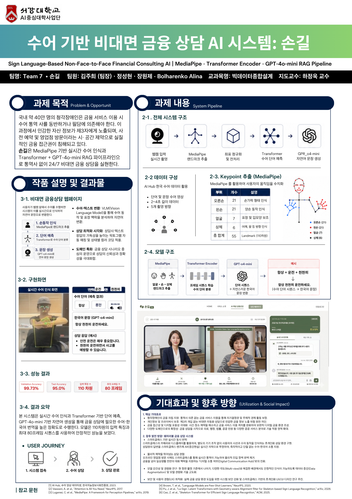
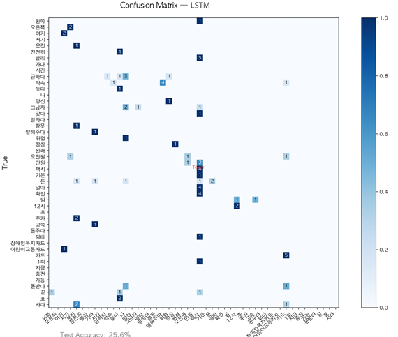
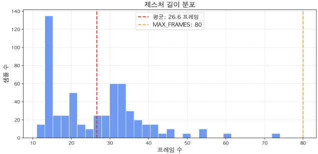

### 실시간 수어 인식

웹캠 앞에서 직접 수어를 하며, VS Code 터미널에서 모델이 단어를 알아보는 과정을 확인한 화면입니다.

- MediaPipe가 양손·얼굴·상체에 점 55개를 찍어 움직임을 따라갑니다.
- 최근 60프레임을 보고 10프레임마다 단어를 예측하고, 같은 단어가 두 번 연속·확신도 80% 이상일 때만 확정합니다.
- 확정된 단어는 터미널에 차례로 쌓이고, 15초가 지나면 문장으로 바뀝니다.

### 수어 기반 비대면 금융 상담 AI

국내 약 40만 명의 청각장애인은 금융 서비스를 이용할 때 수어통역사와 동행하거나 필담에 의존해야 합니다. 이 과정에서 재산·대출 같은 민감한 정보가 제3자에게 노출되고, 사전 예약과 영업점 방문이라는 제약 때문에 금융 접근권이 침해되고 있습니다.

손길은 웹캠 수어를 실시간으로 알아보고 한국어 문장으로 바꿔, 통역사 없이 24시간 은행 상담을 받을 수 있게 하는 서비스입니다.

1. **키포인트 추출** — MediaPipe Hands·Pose로 프레임마다 몸의 점 55개(110차원)
2. **단어 분류** — Transformer Encoder로 수어 단어 예측
3. **문장 생성** — OpenAI o4-mini가 단어 목록을 존댓말 한국어 문장으로 (예: 항상 + 운전 + 천천히 → "항상 천천히 운전하세요.")

테스트 정확도 **95.0%**, 검증 정확도 **99.73%**.

## Demo

실제 상담 화면입니다. 왼쪽 카메라에서 수어를 인식하고, 오른쪽 대화창에서 상담이 이어집니다.

1. **수어 입력 시작**을 누르고 카메라 앞에서 수어를 합니다.
2. 인식한 단어가 화살표로 이어져 차례로 쌓입니다.
3. o4-mini가 단어를 문장으로 다듬어 내 말풍선으로 올립니다.
4. 상담원이 답하고 다음 질문을 합니다. (예: "대출 상담을 원하시는군요! 직업이 어떻게 되세요?" → "요리사이시군요! 소상공인 대출 상품을 안내해 드리겠습니다.")

화면 아래에는 예상 금리, 필요 서류, 상담 시간 같은 상담 정보가 함께 표시됩니다.

상담 화면의 UI/UX는 제가 설계했습니다. 한 손으로 수어를 하면서도 상황을 바로 알아볼 수 있도록, 상태를 색으로 구분했습니다. **초록은 완료·승인, 노랑은 대기·안내, 빨강은 오류·불가**입니다. 상담 내용에 맞는 픽토그램을 자동으로 붙여 글을 읽지 않아도 흐름을 따라갈 수 있게 하는 작업도 함께 진행했습니다.

설계할 때 세 가지를 지키려 했습니다.

- **언제든 바로** — 모바일이나 PC 카메라만 있으면 예약이나 대기 없이 24시간 상담을 시작합니다.
- **나만 아는 상담** — 통역사 없이 사용자와 AI가 1:1로 바로 이어져, 자산 정보가 제3자에게 노출되지 않습니다.
- **핵심부터 빠르게** — 실시간 상담에서는 핵심 정보가 빨리 전달되는 것이 가장 중요하다고 보고, 사용자 경험을 기준으로 파이프라인을 다듬었습니다.

## Research

처음에는 "수어를 알아보는 서비스를 만들어 보자"는 생각으로 시작했습니다. 그런데 만들수록 두 가지 질문이 커졌습니다. 한국수어 데이터는 영어에 비해 턱없이 적었고, 정작 이 기술을 쓸 농인이 무엇을 원하는지 저희는 잘 몰랐습니다. 그래서 서강대 '수화의 이해' 모상근 교수님을 찾아가 자문을 받으며 서비스 방향을 다시 잡았습니다.

- **수어는 손 모양만이 아니다** — 수어는 수형(손 모양), 수위(손 위치), 수동(움직임), 수향(손바닥 방향), 비수지 표현(표정·고개·몸짓) 다섯 요소가 합쳐진 언어이고, 하나만 바뀌어도 뜻이 달라집니다. 같은 손동작도 표정에 따라 '좋다'가 '좋긴 뭐가 좋아'가 됩니다. 그래서 손 키포인트만이 아니라 **얼굴과 상체 점까지** 입력에 넣었습니다.
- **한국어와 1:1로 대응하지 않는다** — 어순이 다르고 생략과 관용 표현이 많으며, '(비가) 내리다'와 '(버스에서) 내리다'는 서로 다른 수어입니다. 그래서 인식한 단어를 그대로 잇지 않고, 언어 모델에 "없는 말을 지어내지 말고 순서를 지킬 것"을 조건으로 문장을 다듬게 했습니다.
- **가장 큰 불편은 사생활** — 농인은 일상 안내에는 통역사와 동행해도 괜찮지만, 진료나 재산·대출처럼 사적인 상담에서는 통역사 앞에서 "벌거벗은 것 같다"고 느낍니다. 필담도 대안이 되기 어렵습니다. 농인에게 한국어는 모국어가 아닌 제2언어에 가까워, 사람마다 문해력 차이가 크기 때문입니다.
- **작게 시작하라** — 처음부터 어려운 의료·심리 상담을 목표로 하면 실패하기 쉽습니다. 예/아니오처럼 단순한 선택지나 은행·관공서의 정형화된 업무부터 성공 모델을 만든 뒤 넓혀 가라는 조언을 들었습니다.

> 기술적인 완성도도 중요하지만, 무엇보다 기술이 쓰일 현장의 언어인 '수어' 그 자체를 깊이 이해하고, 사생활 보호와 같은 농인의 실질적인 고충을 우선적으로 해결하는 단계적 접근이 필요하다.
> (모상근 교수님 자문)

### Domain: 은행

팀 회의에서 "교수님께서 처음부터 어려운 상담보다 은행 업무부터 시작하라고 하신 것 같은데, 도메인을 어떻게 잡으면 좋을까요?"라고 의견을 모았습니다. 사생활이 민감한 은행과 병원이 후보였고, 그중 자문에서 특히 강조된 금융을 골랐습니다. 대출·카드 발급처럼 질문과 답이 비교적 정해진 은행 상담부터 시작하기로 했습니다.

## Data

[AI Hub 한국수어 영상 데이터](https://www.aihub.or.kr/aihubdata/data/view.do?currMenu=115&topMenu=100&searchKeyword=%EC%88%98%EC%96%B4%20%EC%98%81%EC%83%81&aihubDataSe=data&dataSetSn=103)의 일상생활 수어 데이터를 사용했습니다. 서로 다른 16명이 정면·위·아래·왼쪽·오른쪽 5개 방향에서 촬영한 2~4초 길이의 단어·문장 영상이고, 영상마다 어떤 형태소가 몇 초부터 몇 초까지 쓰였는지 라벨이 붙어 있어 단어 단위 학습에 잘 맞았습니다.

- **키포인트를 직접 다시 뽑았습니다** — 데이터셋에는 미리 추출된 키포인트가 들어 있었지만, 그대로 쓰면 실제 서비스에서 웹캠으로 들어오는 실시간 데이터와 형식·속도가 맞지 않을 수 있었습니다. 그래서 수십 GB의 원본 영상에서 서비스와 똑같이 MediaPipe로 손·상체·얼굴 키포인트를 새로 추출했습니다.
- **단어 구간 자르기** — 라벨의 시작·끝 시간을 30fps 프레임 번호로 바꿔, 영상 하나를 단어 단위 학습 샘플로 나눴습니다.
- **키포인트 110차원** — 오른손 21 + 왼손 21 + 얼굴 7(코·눈·귀·입꼬리) + 상체 6(어깨·팔꿈치·손목) = 55개 점의 x, y 좌표. 추출한 좌표는 모델이 가볍게 읽도록 JSON으로 묶었습니다.
- **길이 맞추기** — 사람마다 수어 속도가 달라 프레임 수가 제각각이어서, 최대 80프레임 기준으로 길면 고르게 골라 쓰고 짧으면 채워 넣었습니다.
- **위치 정규화** — 손은 손목, 얼굴은 코, 상체는 어깨를 기준점으로 삼아 좌표를 다시 계산했습니다. 화면 어디에 서 있든 모델이 동작의 모양에만 집중하도록 하기 위해서입니다.
- 학습 70% / 검증 15% / 테스트 15%로 나눴습니다.

### 도메인 갭과 웹캠 데이터

AI Hub 데이터는 스튜디오에서 고화질 카메라와 통제된 조명으로 찍은 아주 정제된 영상입니다. 이 데이터로 학습한 모델은 테스트에서 95%를 넘었지만, 실제 노트북 웹캠 앞에서는 인식률이 크게 떨어졌습니다. 일반 웹캠은 화질이 낮고 조명이 어둡고, 각도와 배경도 훨씬 복잡하기 때문입니다.

그래서 실제 사용 환경을 닮은 **파인튜닝용 데이터를 직접 만들었습니다.** 팀원들이 각자 노트북 웹캠으로 여러 일상적인 배경과 조명에서 상담에 쓰일 수어를 촬영하고, 학습 데이터와 똑같은 파이프라인으로 키포인트를 뽑았습니다. 대규모 공공 데이터로 수어의 기본 뼈대와 패턴을 익히고, 직접 만든 웹캠 데이터로 실제 환경에 맞게 다듬는 구조입니다.

## Model

### 왜 이 구조인가

- **MediaPipe** — 다른 연구들은 키포인트 추출에 무거운 모델을 많이 쓰지만, 그러면 실시간성을 지킬 수 없고 CPU만으로 돌리기 어렵습니다. 빠르고 정확하면서 CPU에서도 돌아가는 MediaPipe를 골랐습니다.
- **얼굴 키포인트** — 수어는 표정으로도 뜻이 바뀝니다(비수지 표현). 손만 보던 기존 연구·서비스와 달리 얼굴 점을 함께 넣어 미묘한 표정까지 읽으려 했습니다.
- **Transformer Encoder** — 데이터가 "몇 초부터 몇 초까지 어떤 단어"로 나뉘어 있어, 연속 수어 인식이 아닌 고립 수어 인식(Isolated Sign Language Recognition) 선행 연구를 참고했습니다.
- **o4-mini** — 한국수어는 한국어와 문법이 달라 단어를 그대로 이으면 어색합니다. 응답이 빠르고 추론 능력이 좋은 o4-mini에 "수어 번역 전문가" 역할을 주고 단어 시퀀스를 자연스러운 문장으로 바꾸게 했습니다.

### 첫 시도: LSTM

처음에는 LSTM으로 단어를 분류했지만 테스트 정확도가 25.6%에 그쳤습니다. 혼동 행렬을 보면 여러 단어가 몇몇 단어로 몰려 예측됐습니다. 제스처 길이도 살펴보니 평균 26.6프레임으로 대부분 40프레임보다 짧았고, 80프레임에 맞추면 절반 이상이 채워 넣은 프레임이었습니다. 멘토님도 "그럴 수밖에 없는 구조"라고 보셨습니다. 앞에서부터 차례로 읽는 순환 구조 대신, 모든 프레임을 한 번에 보고 채워 넣은 프레임은 가릴 수 있는 Transformer로 바꿨습니다.

### Transformer Encoder

1. **입력** — 프레임마다 오른손 42 + 왼손 42 + 얼굴 14 + 상체 12 = 110개의 숫자
2. **KeypointNormalizer** — 부위별 기준점(손목·코·어깨)으로 좌표를 상대값으로 바꿈
3. **Positional Encoding** — 모든 프레임을 동시에 처리하는 Transformer에 sin·cos로 순서 정보를 더함
4. **Encoder 6층** — Self-Attention으로 동작의 시작과 끝을 함께 보며 전체 패턴을 학습 (헤드 8개, 256차원)
5. **Mean Pooling + Classifier** — 마스크로 실제 프레임만 평균 내 하나의 벡터로 만들고 단어를 분류

CrossEntropy와 Adam(학습률 0.0001)으로 50 epoch 학습했고, 검증 손실이 5 epoch 동안 나아지지 않으면 학습률을 절반으로 줄이는 스케줄러와 gradient clipping으로 학습을 안정시켰습니다.

### 파인튜닝

직접 찍은 웹캠 데이터는 양이 적어서, 잡음·위치 이동·크기 변화·시간 왜곡·좌우 반전 다섯 가지 증강을 샘플마다 50번씩 적용했습니다. 이미 배운 특징을 지키기 위해 정규화·입력 층은 고정하고, 나머지 층만 낮은 학습률(0.00001)로 20 epoch 더 학습했습니다. 그 결과 검증 정확도가 **99.73%**까지 올랐고, 웹캠 실시간 환경에서도 제대로 동작하게 되었습니다.

## Real-time

웹캠 영상의 최근 60프레임을 계속 모아 두고 10프레임마다 단어를 예측합니다. 같은 단어가 두 번 연속, 확신도 80% 이상으로 나올 때만 단어로 확정하고 버퍼를 비워 다음 단어를 준비합니다. 15초 동안 모은 단어 목록은 "없는 말을 지어내지 않고, 순서를 지키고, 존댓말로" 같은 규칙과 함께 o4-mini에 보내 문장으로 만듭니다. 상담 화면은 Streamlit으로 만들었고, 상담원 응답은 대출·카드 상담 시나리오로 시연했습니다.

## Outcome

- 스튜디오 데이터 테스트 정확도 **95.0%** → 웹캠 데이터 파인튜닝 후 검증 정확도 **99.73%**, 실시간 환경에서도 동작
- LSTM 25.6% → Transformer 95.0%
- 수어를 배운 교수님이 직접 수어를 했을 때 바로 정확한 번역이 나왔습니다.
- 수어 인식 → 단어 예측 → 문장 생성으로 이어지는 금융 상담용 수어-한국어 번역을 구현했습니다. 서강대 해커톤 장려상을 받았습니다.

### 멘토링에서 들은 것

- **"요즘은 어떻게 데이터화하느냐가 관건"** — 수어 전문가가 아닌 저희가 만든 파인튜닝 데이터도 괜찮은지 여쭤봤을 때, 웹캠으로 데이터를 직접 만든 것 자체가 의미 있는 작업이고, 이 방법이면 데이터를 계속 늘려 갈 수 있다는 가능성을 연 것이라는 답을 들었습니다.
- **기술보다 필요성의 설득** — 기술은 가능성을 보여 주는 정도로 충분하고, 더 중요한 것은 "이 서비스가 왜 필요한가"를 설득하는 것이라는 조언을 받았습니다.
- **실시간성은 필수** — 개인정보가 오가는 상담일수록 지연 없이 바로 번역되어야 하고, 처음 20개였던 파인튜닝 원본을 수십 개 더 늘려야 빠르고 정확해질 것이라는 피드백을 받았습니다.

## Role

팀장으로서 상담 화면의 UI/UX를 설계하고, 데이터 전처리와 파인튜닝용 웹캠 데이터 제작을 맡았습니다. 수어 전문가 자문을 이끌어 은행 도메인을 정하는 데에도 참여했습니다.

- **팀장 (나)** — UI/UX 설계, 데이터 전처리, 파인튜닝 데이터 제작
- **팀원 A** — 데이터 전처리, 파인튜닝 데이터 제작
- **팀원 B** — AI 파이프라인 설계, 모델 구조 분석
- **팀원 C** — AI 모델링, 학습, 파인튜닝

## Next

> 기술이 사람의 마음과 마음을 잇는 따뜻한 손길이 되도록

손길 이후의 방향은 기술을 더 정교하게 만드는 것에서 그치지 않고, **한국수어와 그 언어를 쓰는 사람들에게 시점을 두는 것**입니다. 한국수어 기술 자체가 더 커지고, 그 기술이 농인의 일상에 실제로 닿는 서비스가 되도록 세 단계로 키워 가려 합니다.

1. **도메인 확장** — 은행에서 시작해 의료·행정·지자체 등 공공 서비스 전반으로 넓힙니다. 지역마다 다른 수어 방언 데이터를 체계적으로 모아, 누구의 수어든 알아볼 수 있게 하려 합니다.
2. **웨어러블 AI, 실감형 인터페이스** — AR 글래스 같은 웨어러블 기기와 연결해, 시선을 옮기지 않아도 눈앞에 실시간 자막이 뜨게 합니다. 단어 단위를 넘어 문장 단위로 이어 읽는 연속 수어 인식과 AR HUD 대면 상담으로 양방향 소통을 완성하려 합니다. 화면 앞에 앉지 않아도, 통역사 없이도 대화가 이어지는 일상 속 기술입니다.
3. **수어 아바타 생성** — 반대 방향으로, 텍스트를 받아 고정밀 3D 수어 아바타가 수어로 전하게 합니다. 동작 사이를 자연스럽게 잇는 보간 기술을 쓰고, 미세한 손가락 움직임과 표정까지 살리는 어려운 과제에 도전하려 합니다.

### 지금 풀어야 할 한계

- 지금은 **천천히, 끝맺음을 분명하게** 수어를 해야 잘 알아보고, 못 알아보면 다시 해야 합니다. 실제 사용자에게 가장 먼저 필요한 개선이 무엇인지 농인의 의견을 들으며 우선순위를 정하려 합니다.
- 표정 같은 비수지 표현의 미세한 차이, 동음이의어, 한국어와 다른 어순은 아직 충분히 다루지 못합니다.
- 다양한 각도와 복잡한 배경에서도 안정적이도록 데이터를 늘리고, 모델 경량화와 지식 증류, 보안을 함께 연구하려 합니다.

이름처럼, 기술이 필요한 사람에게 정말로 **손길이 닿는** 서비스로 자라기를 바랍니다.

## Learnings

- **코드보다 언어를 먼저 이해해야 했습니다.** 처음에는 손 모양만 잘 잡으면 된다고 생각했지만, 수어가 다섯 요소로 이루어진 하나의 언어라는 것을 배우고 나서야 무엇을 입력으로 넣어야 하는지, 어디까지가 기술의 한계인지 보였습니다. 교수님께서 개발자도 수어를 직접 배워야 한다고 하신 이유를 프로젝트를 하면서 실감했습니다.
- **"무엇을 만들 수 있나"보다 "누가 왜 필요로 하나"를 물어야 했습니다.** 수어 인식이라는 기술에서 출발했지만, 자문을 통해 농인이 가장 불편해하는 지점이 사생활이라는 것을 알게 되면서 서비스가 '수어 번역기'에서 '통역사 없이 받는 금융 상담'으로 바뀌었습니다.
- **테스트 점수와 실제 환경은 다릅니다.** 95%라는 숫자에도 웹캠 앞에서는 잘 동작하지 않았습니다. 실제 사용 환경을 닮은 데이터를 직접 만들어 도메인 갭을 줄인 경험에서, 데이터를 "어떻게 모으고 만드느냐"가 모델만큼 중요하다는 것을 배웠습니다.
- **숫자 뒤의 데이터를 봐야 했습니다.** LSTM의 25.6%라는 결과에서 멈추지 않고 혼동 행렬과 제스처 길이를 들여다본 덕분에, 모델 구조와 시퀀스 길이 설계를 바꿀 근거를 찾을 수 있었습니다.
- **작게 시작해 정확히 닿는 것.** 완벽한 쌍방향 번역 대신 정형화된 은행 상담에서 먼저 동작하는 서비스를 만들고, 남은 한계를 다음 단계로 분명히 적어 두는 것이 사람에게 닿는 기술로 가는 현실적인 길이라는 것을 배웠습니다.
