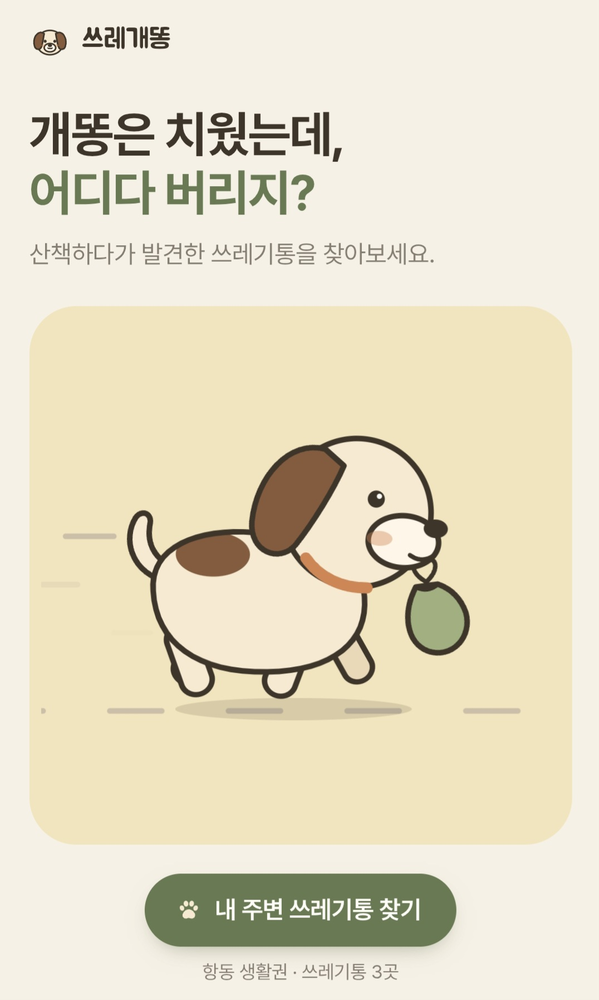
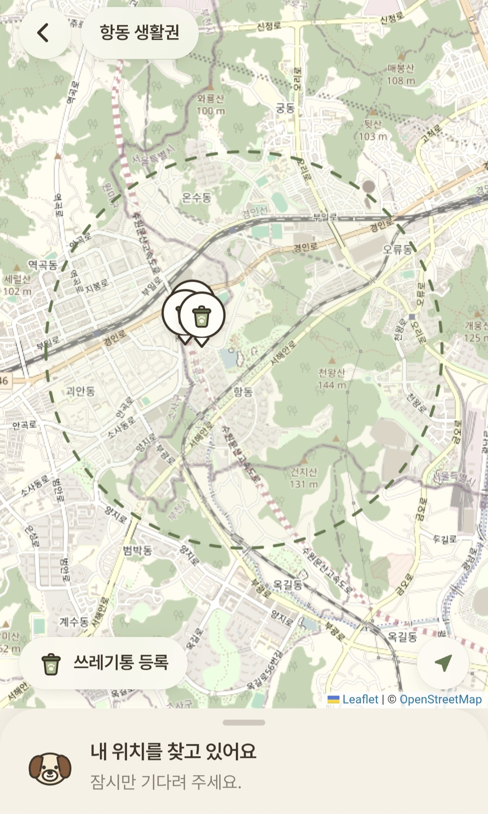
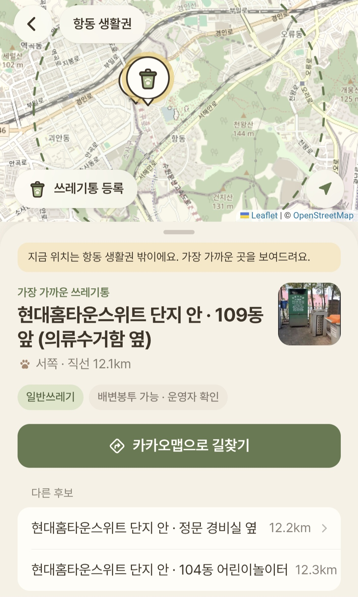
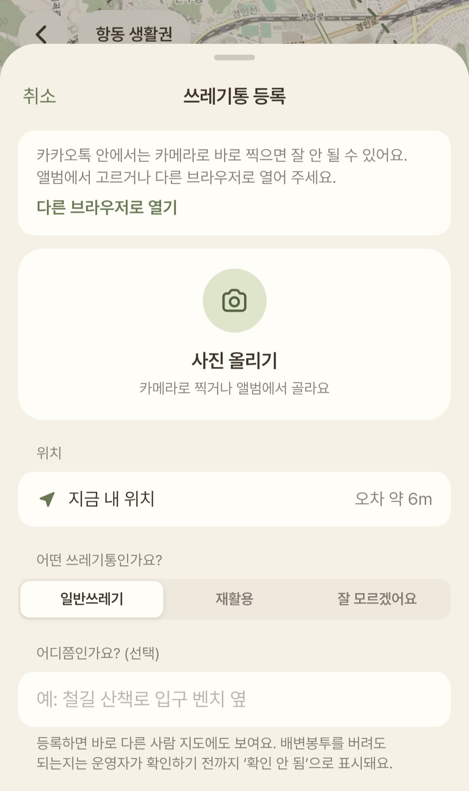

> 개똥은 치웠는데, 어디다 버리지?

## Question

강아지가 산책 중에 배변을 하면 보호자는 봉투에 담습니다. 문제는 **그다음**입니다.

- 지도 앱에서 '쓰레기통'은 검색이 거의 안 됩니다.
- 쓰레기통을 찾아도 **배변봉투를 버려도 되는 곳인지** 알 수 없습니다. "사용한 봉투는 집으로 가져가세요"라고 안내하는 지자체도 있습니다.
- 그 순간 보호자는 한 손엔 리드줄, 다른 손엔 봉투를 들고 있고, 급하고, 화면을 오래 볼 수 없습니다. 밤일 수도 있습니다.

그래서 질문을 이렇게 좁혔습니다. **"지금 여기서, 어느 쪽으로 몇 분 걸어가면 되는가"를 한눈에 알려 줄 수 있을까?**

## Principles

만들기 전에 지킬 원칙부터 정했습니다. 기능보다 이 원칙들이 서비스의 성격을 정한다고 생각했습니다.

- **모르면 모른다고 말하기** — "버려도 되는지"는 현장 안내문, 관리기관 안내, 운영자의 직접 확인 같은 근거가 있을 때만 표시하고, 그 전에는 모두 '확인 안 됨'으로 둡니다. 일반 쓰레기통이라서, 이름이 '배변봉투함'이라서 버려도 된다고 추측하지 않습니다. 배변봉투함은 봉투를 나눠 주는 지급함일 수도 있기 때문입니다.
- **필요한 것만** — 회원가입, 커뮤니티, 강아지 프로필, 산책 기록은 넣지 않았습니다. 앱을 켜면 바로 추천이 보이고, 길찾기는 이미 잘 만들어진 카카오맵에 맡깁니다.
- **실제 생활권에서 시작하기** — 서비스 지역을 행정구역이 아니라 실제 산책 동선으로 정했습니다. 푸른수목원(서울 구로구 항동)을 중심으로 도보 20분, 직선 약 1.5km 안의 하버라인·항동 철길·아파트 단지·역곡역 주변입니다. 항동 → 구로구 → 서울시 순서로 넓혀 갈 계획입니다.
- **출처를 남기기** — 쓰레기통 한 곳마다 좌표를 어떻게 얻었는지, 누가 언제 확인했는지를 기록합니다. 카카오 지도 API의 검색 결과는 운영정책상 저장할 수 없어 데이터베이스에 넣지 않았고, 공용 공간의 쓰레기통만 등록합니다.

## Map & Data

이 서비스에서 가장 오래 고민한 것은 **"쓰레기통 위치를 어디서, 어떻게 가져올까"**였습니다. 지도 위에 점 하나를 찍는 일인데, 생각보다 넘어야 할 단계가 많았습니다.

1. **공공데이터부터 찾았습니다** — 서울시 가로쓰레기통 설치정보(2025.11)와 중구 반려동물 배변봉투함(2026.07) 데이터를 찾았습니다. 그런데 서울시 데이터에는 **좌표가 없고 주소만** 있었습니다. 지도에 찍으려면 주소를 좌표로 바꾸는 지오코딩이 필요했습니다.
2. **지오코딩 서비스를 하나씩 확인했습니다** — 카카오 로컬 API는 결과 좌표를 저장하는 것이 운영정책상 금지라는 답을 받았고, 브이월드 지오코더도 실시간 사용만 되고 DB 저장은 안 된다는 안내를 확인했습니다. SGIS는 약관에 허용·금지가 명시돼 있지 않아 공식 문의를 넣고 답을 기다리는 중입니다. 쓸 수 있다고 확인되기 전까지는 저장하지 않기로 했습니다.
3. **그래서 직접 모으기로 했습니다** — 산책하며 쓰레기통을 찍고, 사진 속 GPS나 휴대폰 위치로 좌표를 얻는 방식입니다. 기록 양식과 촬영 규칙(근접·주변·안내문 사진, 사람 얼굴과 동·호수는 찍지 않기)을 정한 현장조사 계획을 세웠습니다.
4. **좌표마다 출처를 남겼습니다** — 사진 GPS, 기기 GPS, 사람이 직접 찍은 핀, 원본 데이터 좌표처럼 좌표를 어떻게 얻었는지 기록하고, 좌표를 얻지 못한 곳은 지도에 띄우지 않습니다.
5. **지도도 바꿨습니다** — 처음에는 카카오맵으로 지도를 띄우려 했지만, 가입과 키 없이 바로 시작할 수 있는 OpenStreetMap + Leaflet으로 정하고, 카카오맵은 길찾기 연결에만 썼습니다.
6. **단지 안 쓰레기통은 위성사진으로 찍었습니다** — 첫 실제 데이터인 아파트 단지 안 쓰레기통 3곳은 정확한 위치를 몰라 처음엔 단지 주소 좌표에 임시로 표시했습니다. 개발 화면에만 보이는 위성사진 보기를 만들고, 제가 단지 지도에 표시한 위치를 위성사진에 맞춰 하나씩 옮겨 찍었습니다. (오차 약 10~20m)

공공데이터는 지오코딩 문제가 풀리면 구로구·서울시로 넓힐 때 쓸 예정입니다.

## Recommendation

가장 가까운 곳이 늘 정답은 아닙니다. 거리만으로 정렬하지 않고, **실제로 버릴 수 있을 가능성**을 곱한 '체감 거리'로 순서를 정했습니다.

- 배변봉투 가능이 확인된 곳 — 실제 거리 그대로 (× 1.0)
- 배변봉투함인데 확인 전 — × 1.2
- 일반쓰레기를 받는 통인데 확인 전 — × 1.3
- 재활용만 받는 통 — × 1.8
- 금지 안내가 있거나 없어진 곳 — 추천하지 않음

가장 적절한 1곳과 대안 2곳을 방향·거리·도보 시간과 함께 보여 주고, 가중치는 현장 테스트 피드백으로 조정할 예정입니다.

## Design

산책 중에 한 손으로 급하게 쓰는 서비스라서, 화면을 보자마자 알아보고 바로 누를 수 있게 만드는 데 가장 신경 썼습니다.

- **한 손, 한눈** — 주요 버튼은 엄지가 닿는 화면 아래쪽에, 크게 둡니다. 한 화면에 문장은 두 개 이하, 작은 휴대폰에서도 스크롤 없이 보이게 했습니다.
- **누를 곳은 한 색** — 크림 바탕에 세이지 초록 하나만 '누르는 색'으로 씁니다. 화면에서 가장 진한 면이 곧 누를 곳입니다.
- **같은 강아지 한 마리** — 머리 큰 2등신 강아지를 직접 정의하고, 홈 화면에서 봉투를 물고 달리게 했습니다. 캐릭터는 보조 역할이라 한 화면에 한 번만 나옵니다.
- **AI가 만든 티 빼기** — 처음 화면이 이모지와 굵은 그림자로 장식된 "AI가 만든 것 같은" 모습이어서, iOS 앱처럼 깔끔하게 다시 정리했습니다. 이모지 대신 강아지와 같은 화풍의 스티커 아이콘을 만들었습니다.

## Building

개발은 Claude Code와 대화하며 진행했습니다. 제가 기획·디자인 방향과 데이터 원칙을 정하고, 한 번에 한 단계씩 만들어 **각 단계가 끝날 때마다 휴대폰으로 직접 써 보고** 다음으로 넘어갔습니다.

1. 문서부터 — 서비스 기획, 데이터 구조, 디자인 규칙, 현장조사 양식을 먼저 정리
2. 배포 — React + Vite + TypeScript, Vercel 자동 배포
3. 지도 — OpenStreetMap + Leaflet, 내 위치, 서비스 지역 원, 추천 카드, 카카오맵 길찾기
4. 등록 — 산책 중 사진과 현재 위치로 쓰레기통을 등록하면 바로 지도에 나타남 (Supabase)

### 실제로 써 보며 고친 것

- **사진을 찍고 돌아오면 홈 화면으로 튕기는 문제** — 휴대폰이 카메라를 여는 동안 메모리가 부족하면 브라우저 페이지를 끄고 처음부터 다시 엽니다. 작성 중이던 내용을 잠깐 기억해 두었다가 다시 열리면 등록 화면으로 돌아오게 했습니다.
- **카카오톡으로 링크를 열면 생기는 문제** — 카카오톡 안 브라우저는 카메라를 다녀오면 처음 링크로 돌아가고 저장해 둔 내용까지 지웠습니다. 기억하는 방식을 바꾸고, 카카오톡 안에서는 "다른 브라우저로 열기"를 안내했습니다. 견주들이 단체방 링크로 들어올 것이라 꼭 필요했습니다.
- **회원가입 없이 내 것만 지우기** — 잘못 등록한 쓰레기통을 지울 수 있어야 했지만 로그인은 넣고 싶지 않았습니다. 등록할 때 휴대폰에 무작위 열쇠를 저장하고 서버에는 그 열쇠의 해시값만 남겨, 등록한 휴대폰에서만 지울 수 있게 했습니다.
- **개인정보 지키기** — 올리는 사진은 크기를 줄이고 위치정보(EXIF)를 지웁니다. 사용자가 등록한 곳은 바로 보이지만, '버려도 되는지'는 서버 규칙으로 항상 '확인 안 됨'으로만 들어갑니다.
- **작은 어색함들** — 쓰레기통 바로 앞에서 "동쪽 · 0m" 대신 "바로 근처예요", 3km보다 멀면 "도보 4323분" 대신 직선 거리만, 지도를 가리던 카드는 끌어서 접을 수 있게.

## Next

- **현장조사** — 산책하며 쓰레기통 사진·위치·안내문을 기록해 20~30곳을 채웁니다. 사진 속 GPS로 좌표를 뽑고, 원본 사진은 저장소에 올리지 않습니다.
- **실사용 테스트** — 항동 아파트 게시판에 "앱 쓰기"와 "피드백 남기기" QR 두 개를 붙여 견주들을 모으고, 그 피드백으로 위치와 추천 기준, 화면을 고칩니다.
- **넓히기** — 서울시 가로쓰레기통 공공데이터로 구로구, 그다음 서울시로 확장합니다.
- 산책하는 사람에게 정말 필요한 것만 남기면서, 동네의 작은 불편을 데이터와 서비스로 푸는 경험을 쌓아 가고 있습니다.
