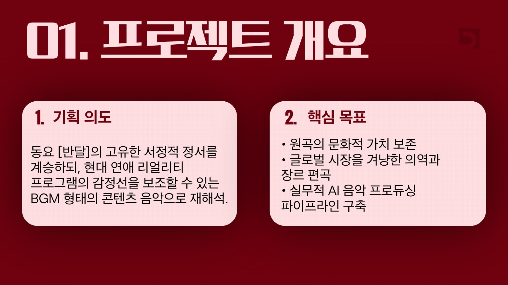
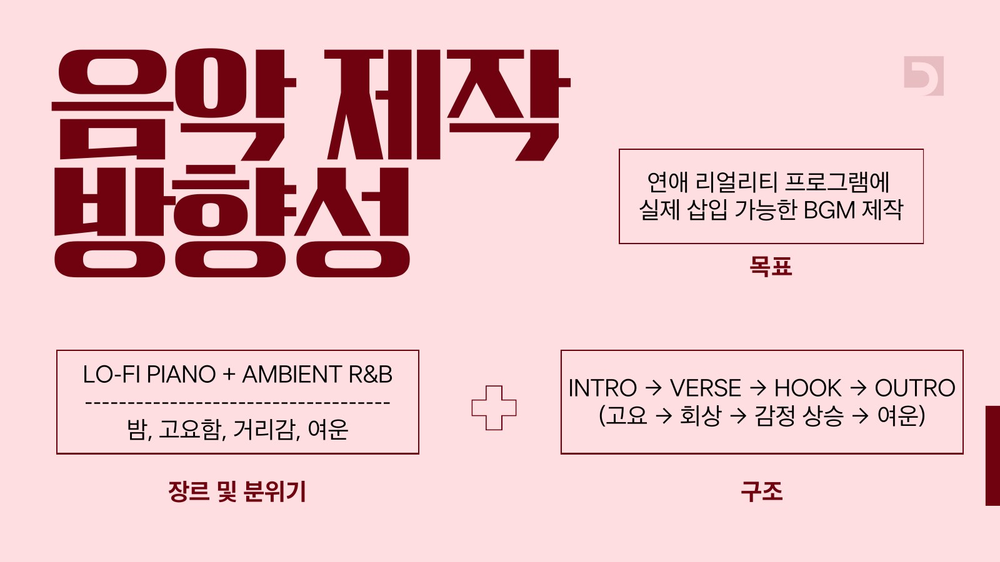
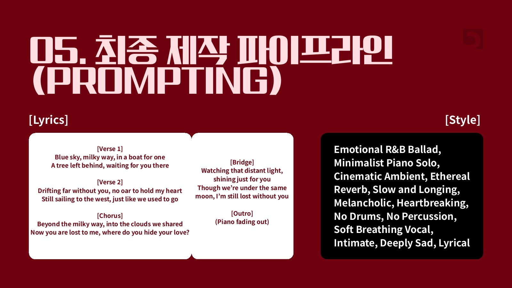
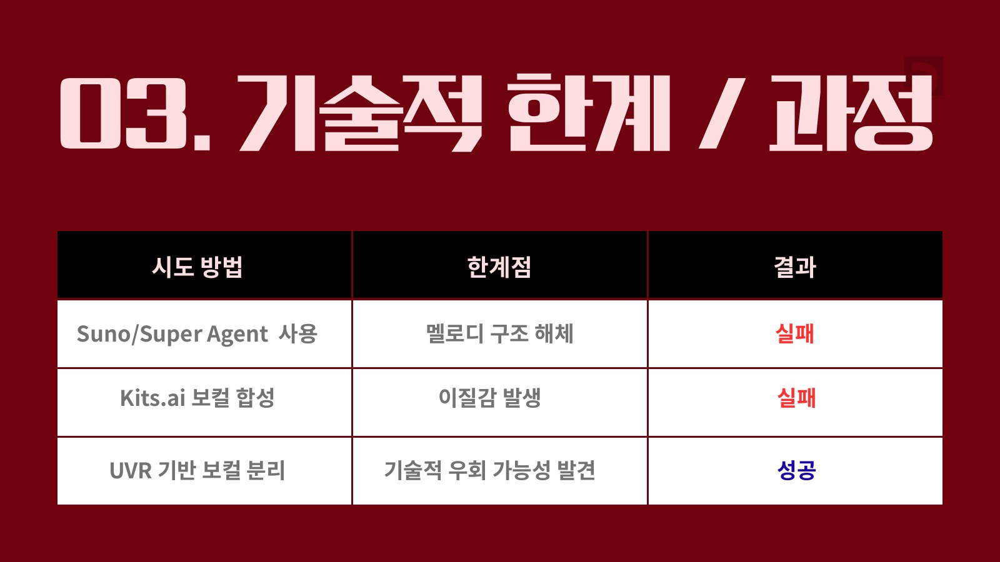
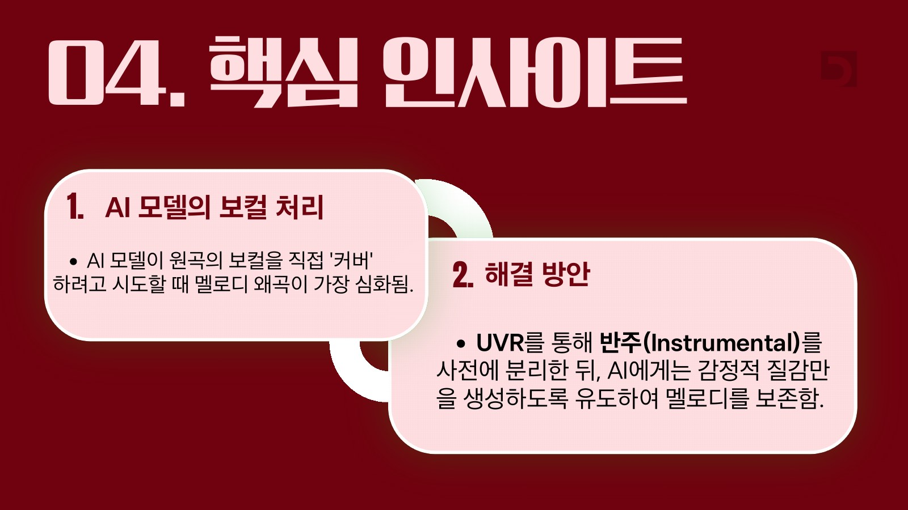
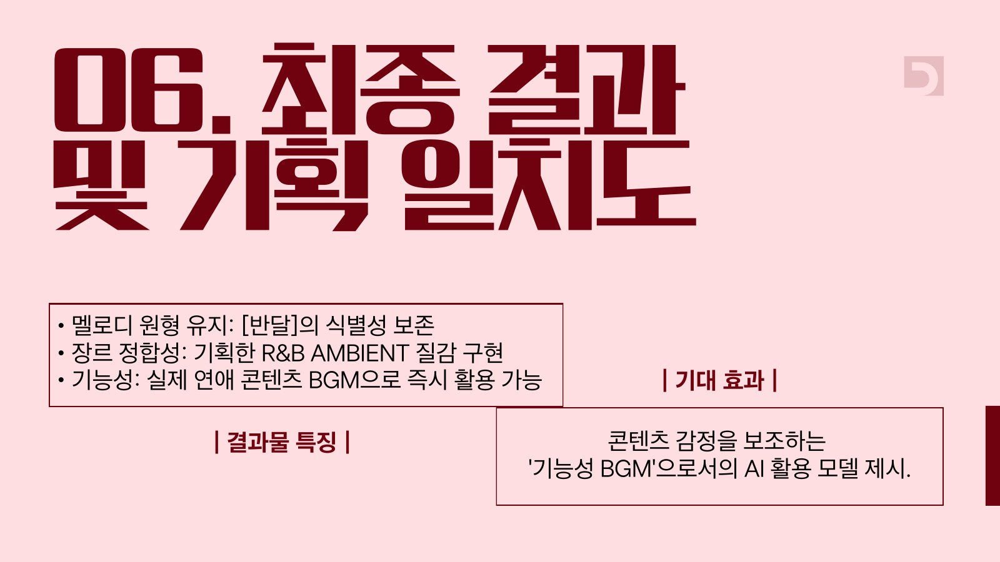

> Though we're under the same moon, I'm still lost without you

## Overview

디지털방송론 수업의 과제는 **글로벌 프로듀서가 되어 한국 동요를 세계에 전하는 것**이었습니다. 저는 윤극영의 「반달」(1924)을 골라, 원곡의 서정은 지키면서 해외 시청자도 공감할 수 있는 연애 리얼리티 프로그램의 BGM으로 다시 만들었습니다.

- 원곡의 문화적 가치를 지킬 것
- 해외 시장을 겨냥해 가사를 의역하고 장르를 바꿀 것
- 실무에서 쓸 수 있는 AI 음악 제작 과정을 만들 것

## Direction

- **목표** — 연애 리얼리티 프로그램에 실제로 넣을 수 있는 BGM
- **장르와 분위기** — Lo-fi Piano + Ambient R&B. 밤, 고요함, 거리감, 여운
- **구조** — Intro → Verse → Hook → Outro (고요 → 회상 → 감정 상승 → 여운)

완성한 곡은 영화 「The Break-Up」(2006)의 이별 장면에 입혔습니다. 곡이 실제 연애 콘텐츠 위에서 감정선을 어떻게 받쳐 주는지 직접 확인해 보기 위해서였습니다.

## Lyrics

가사는 그대로 번역하지 않고, 이별 뒤의 그리움으로 의역했습니다. 하얀 쪽배는 혼자 탄 배(*a boat for one*)가 되고, 계수나무는 그 자리에 남아 기다리는 나무(*a tree left behind*)가 되고, 서쪽 나라로 가는 길은 함께 가던 길(*just like we used to go*)이 됩니다. 마지막에는 같은 달 아래 있어도 길을 잃은 마음으로 끝납니다.

스타일 프롬프트에는 Emotional R&B Ballad, Minimalist Piano Solo, Cinematic Ambient, No Drums, Soft Breathing Vocal처럼 밤의 고요함과 여운을 만드는 말들을 골라 넣었습니다.

## Problem

Suno와 Mureka는 감정의 분위기는 잘 맞췄지만, 원곡의 핵심 멜로디를 지키지 못하고 추상적인 소리로 바꿔 버렸습니다. AI가 스스로 곡을 만드는 과정에서 BGM에 꼭 필요한 긴장과 이완의 구조도 무너졌습니다.

- **Suno 에이전트로 직접 생성** → 멜로디 구조가 해체되어 실패
- **Kits.ai 보컬 합성** → 목소리에 이질감이 생겨 실패
- **UVR로 보컬과 반주 분리** → 돌아갈 길을 찾아 성공

## Insight

멜로디가 가장 심하게 무너진 것은 AI가 원곡의 보컬을 직접 '커버'하려 할 때였습니다. 그래서 순서를 바꿨습니다. UVR로 원곡의 반주를 먼저 분리해 멜로디의 뼈대를 붙잡아 두고, AI에게는 그 위에 얹을 감정의 질감만 만들도록 했습니다. 그러자 「반달」의 멜로디를 알아볼 수 있게 남기면서도, 기획한 R&B · Ambient의 분위기를 함께 낼 수 있었습니다.

## Outcome

- **멜로디** — 「반달」의 원형을 알아볼 수 있게 남김
- **장르** — 기획한 R&B · Ambient 질감 구현
- **쓰임** — 연애 콘텐츠의 감정을 받쳐 주는 BGM으로 바로 쓸 수 있는 곡

## How I made it

1. 원곡 고르기 — 해외에 전할 한국 동요로 「반달」을 고르고, 연애 리얼리티 BGM이라는 쓰임을 정함
2. 방향 정하기 — 장르, 분위기, 곡의 구조를 먼저 설계
3. 영어 가사 쓰기 — 원곡의 이미지를 이별 뒤의 그리움으로 의역
4. 생성해 보기 — Suno, Mureka, Kits.ai로 여러 번 생성하며 어디서 무너지는지 확인
5. 반주 분리 — UVR로 원곡의 반주를 분리해 멜로디를 지킴
6. 질감 입히기 — 가사와 스타일 프롬프트로 감정의 질감을 만들어 완성
7. 영상에 입히기 — 영화 장면에 곡을 입혀 실제 BGM처럼 편집하고 유튜브에 공개

## Learnings

AI 음악이 하루가 다르게 쏟아져 나오는 지금, 저는 이 흐름을 한국 음악이 세계로 나아가는 기회로 쓸 수 없을까 생각했습니다. 그래서 백 년 가까이 불려 온 동요 「반달」을 골랐습니다. 누구나 아는 노래이지만, 그 안에 담긴 그리움은 국경을 넘어서도 통할 수 있다고 믿었기 때문입니다. 목표는 원곡의 의미를 그대로 품은 채, 해외의 누군가도 자연스럽게 듣게 되는 곡으로 다시 만드는 것이었습니다.

하지만 생각처럼 쉽지 않았습니다. Suno에 맡기면 분위기는 금방 맞췄지만 「반달」의 멜로디는 사라졌고, Kits.ai로 목소리를 입히면 어딘가 낯선 소리가 났습니다. 원곡을 알아볼 수 없다면 이 작업을 하는 의미가 없다고 생각해, 결과물을 듣고 어디서 무너지는지 하나씩 짚어 가며 계속 다시 시도했습니다. 그러다 AI가 보컬을 직접 커버하려 할 때 멜로디가 가장 크게 망가진다는 것을 알게 되었고, UVR로 반주를 먼저 분리해 멜로디를 붙잡아 둔 뒤 AI에게는 감정의 질감만 맡기는 방법을 찾아냈습니다. 그 과정에서 도구를 알면 알수록 더 잘 쓸 수 있다는 것을 몸으로 배웠고, 조금 더 나아지게 만들고 싶다는 생각으로 끝까지 붙잡은 끝에, 원곡을 해치지 않고 가사만 영어로 바꾼 AI 음악을 완성할 수 있었습니다.

그렇게 완성한 곡을 영화 장면 위에 얹어 들었을 때, 언어와 장르가 바뀌어도 「반달」의 그리움은 그대로 남아 있었습니다. 좋은 노래는 누가 부르든 울림이 있다는 것을 그때 깨달았습니다. 은하수와 쪽배가 이별 뒤의 그리움으로 바뀌어도 마음에 닿는 이유는, 결국 노래가 처음부터 품고 있던 이야기 때문이었습니다.

요즘 AI 음악과 실제 가수들 사이에는 많은 논쟁이 있습니다. 이 작업을 하면서 저는 누가, 무엇으로 만들었는지보다 그 노래가 어떤 울림을 남기는지가 더 중요하다고 생각하게 되었습니다. 그리고 기술이 무엇이든 만들어 낼 수 있는 시대일수록, 우리는 어떤 울림을 전하는 사람이 되어야 하는지를 스스로 묻게 되었습니다.
