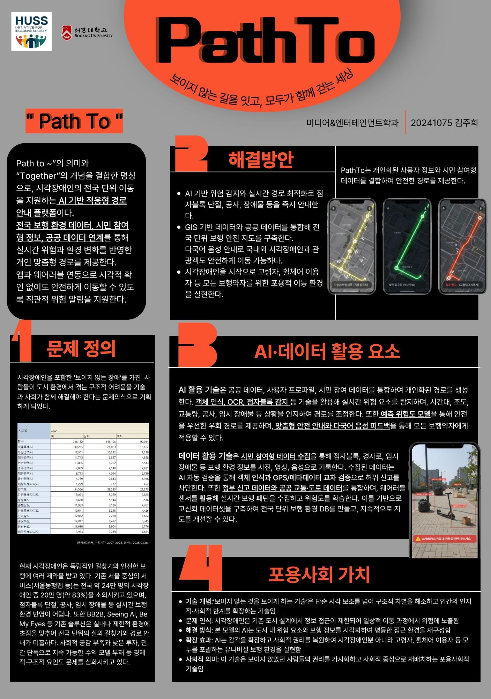

> 보이지 않는 길을 잇고, 모두가 함께 걷는 세상

## Problem

시각장애인은 독립적인 길찾기와 안전한 보행에 여러 제약을 받고 있습니다. 서울 중심의 기존 서비스는 전국 약 24만 명의 시각장애인 중 약 83%를 소외시키고, 점자블록 단절·공사·임시 장애물 같은 실시간 보행 환경을 반영하기 어렵습니다. 기존 솔루션도 실내나 제한된 환경에 초점이 맞춰져 있어 전국 단위의 실외 길찾기가 부족합니다.

## Idea

**PathTo**는 'Path to ~'와 'Together'를 결합한 이름입니다. 전국 보행 환경 데이터, 시민 참여형 정보, 공공 데이터를 연결해 실시간 위험과 환경 변화를 반영한 개인 맞춤형 경로를 안내합니다. 앱과 웨어러블을 연동해 화면을 보지 않고도 위험을 알 수 있도록 하고, 다국어 음성 안내도 지원합니다.

## AI & data

- 객체 인식, OCR, 점자블록 감지로 실시간 위험 요소 탐지
- 시간대·조도·교통량·공사·임시 장애물을 반영한 경로 조정과 위험도 예측 모델로 안전한 우회 경로 제공
- 시민이 사진·영상·음성으로 보행 환경을 기록하고, 객체 인식과 GPS·메타데이터 교차 검증으로 허위 신고를 걸러 전국 단위 보행 환경 DB 구축

## Inclusive value

보이지 않던 사람들의 권리를 드러내는 기술로, 시각장애인을 시작으로 고령자와 휠체어 이용자까지 모든 보행약자를 위한 유니버설 보행 환경을 지향합니다.
