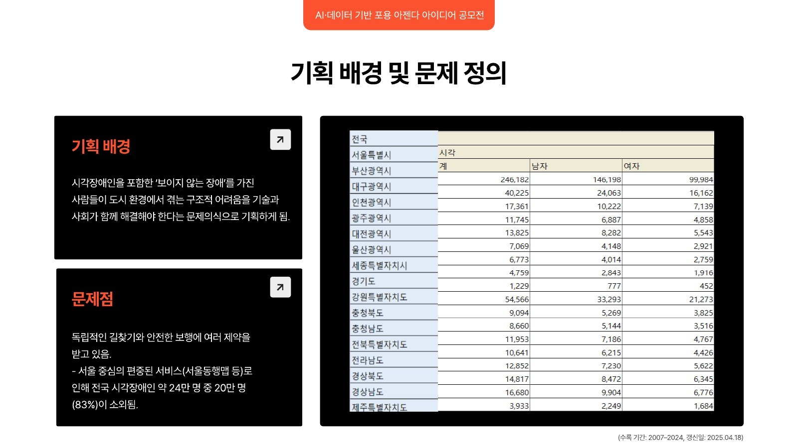
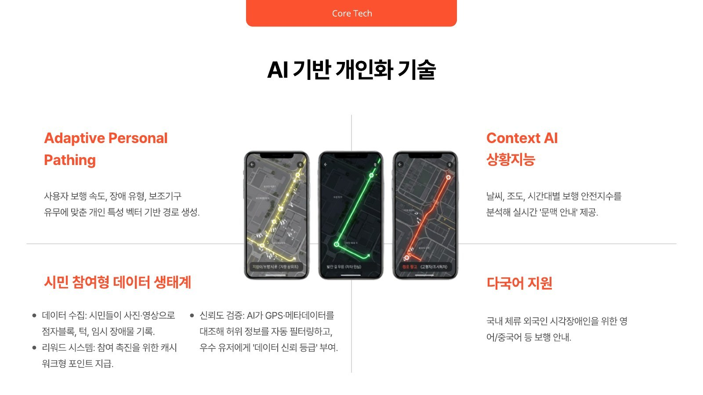
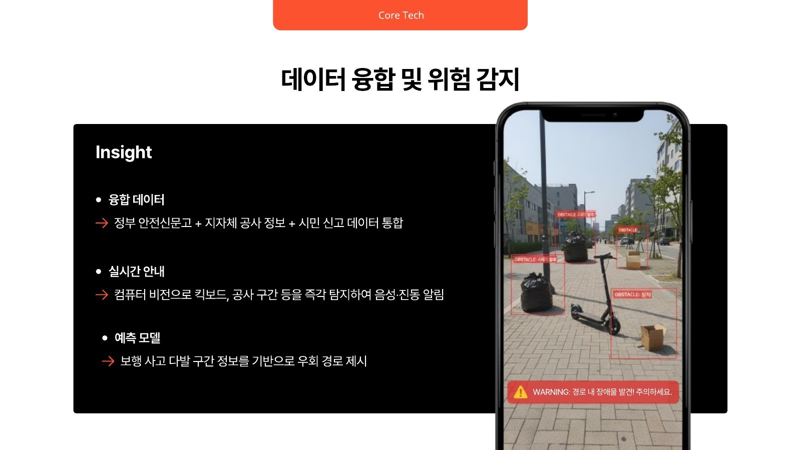
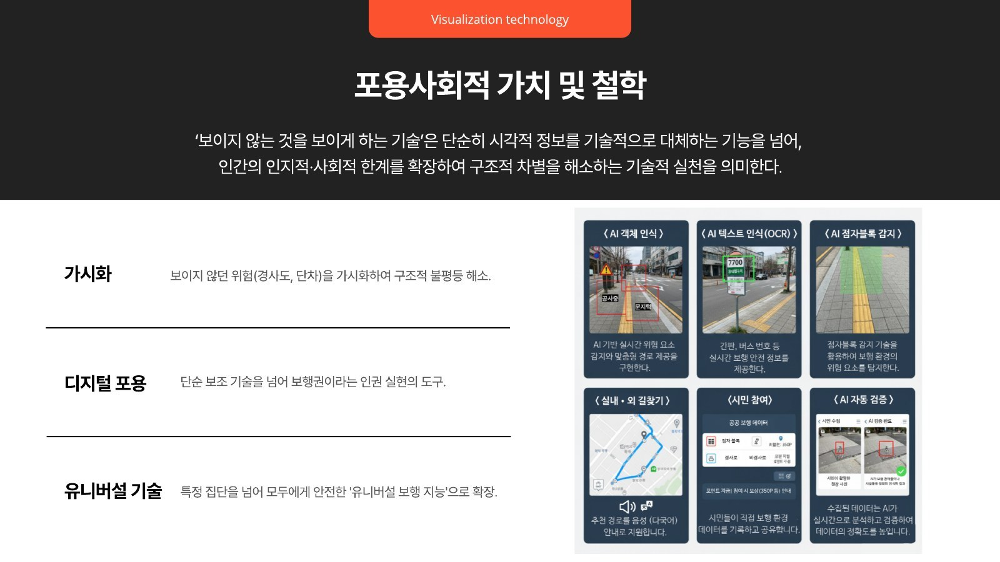
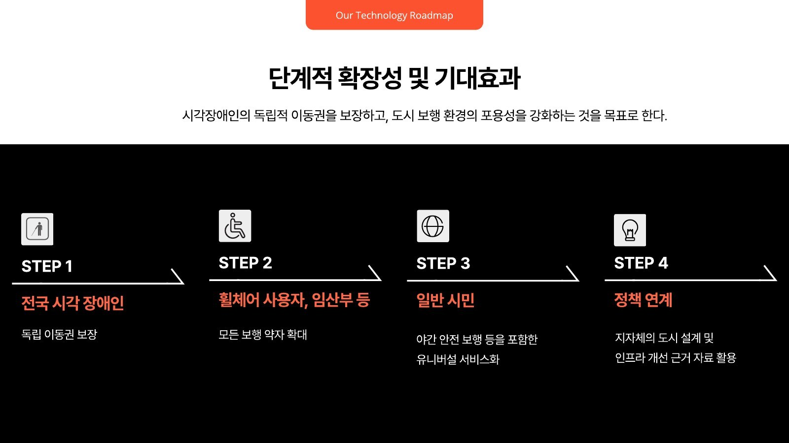

## Overview

서강대학교 HUSS 포용사회 사업단의 **AI·데이터 기반 포용 아젠다 아이디어 공모전**에 혼자 기획해 출품한 아이디어입니다. **PathTo**는 'Path to ~'와 'Together'를 합친 이름으로, AI와 데이터로 전국 어디서든 시각장애인이 혼자서도 안전하게 걸을 수 있도록 돕는 이동 지원 플랫폼을 제안했습니다.

## Problem

시각장애인을 포함해 '보이지 않는 장애'를 가진 사람들은 도시에서 **독립적인 길찾기와 안전한 보행**에 여러 제약을 받습니다. 점자블록이 끊기거나, 공사 구간과 킥보드 같은 임시 장애물이 나타나도 그 변화를 미리 알 방법이 거의 없습니다.

기존 서비스는 서울동행맵처럼 **서울 중심**에 편중되어 있었습니다. 장애인 현황 통계(2007–2024)를 보면 전국 시각장애인은 246,182명인데, 그중 서울은 40,225명뿐입니다. 즉 **약 24만 명 중 20만 명(약 83%)이 서비스 밖에 놓여 있는 셈**입니다. 기존 솔루션도 실내나 제한된 환경에 초점이 맞춰져 있어, 전국 단위의 실외 길찾기는 비어 있었습니다.

## Idea — AI 기반 개인화 기술

같은 길도 사람마다 다르게 걷습니다. PathTo는 한 가지 "최단 경로"가 아니라, 사용자에 맞춘 경로를 만듭니다.

- **Adaptive Personal Pathing** — 보행 속도, 장애 유형, 보조기구 유무를 담은 개인 특성 벡터로 경로를 생성합니다.
- **Context AI(상황지능)** — 날씨, 조도, 시간대별 보행 안전지수를 분석해 "지금 이 길"에 맞는 실시간 문맥 안내를 제공합니다.
- **시민 참여형 데이터 생태계** — 시민이 사진·영상으로 점자블록, 턱, 임시 장애물을 기록하면 캐시워크형 포인트를 지급합니다. AI가 GPS와 메타데이터를 대조해 허위 정보를 걸러 내고, 우수 참여자에게 '데이터 신뢰 등급'을 부여합니다.
- **다국어 지원** — 국내에 체류하는 외국인 시각장애인을 위해 영어·중국어 등으로 보행을 안내합니다.

## Data Fusion & Hazard Detection

- **융합 데이터** — 정부 안전신문고, 지자체 공사 정보, 시민 신고 데이터를 하나로 통합합니다.
- **실시간 안내** — 컴퓨터 비전으로 킥보드, 쓰레기 더미, 공사 구간 등을 즉시 탐지해 음성과 진동으로 알립니다. 화면을 보지 않아도 위험을 알 수 있도록 앱과 웨어러블을 연동합니다.
- **예측 모델** — 보행 사고가 잦은 구간 정보를 바탕으로 미리 우회 경로를 제시합니다.

## Inclusive Value

> '보이지 않는 것을 보이게 하는 기술'은 시각 정보를 기술로 대체하는 데서 멈추지 않고, 인간의 인지적·사회적 한계를 확장해 구조적 차별을 해소하는 기술적 실천이다.

- **가시화** — 경사도, 단차처럼 보이지 않던 위험을 드러내 구조적 불평등을 줄입니다.
- **디지털 포용** — 단순 보조 기술을 넘어, 보행권이라는 인권을 실현하는 도구가 됩니다.
- **유니버설 기술** — 특정 집단을 넘어 모두에게 안전한 '유니버설 보행 지능'으로 확장합니다.

AI 객체 인식, 텍스트 인식(OCR — 간판·버스 번호), 점자블록 감지, 실내·외 길찾기, 시민 참여, AI 자동 검증이 이 가치를 실제 기능으로 옮깁니다.

## Roadmap

시각장애인의 독립적 이동권을 보장하고, 도시 보행 환경의 포용성을 높이는 것을 목표로 네 단계로 확장합니다.

1. **전국 시각장애인** — 독립 이동권 보장
2. **휠체어 사용자, 임산부 등** — 모든 보행약자로 확대
3. **일반 시민** — 야간 안전 보행 등을 포함한 유니버설 서비스
4. **정책 연계** — 쌓인 데이터를 지자체의 도시 설계와 인프라 개선 근거 자료로 활용

> 함께 만들고 함께 누리는 사회를 향해, PathTo가 앞장서겠습니다.

## After — 선상인문학 데이터팀

이 공모전을 계기로 **HUSS 선상인문학 데이터팀**에 합류해 일본에서 인문학을 배우고 왔습니다.

PathTo를 기획하면서 가장 오래 붙잡고 있던 질문은 기술이 아니라 사람이었습니다. 시각장애인이 길에서 무엇을 두려워하는지, 왜 서울 밖에서는 같은 서비스를 누릴 수 없는지, 점자블록 하나가 끊기는 일이 누군가에게는 얼마나 큰 단절인지. 데이터와 통계는 "24만 명 중 83%"라는 숫자를 보여 주었지만, 그 숫자 뒤의 경험을 이해하지 않으면 좋은 기술도 엉뚱한 곳을 향할 수 있다는 것을 알게 되었습니다.

일본에서 인문학을 배우며 이 생각은 더 분명해졌습니다. **약자를 위한 기술은 약자를 이해하는 데서 시작한다**는 것입니다. 기술이 누구를 위해 존재하는지, 누가 그 기술에서 빠져 있는지를 묻는 일은 인문학의 몫이었고, 그 질문이 있어야 데이터와 AI가 올바른 방향을 가질 수 있었습니다. 이후 HUSS 인사이트 AI 경진대회와 DH2026 워크숍으로 이어진 활동도 결국 같은 질문 — 기술에 사람을 맞추는 대신, 사람에게 기술을 맞추려면 무엇을 이해해야 하는가 — 위에 서 있습니다.
