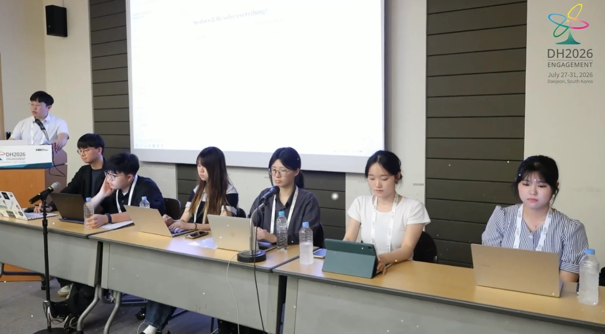
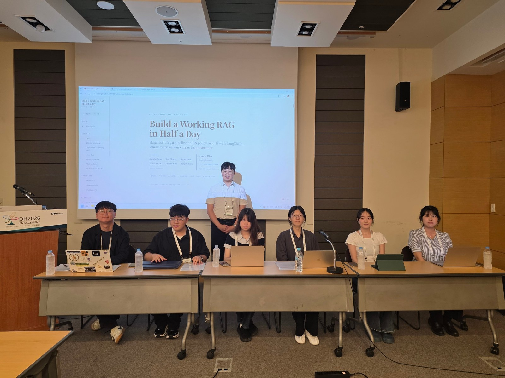
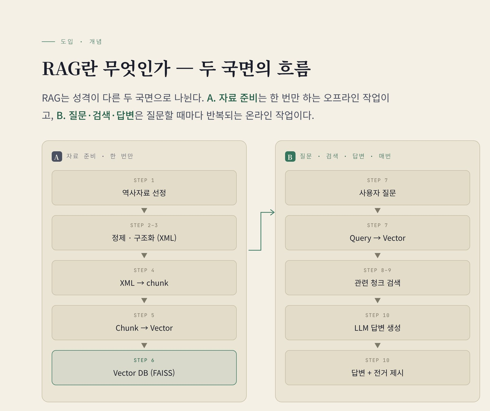
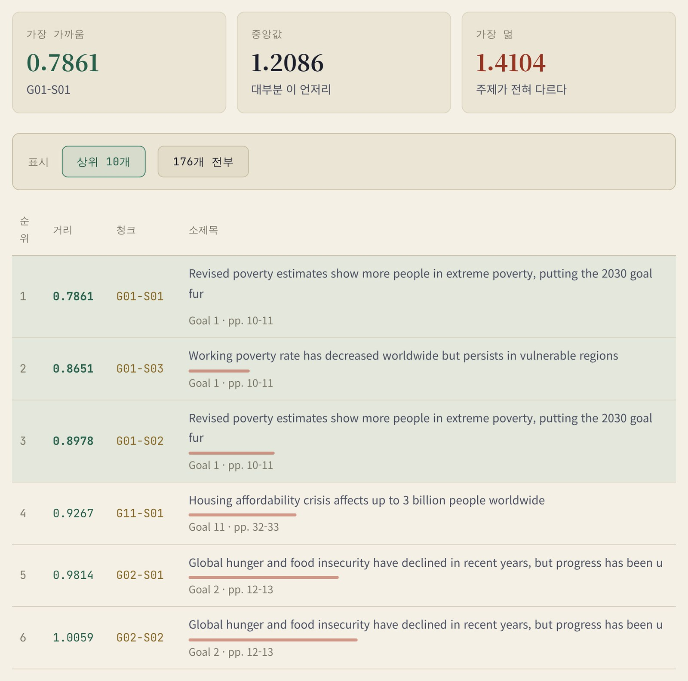
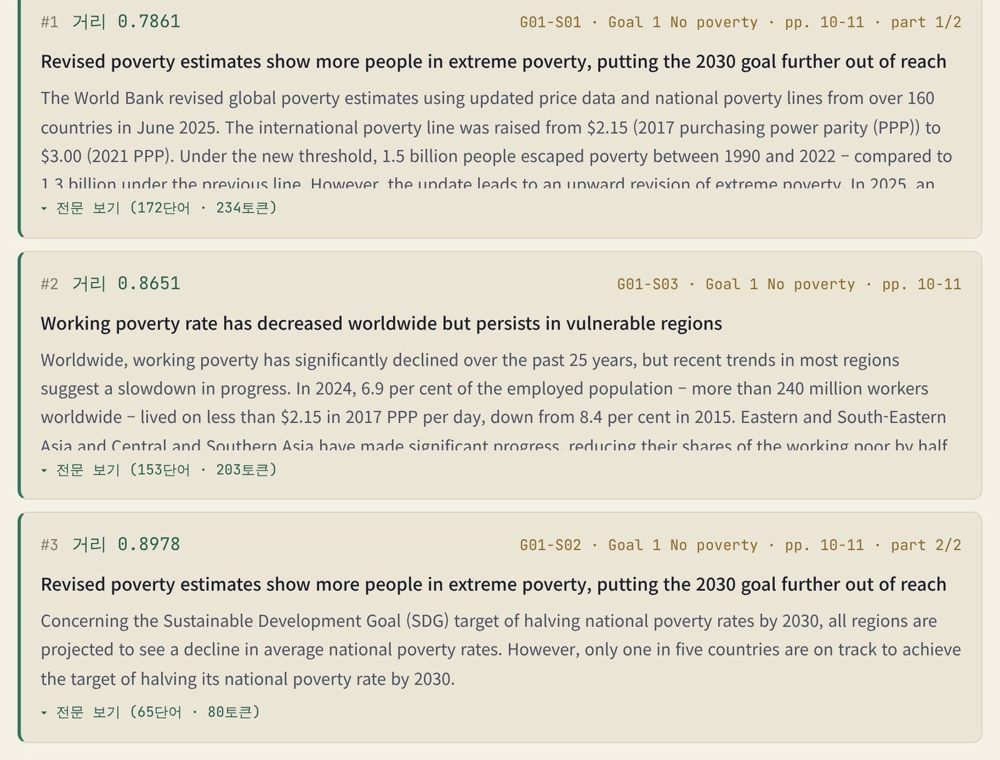
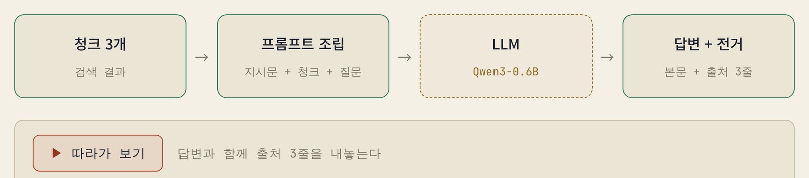
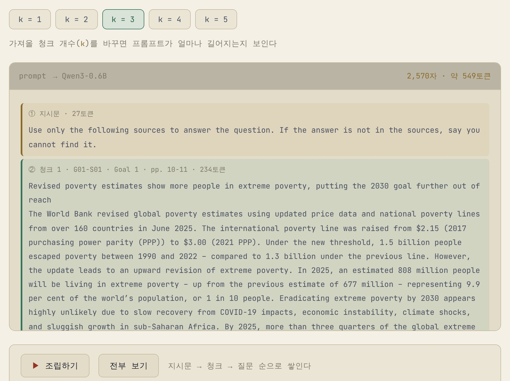
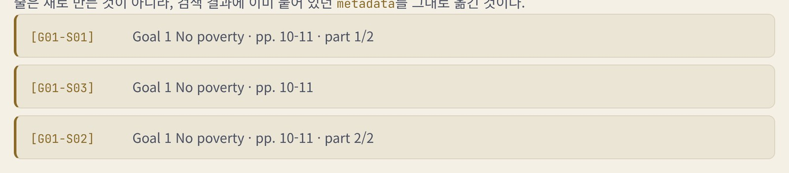

## Overview

국제 디지털 인문학 학술대회 **DH2026: Engagement**(2026.07.27–31, 대전)의 첫날, 서강대학교 사학과 김근하 교수님이 이끈 3시간짜리 워크숍 *Build a Working RAG in Half a Day: UN Policy Reports with LangChain*에 공동발표자로 참여했습니다.

참가자는 Google Colab에서 UN *지속가능발전목표 보고서 2025*(SDG Report 2025, 51쪽)를 재료로, 원본 PDF에서 출발해 **답변마다 "어느 목표(Goal) · 어느 절 · 몇 쪽"인지 출처가 붙는 질의응답 시스템**을 열 단계에 걸쳐 직접 만듭니다. 각 단계는 Colab 셀 하나에 대응하는 코드 19개 블록으로 공개되어 있고, 모델은 공유 드라이브에서 로컬로 불러와 API 키나 외부 호출 없이 돌아갑니다.

교수님과 공동연구자 여섯 명(정용호, 정수아, 박지우, 김준한, 김주희, 변혜진)이 함께 준비했고, 저는 그중 **Top-k Retrieval**(STEP 9–10, 검색 결과가 답변이 되기까지) 파트를 맡아 발표했습니다. 해외 참가자도 있었기 때문에 영어로 인사를 건넨 뒤, 개념을 천천히 한국어로 설명했습니다.

## Why RAG

워크숍은 **"이 답변을 믿으시겠습니까?"** 라는 질문으로 시작했습니다. "극빈 인구는 몇 명인가"라는 질문에 AI가 유려하게 답하고 출처 세 개를 달아 줍니다. 그런데 확인해 보면 첫째는 존재하지 않는 논문, 둘째는 실재하지 않는 절, 셋째는 51쪽짜리 보고서에 없는 214쪽입니다. 유려함은 신뢰가 아닙니다.

이 불안에 대한 기술적 응답이 RAG(Retrieval-Augmented Generation)입니다. Lewis 등(NeurIPS 2020)이 검색기와 생성기를 결합한 구조로 제시한 뒤, 모델의 기억에만 기대지 않고 **근거를 먼저 찾은 뒤에 말하는** 방식으로 빠르게 퍼졌습니다.

하지만 RAG도 만능은 아닙니다. 실제 구축 사례에서 나온 실패 지점 일곱 개가 모두 모델 가중치가 아니라 파이프라인 단계에 있었다는 연구(Barnett 등, 2024), 검색을 붙여도 환각이 살아남는다는 RAGTruth(ACL 2024), 임베딩 차원이 찾을 수 있는 상위 k개 조합 자체를 제한한다는 연구(Weller 등, 2025)가 이어졌습니다. 원인은 RAG 바깥이 아니라 **RAG의 설계** — 자료 정제, 청킹, 임베딩 — 에 있습니다. 그래서 이 워크숍의 목표는 완벽한 챗봇이 아니라, 파이프라인을 한 단계씩 열어 RAG가 어디서 실패하는지까지 손으로 확인하는 것이었습니다.

## Pipeline

RAG는 성격이 다른 두 국면으로 나뉩니다. **A. 자료 준비**는 한 번만 하는 오프라인 작업이고, **B. 질문·검색·답변**은 질문할 때마다 반복되는 온라인 작업입니다. 둘을 잇는 경첩이 벡터 색인(FAISS)입니다.

워크숍은 STEP 1(환경 준비: 라이브러리 버전 고정, 공유 드라이브의 인코더 all-MiniLM-L6-v2와 LLM Qwen3-0.6B 불러오기)부터 STEP 10(답변 생성)까지 이어지고, 공동연구자들이 단계를 나눠 발표했습니다. 아래는 저희가 발표한 내용입니다.

### 청크 — 검색의 최소 단위 (STEP 2–4)

책에서 내용을 찾을 때, 주제별로 카드를 만들어 제목과 내용을 적어 두면 책장을 넘기지 않고 책상 위에 뿌린 카드 중에서 필요한 것을 바로 고를 수 있습니다. 청크는 그 카드 한 장입니다. 데이터를 여러 조각으로 나눠 두고, 질문이 오면 그에 맞는 조각을 찾습니다.

나누는 것은 선택이 아니라 **전제 조건**입니다. 인코더 all-MiniLM-L6-v2는 한 번에 256토큰만 읽을 수 있는데, UN 보고서는 51쪽, 244,337자, 약 50,340토큰입니다. 통째로 넣으면 0.5%만 읽히고, 다 읽으려면 197번을 읽어야 합니다.

청크가 중요한 더 큰 이유는 **청크가 곧 출처가 되기 때문**입니다. 각 청크는 벡터로 바뀌고, 질문 벡터와의 거리로 골라져 답변의 근거가 됩니다. 그러니 청크의 경계가 곧 전거의 단위입니다.

그렇다면 어떻게 자를까요. 가장 단순한 방법인 글자 수(500자, 50자 중첩)로 자르면 535개 조각이 나오는데, **82%가 문장 중간에서 끝나고** 63%가 문장 중간에서 시작합니다. 16%에는 표의 숫자 나열이, 5%에는 "Tick marks 0p3 long" 같은 조판 지시문이 섞여 들어갑니다. 200자든 2,000자든 크기를 바꿔도 문장 절단은 사라지지 않습니다. 길이는 의미의 경계를 모르기 때문입니다.

그래서 글자가 아니라 **조판**을 읽었습니다(STEP 3, 워크숍의 무게중심). 보고서의 소절 제목은 GothamBold 11pt, 본문은 Whitney 9pt입니다. 이 서식 정보로 목표 → 소절 → 문단의 계층을 XML로 재구성하고, 소절 단위로 잘랐습니다(STEP 4). 인코더 한도에 맞춰 제목 포함 172단어를 넘으면 문단·문장 경계에서 나누고, 각 조각에 ID(G01-S01), 목표 번호·이름, 쪽수, 소제목, part를 **메타데이터**로 심어 176개 청크를 만들었습니다.

### 임베딩과 벡터 DB — 문장을 좌표로 (STEP 5–6)

컴퓨터는 "고양이가 소파 위에 있다"는 문장의 뜻을 바로 이해하지 못합니다. 사람에게 '빈곤'과 '가난'은 비슷한 말이지만, 컴퓨터에게는 서로 다른 문자일 뿐입니다. 그래서 문장의 의미를 숫자로 바꾸는 **임베딩**이 필요하고, 그 결과인 숫자 목록이 **벡터**입니다. 지도 위의 한 점을 위도·경도 두 숫자로 나타내듯, 이 워크숍의 인코더는 문장 하나를 **384개의 숫자, 즉 384차원의 좌표**로 바꿉니다. 비슷한 주제의 책을 가까운 서가에 꽂듯, 의미가 비슷한 문장은 가까이 놓입니다. 다만 위치를 정하는 것은 사서가 아니라 학습된 모델입니다.

문장이 벡터가 되는 과정은 네 단계입니다.

1. 문장을 **토큰**으로 나눕니다. 자주 나오는 단어는 토큰 하나, 드문 단어는 여러 조각이 됩니다.
2. 토큰마다 384개의 숫자로 바꿉니다. 토큰이 203개라면 203 × 384 행렬이 됩니다.
3. 같은 위치의 숫자끼리 **평균**을 내서, 청크 전체를 대표하는 384개짜리 벡터 한 줄로 합칩니다.
4. 벡터의 길이가 1이 되도록 **정규화**해, 길이보다 방향으로 유사성을 비교하게 합니다.

벡터에는 음수도 많지만, 남위 37도가 "위도가 부족하다"는 뜻이 아니듯 음수는 반대 방향을 가리킬 뿐입니다. 숫자 하나하나에 뜻이 있는 것도 아니고(137번째 숫자가 '빈곤'을 뜻하지 않습니다), 384개가 함께 만드는 위치가 의미를 나타냅니다.

정말 의미가 비슷한 문장이 가까이 모일까요? 176개 청크로 확인해 보니 **같은 Goal의 청크끼리 평균 거리는 약 0.93, 다른 Goal끼리는 약 1.20**이었고, 각 청크의 가장 가까운 이웃이 같은 Goal일 확률은 **83%**였습니다. 모델에게 Goal을 알려 주지 않았는데도 비슷한 내용이 모인 것입니다. 반대로 벡터를 2차원으로 줄이면 이 비율이 19%, 3차원에서도 37%로 떨어졌습니다. 의미를 담으려면 그만큼 많은 축이 필요합니다. 이렇게 만든 벡터는 원문·메타데이터와 함께 FAISS(IndexFlatL2)에 저장됩니다.

### 거리로 찾는다 — 벡터 유사도 검색 (STEP 7–8)

질문도 청크를 임베딩한 **바로 그 인코더**로 임베딩해, 같은 384차원 좌표계에 놓습니다. 다른 자로 잰 길이는 비교할 수 없기 때문입니다. 그다음 검색 엔진 안에서 일어나는 거리 계산을 FAISS 없이 손으로 풀어 보였습니다.

- 수직선 위 두 점의 거리는 **빼기**입니다. 음수가 나올 수 있으니 **제곱**해 부호를 없앱니다.
- 축이 둘이 되면 **피타고라스 정리** — 가로·세로 차이를 각각 제곱해 더하고 **제곱근**을 취합니다.
- 384차원도 같습니다. 항이 2개에서 384개로 늘 뿐입니다. 이렇게 질문과 1위 청크 G01-S01 사이를 계산하면 **0.7861**이 나옵니다.

제곱은 부호를 없애 벌어진 크기만 남기고, 제곱근은 넓이 단위가 된 값을 다시 길이로 되돌립니다. 이것이 **L2 거리(유클리드 거리)**, 평소에 "거리"라고 부르는 바로 그 개념입니다. 이 계산을 176번 반복해 가까운 순으로 줄 세우면 검색이 끝납니다. 정규화된 벡터 사이의 거리는 0에서 2 사이에 놓이기 때문에 1위와 꼴찌의 차이가 커 보이지 않지만, 중요한 것은 절대값보다 **상대적인 순위**입니다. 그리고 이 손계산이 FAISS 인덱스 이름의 "L2"가 하는 일과 완전히 같습니다.

## My Part — Top-k Retrieval

저는 앞 발표에서 거리를 재서 줄을 세운 바로 그 자리에서 이어받아, **찾아낸 청크가 어떻게 답변이 되는지**(STEP 9–10)를 발표했습니다. 해외 참가자를 위해 "Hello, everyone. My name is Juehee Kim from Sogang University. Today, I will give a presentation about Top-k Retrieval. I will explain it slowly in Korean."라고 영어로 인사한 뒤 한국어로 설명했습니다.

**Top-k Retrieval**이란 질문을 던졌을 때 수많은 문서 중에서 의미적 거리를 재어 가장 가까운 상위 k개의 글 조각(청크)을 골라내는 과정입니다. 예를 들어 `k=3`으로 설정하면, "Goal 1에서 찾아라"라고 지시하지 않아도 오직 거리 계산만으로 가장 관련 깊은 상위 3개의 문서가 위로 올라옵니다. 질문 *"How many people still live in extreme poverty?"* 를 176개 청크 전부와 비교하면, 가장 가까운 청크는 0.7861, 중앙값은 1.2086, 가장 먼 청크는 1.4104였습니다.

발표는 찾은 것 → 사이 → 조립 → 생성 → 전거 → 정리의 여섯 장면으로 구성했습니다.

### ① 찾은 것

STEP 8에서 손으로 한 계산을 FAISS는 `similarity_search_with_score(query, k=3)` 한 줄로 합니다. 먼저 손계산의 상위 3개와 FAISS의 상위 3개가 **정확히 일치(match: True)** 하는 것을 보여 준 뒤, 각 결과에 출처(Goal · 소절 · 쪽 · 거리)를 붙였습니다. 메타데이터는 검색 대상이 아니지만, 결과에는 늘 함께 딸려 나옵니다. 결과는 세 개 모두 Goal 1(빈곤)이었습니다.

- 0.7861 · G01-S01 · "Revised poverty estimates show more people in extreme poverty…" (pp. 10–11, part 1/2)
- 0.8651 · G01-S03 · "Working poverty rate has decreased worldwide but persists…" (pp. 10–11)
- 0.8978 · G01-S02 · 같은 소절의 part 2/2

아무도 "Goal 1에서 찾아라"라고 지시하지 않았는데 거리 계산만으로 주제가 맞는 청크가 위로 올라왔고, STEP 4에서 심어 둔 메타데이터 덕분에 각 청크가 어느 Goal의 몇 쪽인지 함께 딸려 나왔습니다.

### ② 사이

흔히 "검색해서 AI가 바로 답한다"고 생각하지만, 그 사이에는 **조립**이라는 단계가 있습니다. 찾아낸 청크 세 개가 그대로 모델에게 가는 것이 아니라, 하나의 긴 텍스트로 합쳐지고 앞뒤에 지시문과 질문이 붙습니다.

### ③ 조립

모델이 받는 텍스트는 [지시문 → 청크 → 질문] 순서로 쌓입니다. 지시문은 27토큰짜리 한 문장입니다 — *"Use only the following sources to answer the question. If the answer is not in the sources, say you cannot find it."* 모델의 기억이 아니라 준 자료 안에서만 답하고, 없으면 없다고 말하게 못 박는 장치입니다.

k를 바꾸면 모델이 읽는 양이 이렇게 달라집니다.

- k = 1 → 1,251자 · 약 270토큰
- k = 2 → 2,168자 · 약 471토큰
- **k = 3 → 2,570자 · 약 549토큰** (워크숍 기본값)
- k = 4 → 3,687자 · 약 765토큰
- k = 5 → 4,334자 · 약 908토큰

k를 여러 개로 바꿔 보며 프롬프트를 직접 확인한 이유는 LLM에게 **정확한 근거만** 주기 위해서입니다. 거리 순위표를 보면 상위 3개는 모두 빈곤(Goal 1)이지만, 4위부터는 주거(Goal 11, 0.9267)와 기아(Goal 2, 0.9814) 청크가 들어옵니다. 많이 넣는다고 좋아지는 것이 아니라, 질문과 관계없는 자료가 섞이면 LLM은 그럴듯한 거짓말을 만들어 낼 수 있습니다. 바로 이 지점에서 인문학자가 직접 개입해, 찾아낸 사료와 텍스트 조각이 연구에 맞는지 눈으로 확인하고 판단해야 합니다.

### ④ 생성

조립된 프롬프트가 Qwen3-0.6B로 들어가고, 모델은 그 텍스트를 읽어 답변을 만듭니다. Qwen3는 chat 모델이라 입력을 chat 템플릿으로 감싸고, 출력에서 입력 부분을 잘라 답변만 남깁니다. 같은 질문을 근거 없이 던진 **BEFORE**(모델의 기억만으로 답함, 출처 없음)와 검색 결과를 넣은 **AFTER**(보고서 위에 선 답)를 나란히 비교해, 연구자가 검증한 재료 안에서만 답이 만들어진다는 것을 보여 줬습니다.

### ⑤ 전거

답변만 덩그러니 나오면 검증할 수 없습니다. 그래서 답을 만드는 데 쓴 청크의 메타데이터를 옮겨 출처 세 줄을 함께 출력합니다. 이 세 줄은 새로 만든 것이 아니라, 검색 결과에 이미 붙어 있던 메타데이터를 그대로 옮긴 것입니다. 모델은 자기가 어느 문서를 읽었는지 말해 주지 못하지만, 우리는 어느 청크를 골라 넣었는지 알고 있습니다. **답변은 모델이 만들지만, 출처는 우리가 설계한 것**입니다.

STEP 3에서 구조를 세우고, STEP 4에서 메타데이터를 심고, STEP 6에서 원문과 함께 저장해 둔 모든 준비가 결국 이 세 줄을 위한 것이었습니다.

### ⑥ 정리

PDF 한 편을 쪼개고, 좌표로 바꾸고, 거리를 재서 찾고, 조립해 답변을 얻는 열 단계의 여정이 RAG의 전체 구조입니다. 결국 RAG의 본질은 모델을 뜯어고치는 것이 아니라 **모델이 읽을 재료를 우리가 직접 바꿔 주는 것**이고 — 이 조립이 곧 RAG의 "증강(Augmented)"입니다 — Top-k Retrieval은 AI가 읽을 가장 가치 있는 재료를 정확히 골라내는 핵심 관문입니다.

## Why Answers Go Wrong

마지막 발표는 실습에서 틀린 답변이 나오는 이유를 정리했습니다. 원인은 두 가지입니다.

- **모델의 품질** — 실습에 쓴 Qwen3-0.6B는 무료로 배포되고 Colab에서 로컬로 돌릴 수 있다는 장점이 있지만, 유료 대형 모델에 비해 답변 품질이 낮습니다.
- **잘못된 청크** — 이 RAG는 "찾은 것"에 대해서만 답하고, 그 답은 청크를 근거로 만들어집니다. 500자 단위로 자른 청크처럼 맥락이 끊기면, "극빈 속에 사는 사람은 몇 명인가"라는 질문에 엉뚱한 청크를 근거로 답하게 됩니다.

좋은 모델을 써도 청크를 잘못 자르면 틀리고, 청크를 잘 만들어도 모델이 약하면 틀립니다. 정확한 답을 얻으려면 두 조건을 모두 갖춰야 합니다.

## Takeaway

> 자료의 구조가 검색 단위를 정하고, 검색 단위가 답변의 전거 단위를 정한다.

워크숍의 마지막 메시지는 RAG를 설계할 때 가장 먼저 볼 것이 트렌디한 최신 LLM이 아니라 **자료**라는 것이었습니다. STEP 2의 실패는 모델이 나빠서가 아니라 자료의 구조를 먼저 확정하지 않았기 때문이었습니다. 구조를 알고, 거기에 맞춰 정제하고, 구조대로 자르면 잘린 조각마다 제 주소가 붙습니다. 전거는 마지막에 덧붙이는 장식이 아니라 구조를 지킨 결과로 저절로 남는 것입니다. 인문학, 특히 역사학이 오랫동안 강조해 온 "근거를 대라"는 규율이 그대로 RAG의 설계 원칙이 됩니다.

그림 출처: 워크숍 발표자료와 보조자료(littlekg87/DH2026)
