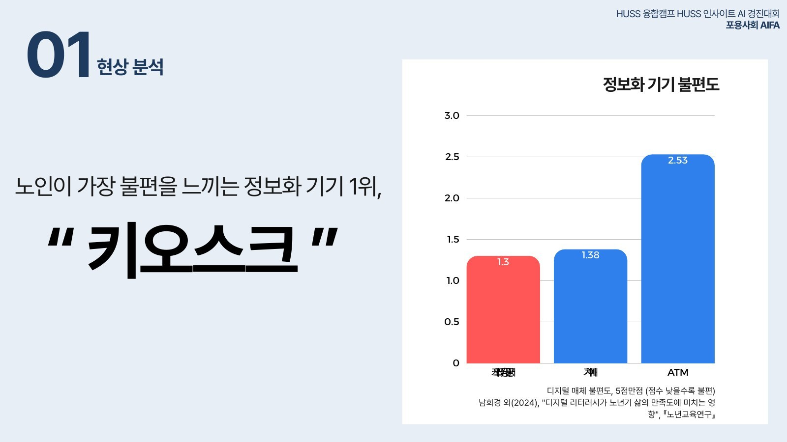
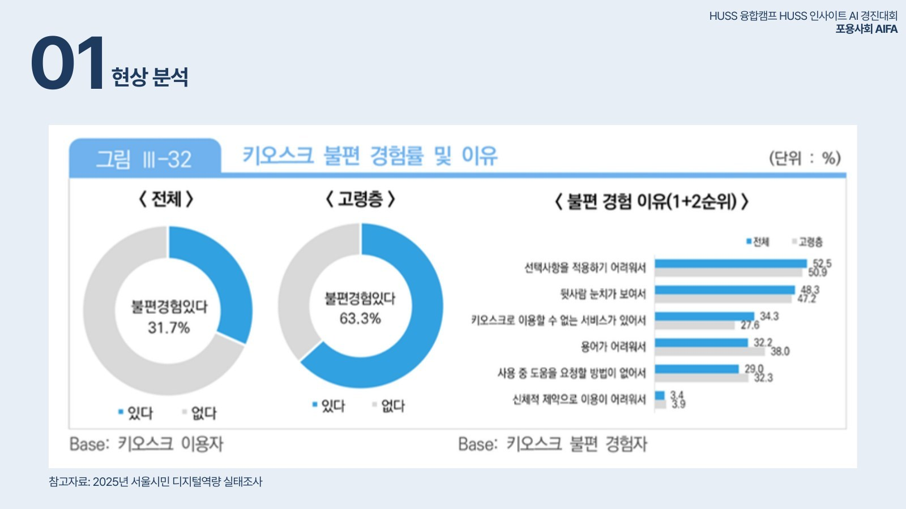
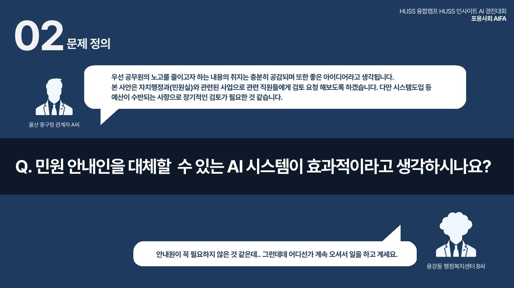
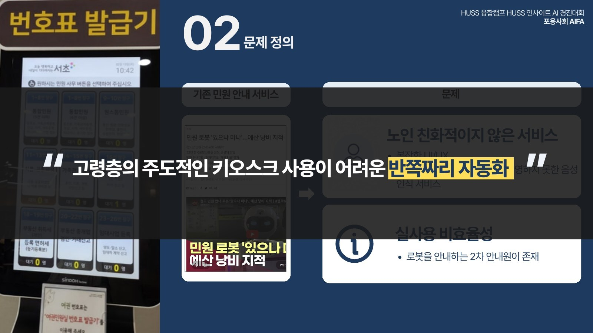
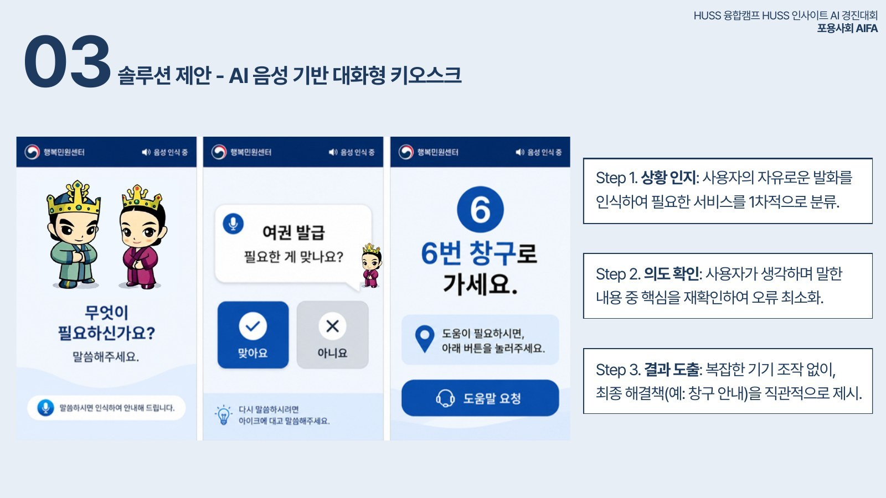
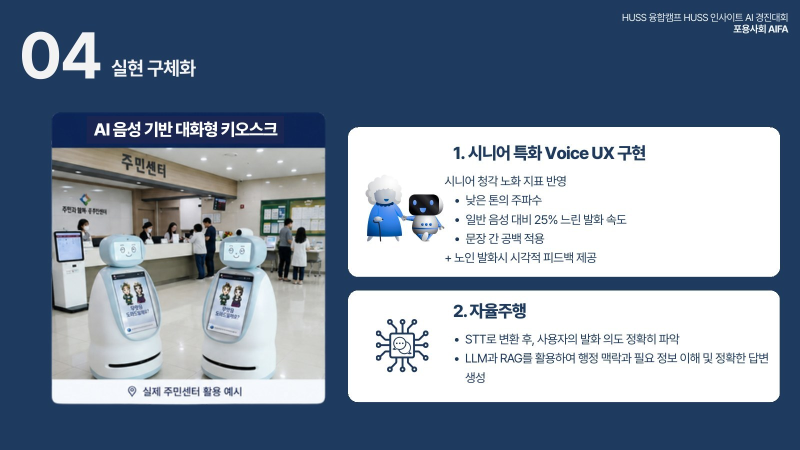
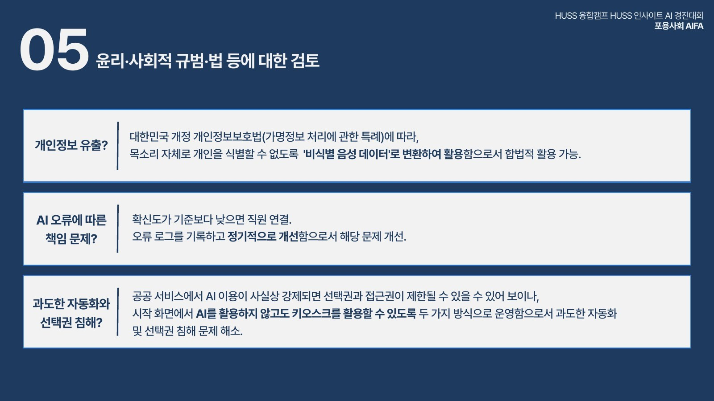
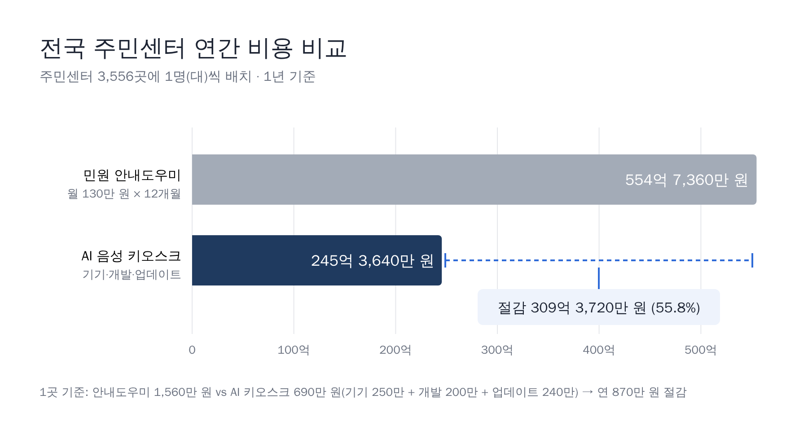

> 진정한 디지털 포용은 소외계층을 새로운 기술에 억지로 적응시키는 것이 아니다.

## Overview

서강대학교 HUSS 포용사회 사업단의 **HUSS 융합캠프**에서 열린 **HUSS 인사이트 AI 경진대회**에 "포용사회 AIFA" 팀으로 참가했습니다. 2박 3일 동안 주제를 정하고, 문제를 정의하고, 직접 동작하는 MVP까지 만들어 발표하는 해커톤입니다.

저희 팀은 **음성인식 기술을 활용한 디지털 포용**을 주제로, 주민센터를 찾은 어르신이 터치 화면을 헤매지 않고 "복지 상담 받으러 왔어요"라고 말하기만 하면 알맞은 창구와 준비 서류를 화면과 음성으로 안내받는 **AI 음성 기반 대화형 키오스크**를 제안했습니다. 저는 MVP 구현에 참여했고, 최종 발표를 맡았습니다.

## Problem

### 키오스크는 늘었지만, 어르신은 더 멀어졌다

키오스크는 비용 절감과 편의성 덕분에 빠르게 늘었습니다(2019년 약 19만 대 → 2022년 약 45만 대). 공공기관도 민원 접수와 안내를 위해 키오스크와 무인민원발급기를 도입하고 있습니다. 그런데 노인이 가장 불편을 느끼는 정보화 기기 1위가 바로 키오스크였습니다(디지털 매체 불편도 5점 만점에 1.3점, 낮을수록 불편 · 남희경 외, 2024).

2025년 서울시민 디지털역량 실태조사에서도 키오스크 불편을 경험한 비율은 전체 31.7%였지만 **고령층은 63.3%**로 두 배였습니다. 이유는 선택사항을 적용하기 어려워서(50.9%), 뒷사람 눈치가 보여서(47.2%), 용어가 어려워서(38.0%), 도움을 요청할 방법이 없어서(32.3%) 순이었습니다. 버튼 선택, 메뉴 탐색, 작은 글씨 중심의 화면은 **"무엇을 해야 하는지 모르는 사람"** 에게 충분한 안내가 되지 못합니다. 2025년부터 배리어프리 키오스크 설치가 의무화되었지만, 현장 보급은 아직 부족하고 대부분 여전히 터치 방식입니다.

### 주민센터 현장에서 벌어지는 일

주민센터는 주민등록, 복지, 세금, 가족관계, 상하수도 등 수많은 업무를 처리하지만, 방문한 어르신은 자신의 업무가 **어느 창구인지, 어떤 서류가 필요한지** 알기 어렵습니다. 결국 창구를 잘못 찾아가거나, 서류가 없어 다시 방문하고, 같은 질문이 안내 직원에게 반복해서 몰립니다.

현장의 목소리도 들었습니다. "민원 안내인을 대체할 수 있는 AI 시스템이 효과적이라고 생각하시나요?"라는 질문에, 한 구청 관계자는 공무원의 노고를 줄이려는 취지에 공감하며 검토해 보겠다고 답했고, 한 행정복지센터 직원은 "안내원이 꼭 필요하지 않은 것 같은데… 어디선가 계속 오셔서 일을 하고 계세요"라고 말했습니다.

문제는 안내 인력이 없다는 것이 아니었습니다. **사람이 반드시 하지 않아도 되는 반복 안내와 감정 노동이 민원 현장의 최전선에 몰려 있다**는 점이었습니다. 입구에서 민원인을 가장 먼저 마주하는 안내 인력은, 그 기관이 처리하지 않는 업무에 대한 반복적인 특이 민원까지 함께 떠안습니다.

### 기존 서비스는 "반쪽짜리 자동화"

이미 번호표 발급기와 민원 안내 로봇이 있지만, 복잡한 UI와 고령층의 말투를 반영하지 못한 음성 인식 때문에 어르신이 주도적으로 쓰기 어렵습니다. 한 지역의 민원 안내 로봇은 "있으나 마나"라는 지적과 함께 예산 낭비 논란을 겪었고, 로봇 사용법을 알려 주는 **2차 안내원**이 따로 필요했습니다. 고령층이 주도적으로 쓸 수 없는, 반쪽짜리 자동화였습니다.

> 주민센터를 찾는 고령층이 복잡한 행정 업무와 창구 정보를 쉽게 이해하지 못해 생기는 불편과, 직원의 반복 안내 부담을 함께 해결해야 한다.

## Why We Built It

그래서 기술에 어르신을 맞추는 대신, **어르신이 평소 쓰던 방식 — 말 — 에 기술을 맞추는 인간 중심(Human-Centered) 기술**을 제안했습니다. 필요한 이유는 세 가지였습니다.

- **접근성** — 메뉴를 찾지 않고 말로 물으면 되기 때문에, 고령자와 디지털 기기에 익숙하지 않은 사람도 쉽게 쓸 수 있습니다.
- **직원의 업무 부담 감소** — 창구 위치, 준비 서류, 업무 분류 같은 단순 안내를 키오스크가 맡으면 직원은 복잡한 민원에 집중할 수 있습니다.
- **만족도** — 여러 창구를 오가며 기다리는 불편을 줄이고, 필요한 정보를 더 빠르게 얻습니다.

다만 기존 음성 데이터는 노인 발화 중심이 아닙니다. 어르신의 말에는 **긴 묵음, 불특정한 대명사의 반복, 잦은 추임새** 같은 특징이 있어, 일반 음성인식으로는 의도를 정확히 잡기 어렵습니다. 그래서 단순한 음성 버튼이 아니라, 노인 발화 구조를 이해하고 한 번에 민원을 안내하는 고령층 특화 음성 키오스크가 필요하다고 보았습니다.

## What We Built

### 세 단계 대화

화면 대신 대화로 흐름을 설계했습니다.

1. **상황 인지** — 사용자의 자유로운 발화("여권 발급하러 왔어요")를 인식해 필요한 서비스를 1차로 분류합니다.
2. **의도 확인** — 말하며 생각하는 어르신의 발화에서 핵심을 뽑아 "여권 발급 필요한 게 맞나요?"라고 큰 글씨와 음성으로 되묻고, 맞아요/아니요로 확인해 오류를 줄입니다.
3. **결과 도출** — 복잡한 조작 없이 "6번 창구로 가세요"처럼 최종 안내를 바로 보여 주고, 필요하면 직원 연결(도움말 요청) 버튼을 제공합니다.

### 시니어 특화 Voice UX와 로봇 형태

- **시니어 청각 노화 지표 반영** — 낮은 톤의 주파수, 일반 음성 대비 25% 느린 발화 속도, 문장 사이 공백. 딱딱한 TTS 대신 부드러운 말투를 쓰고, 어르신이 말할 때 고개를 끄덕이는 등 시각적 피드백을 줍니다.
- **STT → LLM + RAG** — 음성을 텍스트로 바꾼 뒤, LLM과 RAG로 행정 맥락과 필요한 정보를 이해해 정확한 답을 만듭니다.
- **키오스크가 아닌 로봇 형태** — 벽에 붙은 기계 대신 주민센터 입구에서 먼저 다가가는 자율주행 안내 로봇 형태로, 어르신이 기술에 친근하게 다가설 수 있게 했습니다.

### 윤리 · 사회적 규범 · 법 검토

- **개인정보 유출?** — 주민등록번호, 이름, 주소처럼 민원 중 나올 수 있는 식별 정보는 STT 단계와 저장 엔진에서 삭제하거나 마스킹(예: 김\*수, 00동)합니다. 개정 개인정보보호법의 가명정보 처리 특례에 따라, 목소리로 개인을 식별할 수 없도록 특징값만 추출하거나 음성을 변조한 **비식별 음성 데이터**로 활용합니다.
- **AI 오류의 책임?** — 확신도가 기준보다 낮으면 직원에게 연결하고, 오류 로그를 기록해 정기적으로 개선합니다.
- **과도한 자동화와 선택권 침해?** — 시작 화면에서 AI를 쓰지 않고도 키오스크를 이용할 수 있게 두 가지 방식으로 운영합니다.

### 기대 효과

전국 주민센터 3,556곳에 민원 안내도우미를 1명씩 둔다고 가정하면(월 130만 원), 연간 인건비는 약 **554억 7,360만 원**입니다. 반면 AI 음성 키오스크를 1대씩 도입하면 1곳당 1년 690만 원(기기 250만 + 개발 200만 + 업데이트 240만), 전국 약 **245억 3,640만 원**으로, 연간 약 **309억 3,720만 원(55.8%)** 을 절감할 수 있습니다. 비용뿐 아니라 로봇이 단순 민원을 먼저 해결하고 업무를 분류해 특이 민원을 예방하고, 고령층에게 스스로 행정 서비스를 이용하는 경험을 돌려줄 수 있습니다.

## Demo

발표 현장에서 MVP를 시연했습니다. "복지 상담을 받고 싶어"라고 말하자 키오스크가 "복지 상담이 필요하신 게 맞나요?"라고 확인하고, "맞아요"를 누르면 "1번 창구 앞에서 기다려주세요"라고 안내합니다.

## Reflection

저희 학교 팀은 대회 당일에 주제를 받았습니다. 다른 학교는 한 달 전에 주제를 받았다는 걸 알고 나서, 2박 3일이라는 시간이 더 짧게 느껴졌습니다. 그 사이 주제가 여러 번 엎어졌습니다. 아이디어를 세웠다가, 검증해 보고, 버리기를 반복하다가 마지막에 붙잡은 질문은 **"피지컬 AI의 상용화가 정말 필요한 곳은 어디일까"** 였습니다. 화면 속 AI가 아니라 실제 공간에서 사람을 마주하는 AI가 가장 먼저 도움이 될 곳을 찾다 보니, 매일 같은 질문이 반복되고 디지털에 익숙하지 않은 어르신이 많이 찾는 주민센터에 닿았습니다.

시연 영상만 보면 말 한마디에 창구 번호 하나를 알려 주는, 조금은 소박한 결과물로 보일 수 있습니다. 하지만 저희가 보여 주고 싶었던 것은 기능의 개수가 아니라 방향이었습니다. **기술에 사람을 맞추지 않고, 사람이 원래 쓰던 방식에 기술을 맞추는 것.** 그래서 화면을 더 화려하게 만드는 대신 발화 속도와 톤, 되묻기, 큰 글씨, 직원 연결처럼 어르신이 실제로 덜 헤매게 만드는 장치에 시간을 썼고, 개인정보와 선택권 같은 현장 도입의 조건까지 함께 검토했습니다.

정말 짧은 일정 안에 타이트하게 준비했습니다. 저는 MVP 구현에 참여하면서 음성 인식 → 의도 확인 → 창구 안내로 이어지는 흐름을 직접 만들어 보았고, 최종 발표를 맡아 저희가 왜 이 문제를 골랐는지를 처음부터 끝까지 설명했습니다. 짧은 시간 안에 문제를 다시 정의하고, 만들고, 설득하는 과정을 모두 겪으면서 정말 많이 배워 갈 수 있었던 대회였습니다.
