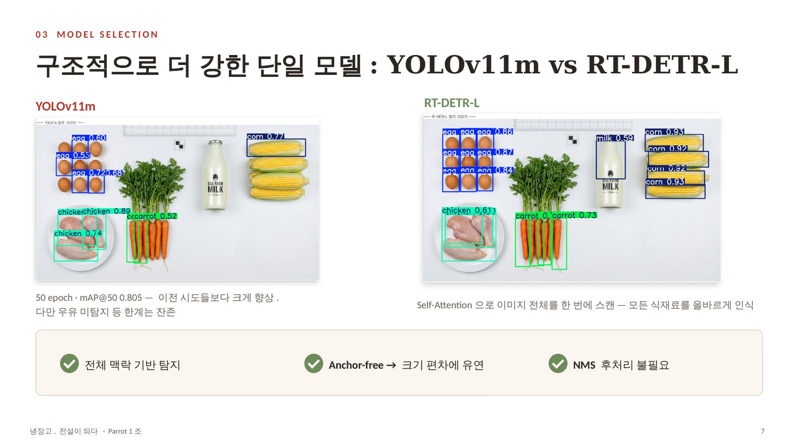
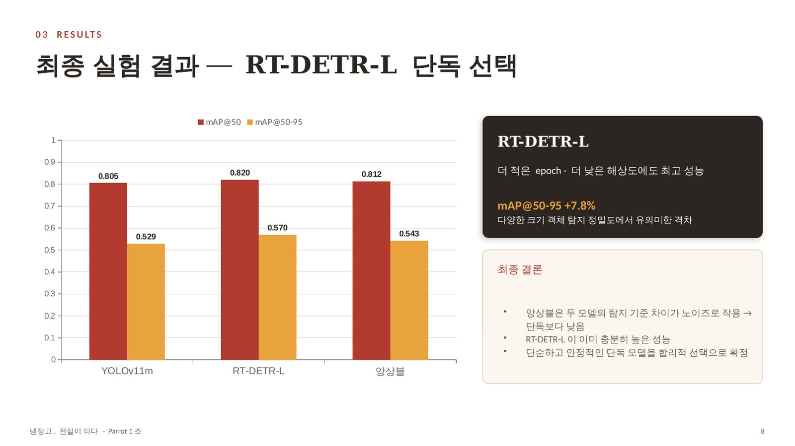
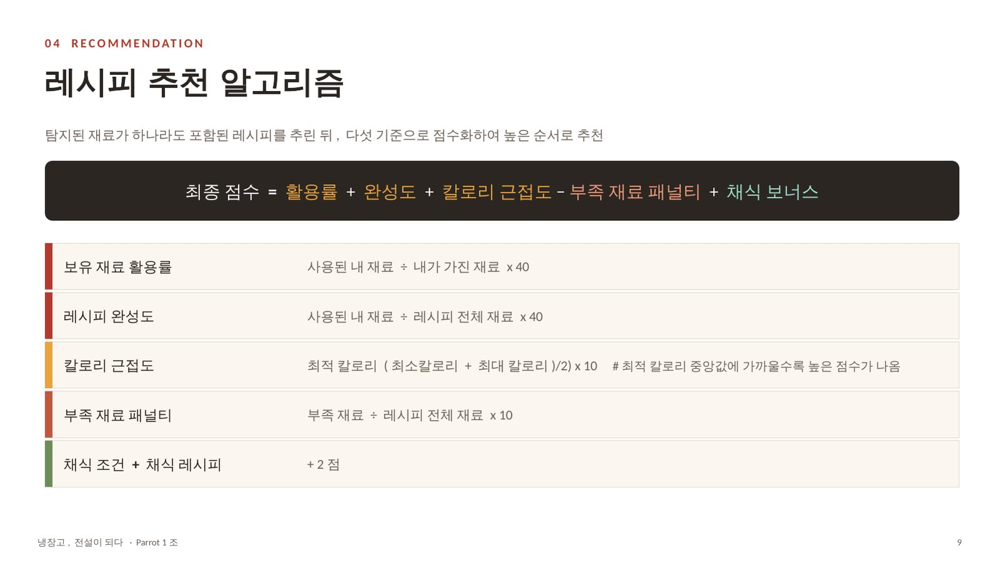
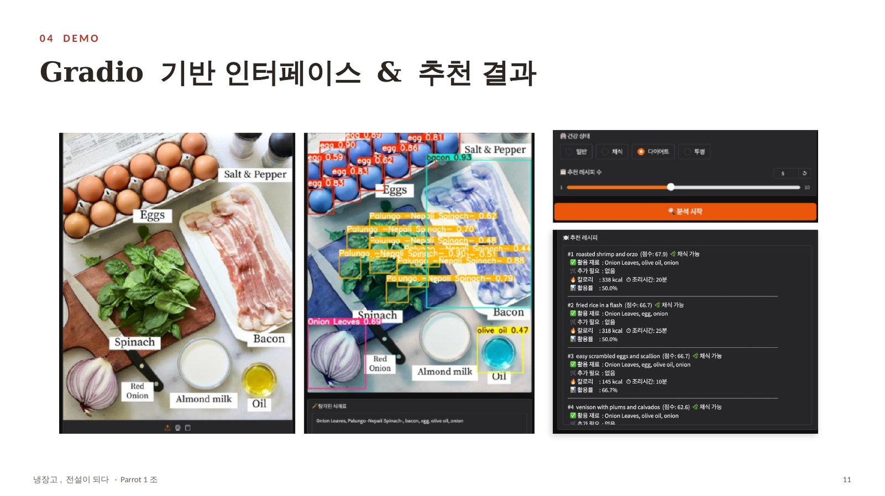

> 오늘 뭐 먹지?

## Question

딥러닝을 처음 배우고 진행한 첫 프로젝트입니다.

장을 보고 와서 산 재료를 어떻게 다 쓸지, 오늘은 무엇을 해 먹을지 고민하는 일은 매일 반복됩니다. 저희는 이 고민을 딥러닝으로 풀어 보고자 했습니다. 식재료를 사진 한 장으로 탐지하고, 사용자의 건강 상태에 맞춰 남은 재료를 가장 잘 활용하는 레시피를 추천해 음식 낭비를 줄이는 것이 목표였습니다.

처음에는 냉장고 안을 찍는 방식을 생각했지만, 냉장고 속은 정리되어 있지 않고 재료가 겹쳐 있어 한 장에 다 담기 어려웠습니다. 그래서 **장을 보고 온 직후 식탁 위에 재료를 펼쳐 놓고 찍는 장면**으로 문제를 다시 정의했습니다. 재료가 덜 가려져 탐지 모델이 인식하기에 훨씬 유리한 조건이었습니다.

## Plan

첫 계획서는 욕심이 컸습니다. 식재료 탐지(YOLOv8m)와 영수증 OCR을 합치고, 재료별 유통기한으로 소진 우선순위를 계산하고, Ingredient2Vec과 MLP로 레시피를 추천한 뒤, 남은 재료가 다음 날로 이어지는 **3일 연쇄 식단 스케줄**과 '이 재료 하나만 더 사면 레시피가 늘어나는' **역방향 재료 추천**까지 다섯 단계로 설계했습니다. 목표 지표는 탐지 mAP@0.5 80% 이상, 추천 Precision@5 70% 이상으로 잡았습니다.

## Feedback

계획서 검토와 멘토링에서 두 가지 피드백을 받았습니다.

- **기간과 환경에 비해 범위가 넓다** — 3주 안에, 학회 Colab 자원으로 다섯 단계를 모두 구현하기는 어렵다는 의견이었습니다.
- **'추천'을 수치로 설명할 수 있어야 한다** — 데이터셋을 모아 학습하고, 평가 지표가 명확하게 확정된 다음에야 주제의 독창성이 의미를 가진다는 조언이었습니다.

그래서 범위를 과감히 줄였습니다. **식재료 탐지 → 레시피 추천 → 건강 상태별 칼로리 기반 추천 → UI**만 남기고, 영수증 OCR · 유통기한 · 3일 식단 · 역방향 추천은 향후 과제로 넘겼습니다. 추천은 칼로리라는 숫자로 설명할 수 있게 바꿨습니다.

## Data

Roboflow의 식재료 데이터셋 3개를 인덱스 재매핑으로 하나의 체계로 통합하고, 학습 데이터가 충분하면서도 레시피에 꼭 필요한 재료를 기준으로 **38개 클래스**를 골랐습니다. Food.com의 레시피 23만 건에서는 조리 시간 · 칼로리 이상치와 재료 개수가 비정상적인 1만 4천여 건을 걸러냈고, Ingredient2Vec으로 재료를 128차원 벡터로 표현해 재료 사이의 관계를 학습했습니다.

데이터가 대부분 서양식 재료였기 때문에, 한식 재료를 억지로 더하기보다 **'미국으로 교환학생을 간 배고픈 대학생'** 이라는 페르소나로 상황을 다시 잡았습니다. 지금 가진 데이터로 인식 정확도를 먼저 확보하는 것이 우선이라고 판단했습니다.

## Detection

첫 YOLOv8 모델은 mAP@50 0.76으로 목표인 0.8에 못 미쳤고, 여러 재료가 함께 있는 사진에서는 작은 재료나 겹친 재료를 자주 놓쳤습니다. 그래서 팀원 네 명이 **각자 하나씩 보완책을 맡아 같은 기준으로 실험**하기로 했습니다.

- **YOLO-World** (제가 맡은 실험) — 라벨 없이 텍스트 프롬프트로 탐지하는 open-vocabulary 모델이라 기대했지만, mAP@50 **0.0032**에 그쳤습니다. 텍스트로 추론하는 방식이 정해진 클래스로 평가하는 방식과 맞지 않았고, 특정 식재료 도메인에서는 범용성이 오히려 약점이 되었습니다.
- **YOLOv8n + YOLO-E 앙상블** — 놓친 재료를 보완하길 기대했지만 0.7609 → **0.6779**로 오히려 떨어졌습니다.
- **YOLOv8m + CLIP 재검증** — 후보 박스를 CLIP으로 다시 확인하는 구조였지만, YOLO가 박스를 만들지 못하면 CLIP도 할 수 있는 일이 없었고, 우유를 바나나로 착각하는 오탐도 남았습니다.
- **YOLOv11m · RT-DETR-L** — 구조적으로 더 강한 단일 모델로 방향을 바꿨습니다.

최종 결과는 YOLOv11m 0.805 / 0.529, **RT-DETR-L 0.820 / 0.570**, 둘의 앙상블 0.812 / 0.543 (mAP@50 / mAP@50-95)이었습니다. RT-DETR-L은 Self-Attention으로 이미지 전체를 한 번에 보기 때문에 재료가 겹치거나 크기가 제각각인 장면에 유리했고, 더 적은 epoch와 낮은 해상도로도 가장 높은 성능을 냈습니다. 앙상블은 박스 형식과 신뢰도 척도가 다른 두 모델이 서로를 방해해 단독보다 낮았기 때문에, **RT-DETR-L 단독**을 최종 모델로 골랐습니다.

## Recommendation

탐지된 재료가 들어간 레시피를 추린 뒤 점수를 매겨 추천합니다. 처음 공식은 재료 수가 많은 레시피일수록 무조건 유리하고 부족 재료 감점이 약하다는 문제가 있어, 각 항목을 비율로 정규화한 공식으로 다시 설계했습니다.

- 보유 재료 활용률 (40점) — 내가 가진 재료를 레시피가 얼마나 쓰는지
- 레시피 완성도 (40점) — 레시피 재료 중 내가 가진 비율
- 칼로리 근접도 (10점) — 건강 상태별 권장 범위의 중앙값에 가까울수록
- 부족 재료 패널티 (−10점) · 채식 보너스 (+2점)

식단 유형은 일반 · 채식 · 다이어트 · 투병 네 가지로 나누고, 한 끼 칼로리 범위를 미국 식이 가이드라인 같은 공개 자료를 근거로 정했습니다. Gradio로 사진 업로드부터 탐지, 추천까지 이어지는 데모를 만들었습니다.

## Presentation

발표는 '왜 이 모델을 썼는지, 더 좋게 만들려면 무엇이 필요한지'를 설명하는 자리라고 생각했습니다. 그래서 코드를 돌려 결과만 내는 대신, 회의마다 각자 실험한 모델의 결과를 같은 테스트 사진으로 맞춰 비교하고, 서로의 코드를 읽으며 이해한 내용을 대본으로 옮겼습니다. 발표 전에는 모델 선택의 근거와 한계, 칼로리 범위의 출처, 추천 공식의 가중치까지 예상 질문을 정리해 Q&A를 준비했습니다.

## Limitations

- **탐지 한계** — 버터 · 치즈를 두부로 인식하는 것처럼 색과 질감이 비슷한 재료에서 혼동이 남았습니다.
- **데이터 불균형과 검증** — 클래스별 bbox 수가 2,076개에서 87개까지 차이 났고, 이미 라벨링된 데이터의 품질을 저희가 모두 검증하기 어려웠습니다.
- **자원** — RT-DETR-L은 Attention 연산 때문에 35 epoch에 약 7시간이 걸려, 증강이나 하이퍼파라미터를 충분히 바꿔 보지 못했습니다.
- **추천 가중치** — 반복 테스트로 정한 값이라 사용자 실험으로 검증되지 않았고, 개인의 선호도도 반영하지 못합니다.

다음 단계로는 사용자 피드백을 쌓아 협업 필터링을 결합하고, 가중치를 사용자가 직접 조절하는 슬라이더를 넣는 방향을 생각했습니다. 처음 계획했던 영수증 OCR, 3일 연쇄 식단, 유통기한, 역방향 재료 추천도 향후 과제로 함께 제안했습니다.

## Role

- 팀장으로 문제 정의와 범위 조정, 회의 일정과 할 일을 정리하며 프로젝트를 이끎
- **기획** — '장보고 온 직후 식탁 위 사진' 시나리오와 '미국 교환학생' 페르소나, 향후 과제 구성 제안
- **모델링** — 팀원들과 함께 탐지 모델을 실험하고 비교했고, 그중 YOLO-World 실험을 맡음
- **발표** — 발표 자료를 만들고 도입 · 데이터 파트를 발표

## Learnings

딥러닝을 처음 배우며 시작한 프로젝트였기에, 모델을 활용하기에 앞서 모델 자체를 이해하는 과정부터 필요했습니다. RT-DETR이 YOLO와 달리 이미지 전체의 관계를 어떻게 파악하는지 이해하기 위해 관련 논문과 리뷰 자료를 찾아 읽었고, 레시피 추천 공식과 칼로리 범위를 설정할 때도 추천 시스템 논문과 식이 가이드라인을 근거로 삼았습니다. 수업에서 개념으로 접했던 객체 탐지와 Transformer를 실제 데이터에 적용하면서, 모델의 구조와 작동 원리를 이해하는 것이 결과를 해석하는 데 얼마나 중요한지 알게 되었습니다.

이번 프로젝트에서 가장 크게 배운 것은 **계획을 구체화하기 전에 검증할 수 있는 기준부터 마련해야 한다**는 점입니다. 처음 계획서에는 구현하고 싶은 기능이 많았지만, 피드백을 거치며 정작 데이터와 평가 지표가 명확하게 정의되지 않았다는 사실을 발견했습니다. 무엇을 기준으로 성능을 판단할지 정해지지 않으면 기능을 구현하더라도 그 결과가 유의미한지 설명하기 어려웠습니다. 이에 프로젝트의 범위를 조정하고 탐지와 추천이라는 핵심 기능에 집중했습니다. 이를 통해 좋은 기획은 많은 기능을 제안하는 것에서 끝나는 것이 아니라, 실제로 검증할 수 있는 목표와 기준을 설정하는 데서 시작한다는 것을 배웠습니다.

객체 탐지 모델을 비교하는 과정에서는 YOLO의 여러 모델을 팀원들과 나누어 맡아 각 모델의 성능을 최대한 높이고, 동일한 기준에서 결과를 비교해 보고자 했습니다. 저는 그중 YOLO-World를 담당해 모델의 구조와 특징을 살펴보고 실제 데이터에 적용했습니다. 실험 결과 YOLO-World는 mAP@50 0.0032라는 매우 낮은 성능을 보였습니다. 이 결과를 통해서 텍스트를 활용해 객체를 탐지하는 범용 모델이 프로젝트의 데이터와 평가 환경에서는 어떤 한계를 보이는지 확인할 수 있었고, 정해진 클래스를 중심으로 학습한 다른 모델들과 비교할 수 있는 근거가 되었습니다. 앙상블을 적용했을 때 오히려 성능이 떨어진 결과도 마찬가지였습니다. 모델을 결합하면 성능이 향상될 것이라는 예상과 달리, 서로 다른 모델의 결과를 무조건 합치는 것이 항상 좋은 선택은 아니라는 사실을 실험으로 확인했습니다. 이 경험을 통해 모델의 성능을 높이는 것뿐 아니라, 각 모델의 특성과 적용 환경을 고려해 결과를 비교하고 해석하는 과정이 중요하다는 것을 배웠습니다.

AI의 도움으로 코드를 빠르게 구현할 수 있는 환경에서, 그 결과를 **우리 스스로 이해하고 설명할 수 있는가**를 끊임없이 질문했습니다. 각자 담당한 모델을 동일한 사진으로 비교하고, 모델을 선택한 이유와 결과의 차이를 서로 설명하며 발표와 질의응답을 준비했습니다. 이 과정에서 작동하는 결과물을 만드는 것과 그 결과가 나온 이유를 이해하는 것은 전혀 다른 일이라는 것을 깨달았습니다. 기술 활용과 그 원리, 한계를 이해한 뒤 결과에 책임 있게 설명할 수 있어야 한다는 점을 배운 프로젝트였습니다.
