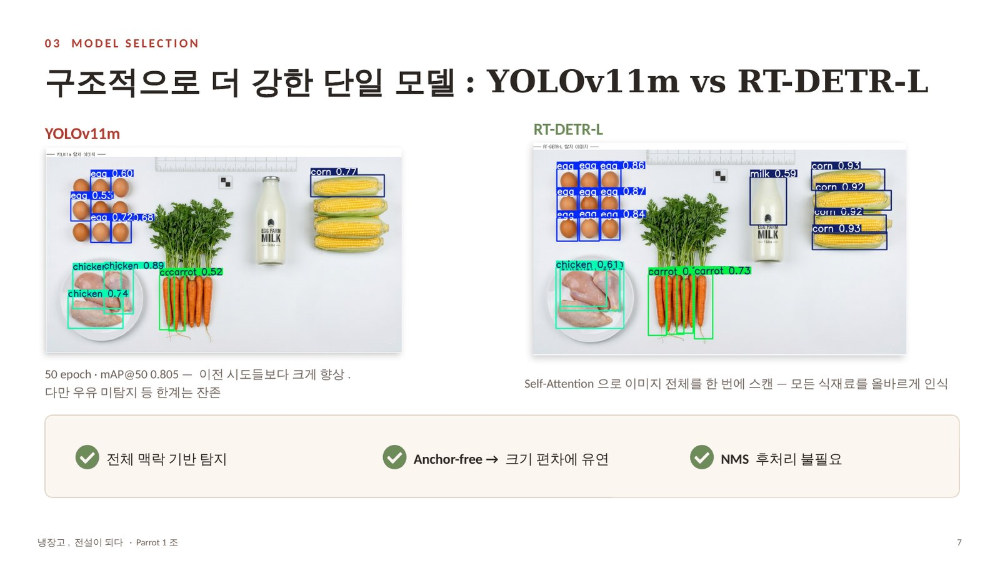
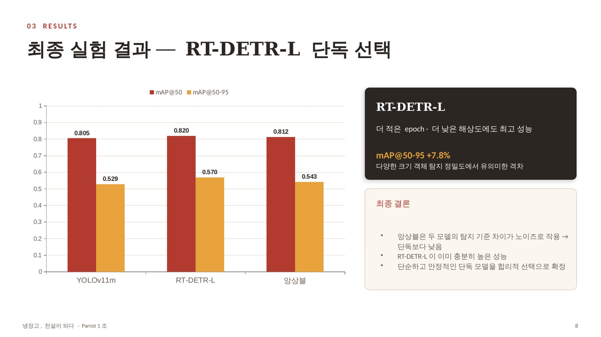
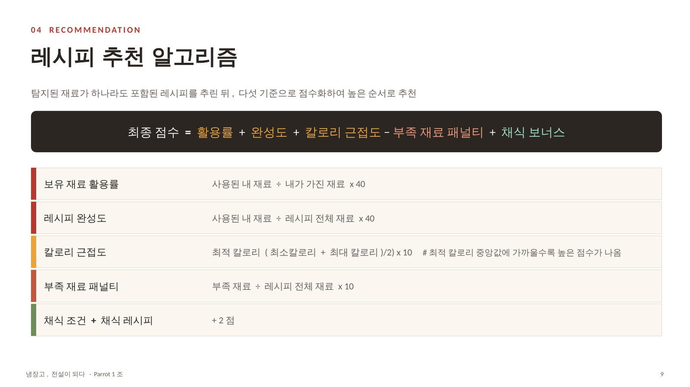
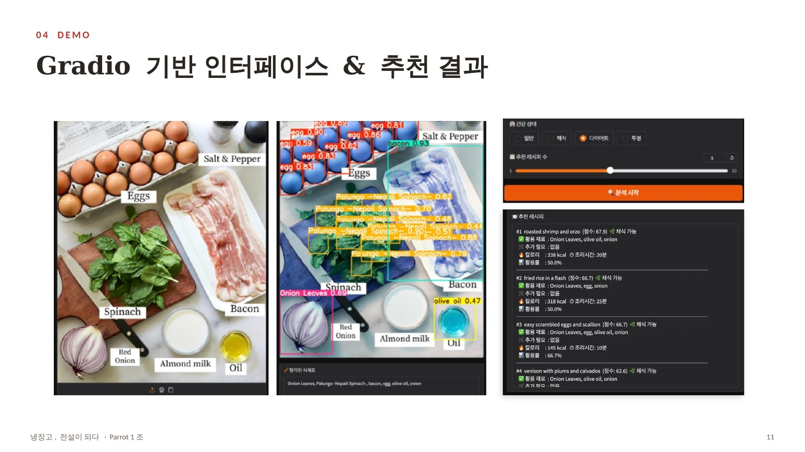

> 오늘 뭐 먹지?

## Question

텅 빈 냉장고 앞에서 매일 반복되는 고민을 딥러닝으로 풀고자 했습니다. 냉장고 속 재료를 사진 한 장으로 탐지하고, 건강 상태와 냉장고 상황에 맞는 레시피를 추천해 음식 낭비를 줄이는 것이 목표였습니다.

## Data

흩어진 3개 데이터셋을 인덱스 재매핑으로 통합하고, 23만 건 레시피 중 노이즈 1.4만여 건을 걸러냈습니다. 조명·그림자·흔들림 같은 실제 주방 환경을 반영해 데이터를 증강하고, 재료를 128차원 벡터로 표현하는 Ingredient2Vec으로 재료 사이의 관계를 학습했습니다.

## Model

YOLOv8m 단독으로는 마늘처럼 작은 재료나 겹친 채소를 자주 놓쳤습니다. YOLO World, YOLO E 앙상블, CLIP 재검증을 차례로 시도했지만 오히려 오탐이 늘었습니다. 구조적으로 더 강한 단일 모델을 비교한 끝에, 이미지 전체를 한 번에 보는 **RT-DETR-L**을 선택했습니다.

- YOLOv11m — mAP@50 0.805 / mAP@50-95 0.529
- RT-DETR-L — mAP@50 **0.820** / mAP@50-95 **0.570**
- 두 모델 앙상블 — 0.812 / 0.543 (단독보다 낮음)

## Recommendation

탐지된 재료가 들어간 레시피를 보유 재료 활용률, 레시피 완성도, 칼로리 근접도, 부족 재료 패널티, 채식 보너스로 점수화해 추천합니다. 일반·채식·다이어트·투병 식단마다 칼로리 범위를 따로 설계했고, Gradio로 사진 업로드부터 추천까지 이어지는 데모를 만들었습니다.

## Limitations

버터·치즈를 두부로, 마요네즈를 우유로 혼동하는 탐지 한계와 클래스 간 데이터 불균형이 남았습니다. 추천 가중치는 경험적으로 정했기 때문에, 협업 필터링과 사용자 가중치 조절 슬라이더로 개인화하는 것이 다음 단계입니다.
