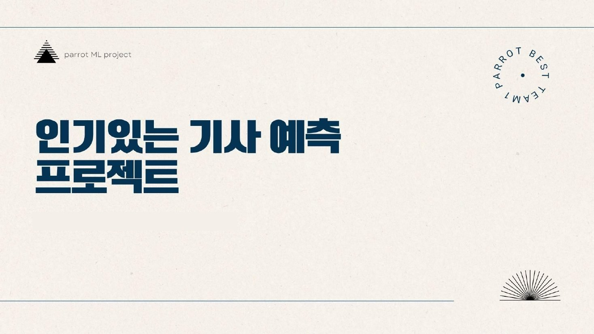
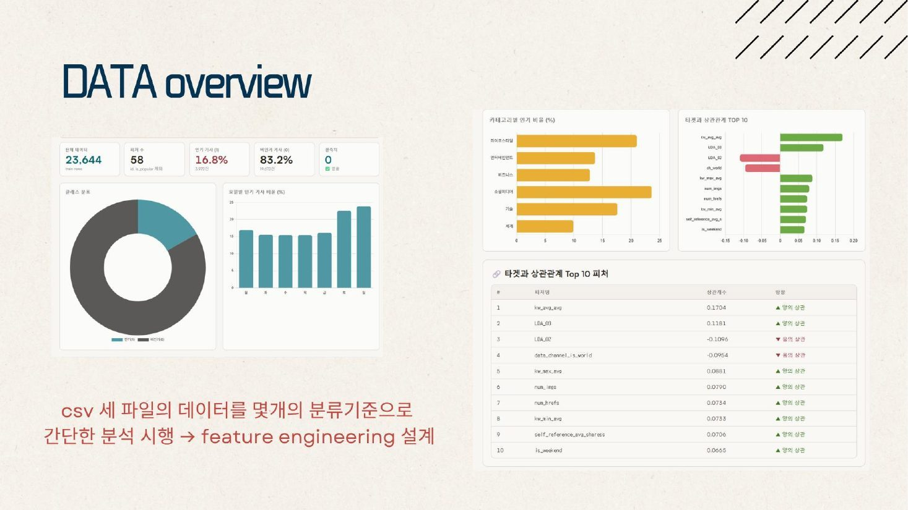
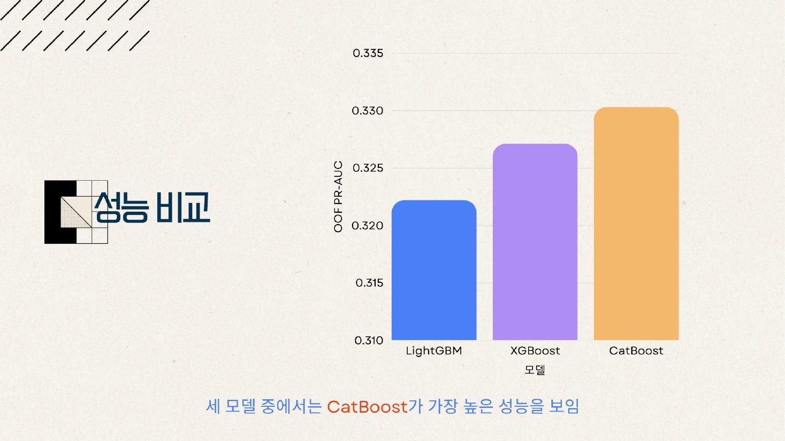
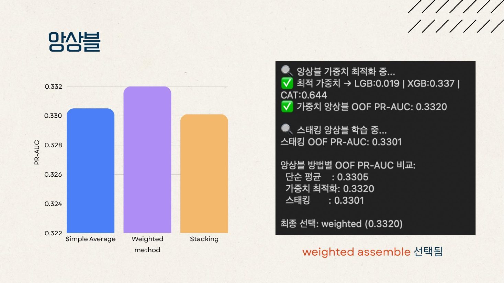
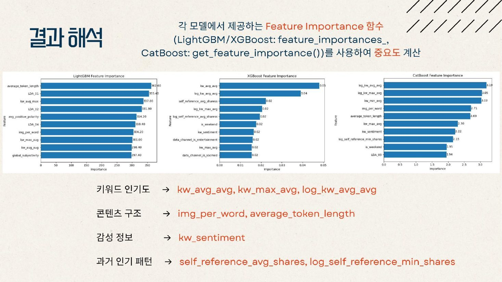
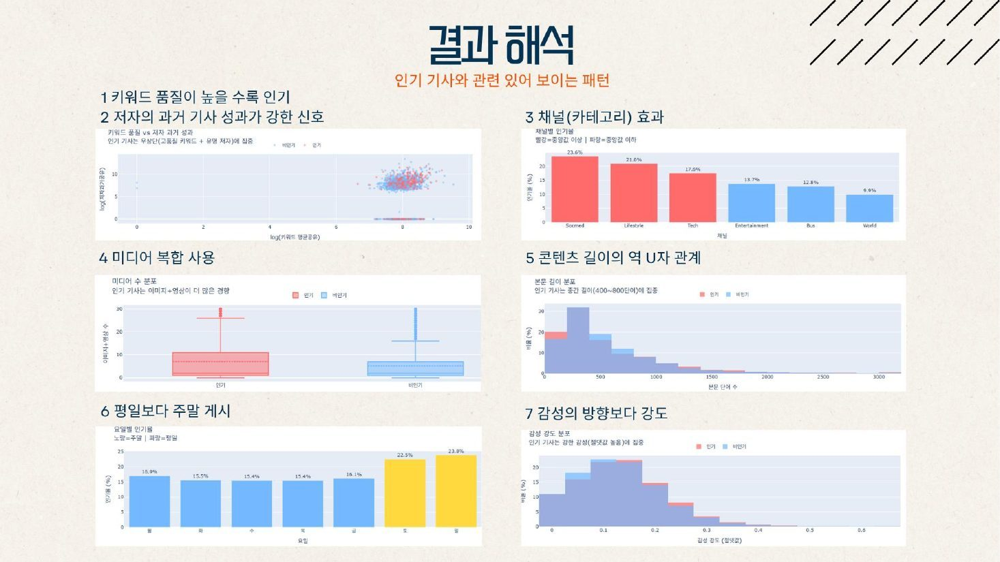

## Overview

PARROT 14기 정규 세션의 ML 프로젝트로, "인기 있는 뉴스는 숫자로 보인다?"라는 질문에서 출발했습니다. 뉴스 기사에는 제목·본문 길이, 이미지·영상 수, 카테고리, 감성, 게시 요일처럼 다양한 정보가 담겨 있습니다. 이 정보만 보고 그 기사가 **인기 기사(`is_popular`)인지 확률로 예측**하는 모델을 만드는 것이 과제였습니다.

평가는 정량 70%(PR-AUC), 정성 30%(발표)였습니다. 제출 직후 점수가 공개되는 **리더보드(public score)** 가 있었지만, 최종 순위는 따로 숨겨 둔 test 데이터의 **private score**로 매겨졌습니다. 그래서 리더보드 점수만 쫓기보다, 검증을 제대로 해서 처음 보는 데이터에서도 성능이 유지되는 모델을 만드는 게 중요했습니다. 발표에는 전처리, 모델 선정과 튜닝, 결과 해석, 어려웠던 점을 꼭 담아야 했습니다.

저희 조는 네 명이 함께 모델을 돌렸고, 최종 발표는 제가 맡았습니다.

## Process

1. **데이터 준비** — 데이터 불러오기, 전처리, 피처 엔지니어링
2. **하이퍼파라미터 탐색** — Optuna로 모델별 최적값 찾기 (3-Fold)
3. **학습** — 찾은 값으로 5-Fold 본학습
4. **앙상블** — 단순 평균, 가중치 최적화, 스태킹 비교
5. **제출** — 최종 앙상블 선택 후 확률값 CSV 저장

## Data

학습 데이터 23,644건, 피처 58개, 결측치는 없습니다. 인기 기사 비율이 **16.8%** 뿐인 불균형 이진 분류 문제라, 정확도 대신 소수 클래스(인기 기사)를 얼마나 잘 골라내는지 보는 PR-AUC로 평가했습니다.

먼저 요일·카테고리별 인기 비율과 타깃과의 상관관계를 살펴보고, 이를 바탕으로 피처 엔지니어링을 설계했습니다. 키워드 평균 점수(`kw_avg_avg`)가 가장 강한 양의 상관을, 세계 뉴스 채널(`data_channel_is_world`)이 음의 상관을 보였습니다.

## Preprocessing & Features

키워드 점수 변수 두 개(`kw_min_min`, `kw_max_min`)에 있을 수 없는 값 -1이 섞여 있었습니다. 이 행들을 지우지 않고 **-1을 0으로 바꿔** 데이터 손실을 줄였습니다.

원본 피처를 그대로 쓰지 않고 29개를 새로 만들었습니다. 오른쪽으로 치우친 개수형 변수 14개에는 log 변환을 했고, 성능 기여가 낮은 파생 변수는 다시 뺐습니다.

- **콘텐츠 구조** — 글 길이 대비 이미지 수(`img_per_word`), 링크 밀도(`link_density`)
- **감성과 키워드 결합** — 키워드 인기 × 주관성(`kw_sentiment`), 긍정·부정 단어 비율(`pos_neg_ratio`)
- **품질과 다양성** — 고유 단어 비율(`content_density`), 키워드 품질(`kw_quality`)

## Modeling

학회에서 배운 부스팅 모델 세 가지를 각자의 장점을 보고 골랐습니다.

- **LightGBM** — 학습이 빠르고 메모리 효율이 높습니다.
- **XGBoost** — 정밀하게 최적화하고, GPU로 학습 속도를 높일 수 있습니다.
- **CatBoost** — 하이퍼파라미터에 덜 민감하고 과적합 위험이 낮아 일반화 성능이 안정적입니다.

세 모델 모두 같은 방식으로 학습했습니다. 먼저 Optuna로 하이퍼파라미터를 자동 탐색했습니다(3-Fold, LightGBM·XGBoost 100회, CatBoost는 한 번 학습이 오래 걸려 60회). 그다음 찾은 값으로 5-Fold 본학습을 했고, 최대 6,000번 반복하되 200번 동안 나아지지 않으면 멈추게(Early Stopping) 했습니다.

- LightGBM — 튜닝 0.3287 → 최종 OOF 0.3222
- XGBoost — 튜닝 0.3292 → 최종 OOF 0.3271
- **CatBoost — 튜닝 0.3324 → 최종 OOF 0.3303** (단일 모델 최고)

## Ensemble

단일 모델 중에서는 CatBoost가 가장 좋았습니다. 여기서 성능을 더 올리려고 세 모델의 예측을 세 가지 방식으로 합쳐 비교했습니다.

- 단순 평균 0.3305
- 스태킹 (세 모델 예측을 로지스틱 회귀로 다시 학습) 0.3301
- **가중치 최적화 0.3320** — 최종 선택

최적 가중치는 CatBoost 0.644, XGBoost 0.337, LightGBM 0.019였습니다. 단일 모델에서 가장 약했던 LightGBM은 사실상 빠지고, 서로 다른 강점을 가진 CatBoost와 XGBoost가 합쳐질 때 가장 좋았습니다.

## Insights

세 모델의 피처 중요도를 비교했더니 공통으로 네 가지가 중요하게 나왔습니다.

- **키워드 인기도** — `kw_avg_avg`, `kw_max_avg`
- **콘텐츠 구조** — `img_per_word`, `average_token_length`
- **감성** — `kw_sentiment`
- **저자의 과거 인기 패턴** — `self_reference_avg_shares`

데이터를 다시 살펴보니 인기 기사에는 이런 패턴이 있었습니다.

1. 키워드 품질이 높을수록 인기가 많습니다.
2. 저자의 과거 기사 성과가 강한 신호입니다.
3. 채널마다 차이가 큽니다 — 소셜미디어 23.6%, 라이프스타일 21.6% vs 세계 뉴스 9.9%.
4. 이미지와 영상을 함께 쓴 기사가 인기가 많습니다.
5. 글 길이는 역 U자 관계입니다 — 400~800단어의 중간 길이에 몰려 있습니다.
6. 평일(15~17%)보다 주말(토 22.5%, 일 23.8%)에 게시한 기사가 인기가 많습니다.
7. 감성이 긍정인지 부정인지보다, 감정이 얼마나 강한지가 중요합니다.

> 좋은 피처 × 올바른 튜닝 × 다양한 모델 = 앙상블 시너지
> 단계 하나하나가 독립적이지 않고, 앞 단계의 품질이 뒤 단계의 성능을 결정한다.

## Limitations

하이퍼파라미터 튜닝 시간이 길었고, 과적합과 모델 최적화도 어려웠습니다. 튜닝은 3-Fold와 Early Stopping으로 시간을 줄였고, 과적합은 Early Stopping과 정규화로 막았습니다. 다음에는 중요도가 낮은 피처를 줄이고, 다른 계열의 모델을 추가해 더 다양한 관점으로 학습해 보고 싶습니다.

## Reflection

ML을 처음 배우고 나서 처음으로 해 본 ML 프로젝트였습니다. 처음에는 모든 게 어렵게 느껴졌습니다. 리더보드가 무엇인지, public score와 private score가 왜 따로 있는지도 몰랐습니다. 그래서 새로운 기법을 찾아 헤매기보다 **학회에서 배운 모델을 제대로 쓰는 것**부터 하기로 했습니다. 세션에서 배운 부스팅 모델을 다시 공부하면서, 파라미터 하나하나가 무슨 뜻인지 찾아보고 직접 바꿔 가며 돌렸습니다.

조원 네 명이 모두 함께 모델을 돌렸습니다. 같은 데이터로 각자 실험한 결과를 비교하면서, 점수가 오르거나 떨어진 이유를 같이 따져 봤습니다. 그 과정에서 리더보드 점수는 참고일 뿐이고, 처음 보는 데이터에서도 통하는 모델을 만들려면 교차검증이 왜 필요한지 자연스럽게 이해하게 됐습니다.

최종 발표는 제가 맡았습니다. 발표를 준비하면서 "왜 이 모델을 골랐는지", "왜 가중치 앙상블이 이겼는지"를 남에게 설명할 수 있을 만큼 정리해야 했고, 그러면서 코드로만 돌리던 과정이 하나의 흐름으로 이해됐습니다. 배운 것을 직접 써 보고, 그걸 다시 말로 설명해 본 경험이 ML을 내 것으로 만드는 첫걸음이 되었습니다.
