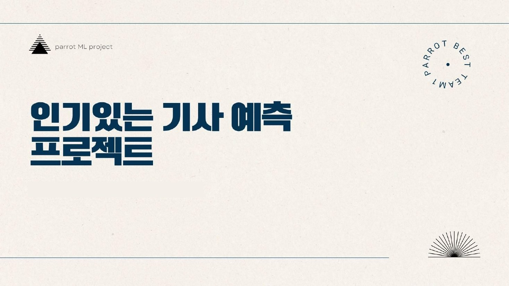
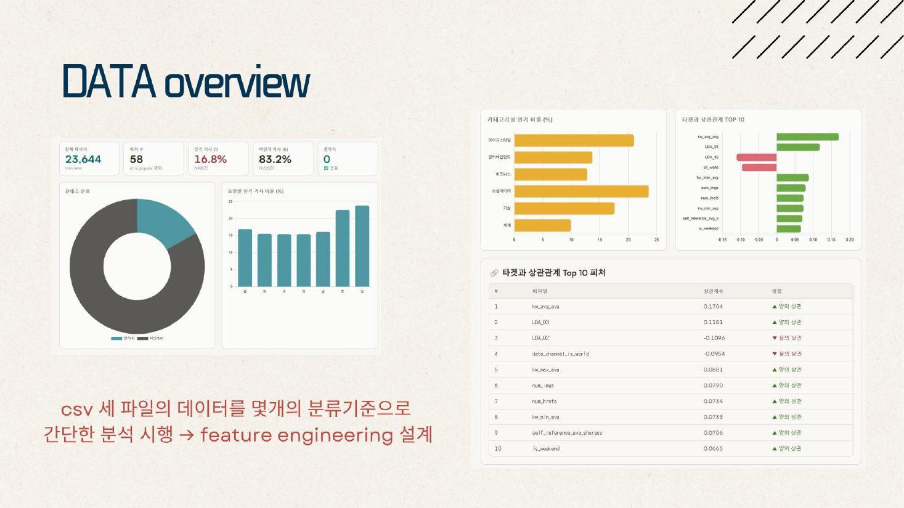
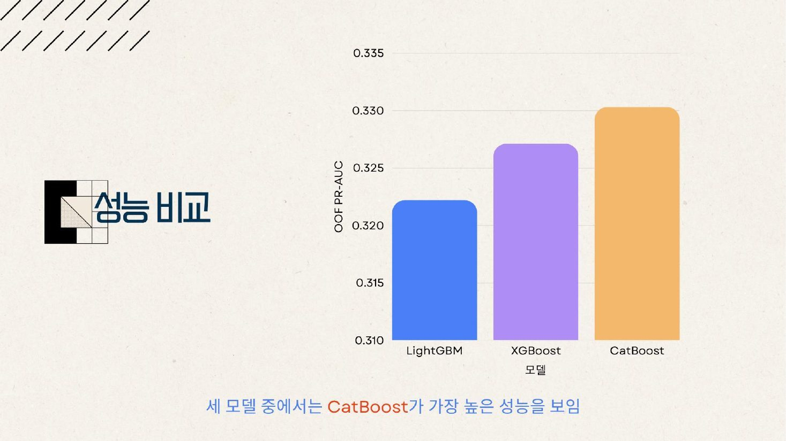
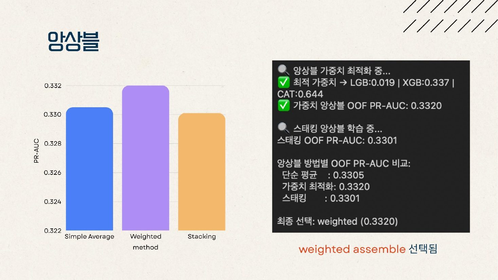
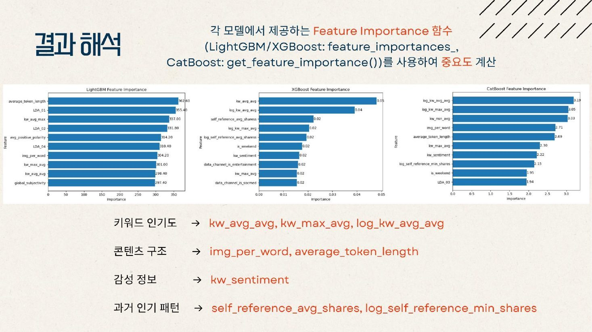
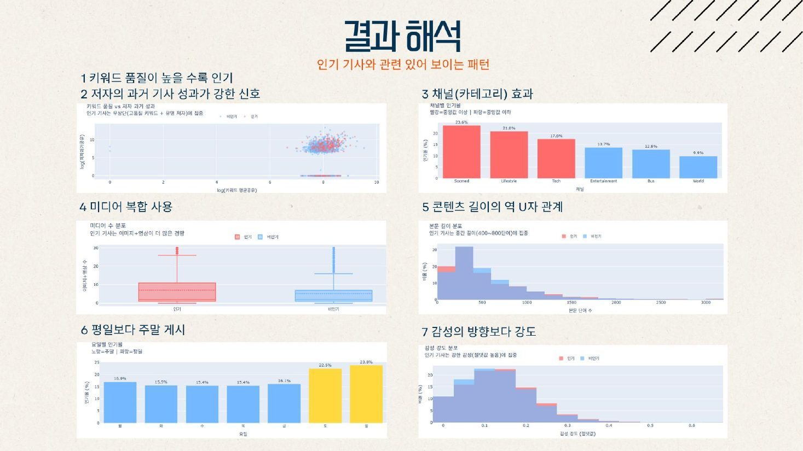

## Overview

PARROT 14기 정규 세션의 ML 프로젝트로, "인기 있는 뉴스는 숫자로 보인다?"라는 질문에서 출발했습니다. 뉴스 기사에는 제목·본문 길이, 이미지·영상 수, 카테고리, 감성, 게시 요일처럼 다양한 정보가 담겨 있습니다. 이 정보만 보고 그 기사가 **인기 기사(`is_popular`)인지 확률로 예측**하는 모델을 만드는 것이 과제였습니다.

평가는 정량 70%(PR-AUC), 정성 30%(발표)였습니다. 제출 직후 점수가 공개되는 **리더보드(public score)** 가 있었지만, 최종 순위는 따로 숨겨 둔 test 데이터의 **private score**로 매겨졌습니다. 그래서 리더보드 점수만 쫓기보다, 검증을 제대로 해서 처음 보는 데이터에서도 성능이 유지되는 모델을 만드는 게 중요했습니다. 발표에는 전처리, 모델 선정과 튜닝, 결과 해석, 어려웠던 점을 꼭 담아야 했습니다.

저희 조는 네 명이 함께 모델을 돌렸고, 최종 발표는 제가 맡았습니다.

## Process

1. **데이터 준비** — 데이터 불러오기, 전처리, 피처 엔지니어링
2. **하이퍼파라미터 탐색** — Optuna로 모델별 최적값 찾기 (3-Fold)
3. **학습** — 찾은 값으로 5-Fold 본학습
4. **앙상블** — 단순 평균, 가중치 최적화, 스태킹 비교
5. **제출** — 최종 앙상블 선택 후 확률값 CSV 저장

## Data

학습 데이터 23,644건, 피처 58개, 결측치는 없습니다. 인기 기사 비율이 **16.8%** 뿐인 불균형 이진 분류 문제라, 정확도 대신 소수 클래스(인기 기사)를 얼마나 잘 골라내는지 보는 PR-AUC로 평가했습니다.

먼저 요일·카테고리별 인기 비율과 타깃과의 상관관계를 살펴보고, 이를 바탕으로 피처 엔지니어링을 설계했습니다. 키워드 평균 점수(`kw_avg_avg`)가 가장 강한 양의 상관을, 세계 뉴스 채널(`data_channel_is_world`)이 음의 상관을 보였습니다.

## Preprocessing & Features

키워드 점수 변수 두 개(`kw_min_min`, `kw_max_min`)에 있을 수 없는 값 -1이 섞여 있었습니다. 이 행들을 지우지 않고 **-1을 0으로 바꿔** 데이터 손실을 줄였습니다.

원본 피처를 그대로 쓰지 않고 29개를 새로 만들었습니다. 오른쪽으로 치우친 개수형 변수 14개에는 log 변환을 했고, 성능 기여가 낮은 파생 변수는 다시 뺐습니다.

- **콘텐츠 구조** — 글 길이 대비 이미지 수(`img_per_word`), 링크 밀도(`link_density`)
- **감성과 키워드 결합** — 키워드 인기 × 주관성(`kw_sentiment`), 긍정·부정 단어 비율(`pos_neg_ratio`)
- **품질과 다양성** — 고유 단어 비율(`content_density`), 키워드 품질(`kw_quality`)

## Modeling

학회에서 배운 부스팅 모델 세 가지를 각자의 장점을 보고 골랐습니다.

- **LightGBM** — 학습이 빠르고 메모리 효율이 높습니다.
- **XGBoost** — 정밀하게 최적화하고, GPU로 학습 속도를 높일 수 있습니다.
- **CatBoost** — 하이퍼파라미터에 덜 민감하고 과적합 위험이 낮아 일반화 성능이 안정적입니다.

세 모델 모두 같은 방식으로 학습했습니다. 먼저 Optuna로 하이퍼파라미터를 자동 탐색했습니다(3-Fold, LightGBM·XGBoost 100회, CatBoost는 한 번 학습이 오래 걸려 60회). 그다음 찾은 값으로 5-Fold 본학습을 했고, 최대 6,000번 반복하되 200번 동안 나아지지 않으면 멈추게(Early Stopping) 했습니다.

- LightGBM — 튜닝 0.3287 → 최종 OOF 0.3222
- XGBoost — 튜닝 0.3292 → 최종 OOF 0.3271
- **CatBoost — 튜닝 0.3324 → 최종 OOF 0.3303** (단일 모델 최고)

## Ensemble

단일 모델 중에서는 CatBoost가 가장 좋았습니다. 여기서 성능을 더 올리려고 세 모델의 예측을 세 가지 방식으로 합쳐 비교했습니다.

- 단순 평균 0.3305
- 스태킹 (세 모델 예측을 로지스틱 회귀로 다시 학습) 0.3301
- **가중치 최적화 0.3320** — 최종 선택

최적 가중치는 CatBoost 0.644, XGBoost 0.337, LightGBM 0.019였습니다. 단일 모델에서 가장 약했던 LightGBM은 사실상 빠지고, 서로 다른 강점을 가진 CatBoost와 XGBoost가 합쳐질 때 가장 좋았습니다.

## Insights

세 모델의 피처 중요도를 비교했더니 공통으로 네 가지가 중요하게 나왔습니다.

- **키워드 인기도** — `kw_avg_avg`, `kw_max_avg`
- **콘텐츠 구조** — `img_per_word`, `average_token_length`
- **감성** — `kw_sentiment`
- **저자의 과거 인기 패턴** — `self_reference_avg_shares`

데이터를 다시 살펴보니 인기 기사에는 이런 패턴이 있었습니다.

1. 키워드 품질이 높을수록 인기가 많습니다.
2. 저자의 과거 기사 성과가 강한 신호입니다.
3. 채널마다 차이가 큽니다 — 소셜미디어 23.6%, 라이프스타일 21.6% vs 세계 뉴스 9.9%.
4. 이미지와 영상을 함께 쓴 기사가 인기가 많습니다.
5. 글 길이는 역 U자 관계입니다 — 400~800단어의 중간 길이에 몰려 있습니다.
6. 평일(15~17%)보다 주말(토 22.5%, 일 23.8%)에 게시한 기사가 인기가 많습니다.
7. 감성이 긍정인지 부정인지보다, 감정이 얼마나 강한지가 중요합니다.

> 좋은 피처 × 올바른 튜닝 × 다양한 모델 = 앙상블 시너지
> 단계 하나하나가 독립적이지 않고, 앞 단계의 품질이 뒤 단계의 성능을 결정한다.

## Limitations

하이퍼파라미터 튜닝 시간이 길었고, 과적합과 모델 최적화도 어려웠습니다. 튜닝은 3-Fold와 Early Stopping으로 시간을 줄였고, 과적합은 Early Stopping과 정규화로 막았습니다. 다음에는 중요도가 낮은 피처를 줄이고, 다른 계열의 모델을 추가해 더 다양한 관점으로 학습해 보고 싶습니다.

## Reflection

ML을 처음 배운 뒤 처음으로 참여한 ML 프로젝트였습니다. 처음에는 리더보드가 무엇인지, Public Score와 Private Score가 왜 구분되어 있는지도 모를 만큼 모든 과정이 낯설었습니다. 그래서 새로운 기법을 무작정 찾아 적용하기보다 **학회에서 배운 모델을 먼저 제대로 이해하고 활용하는 것**을 목표로 삼았습니다. 세션에서 배운 부스팅 모델을 다시 공부하며 파라미터 하나하나의 의미를 찾아보고, 값을 직접 바꿔 가며 결과가 어떻게 달라지는지 실험했습니다.

프로젝트에서는 조원 모두 직접 모델을 실행하고 실험 결과를 비교했습니다. 같은 데이터를 사용하더라도 설정에 따라 점수가 달라지는 이유를 함께 살펴보고, 각자의 결과를 바탕으로 다음 실험 방향을 논의했습니다. 이 과정에서 리더보드 점수가 모델의 성능을 판단하는 유일한 기준은 아니라는 점을 알게 되었습니다. 주어진 데이터에서 높은 점수를 얻는 것과 새로운 데이터에서도 안정적으로 작동하는 모델을 만드는 것은 다르기 때문입니다. 이를 통해 데이터의 일부를 반복적으로 나누어 검증하는 교차검증의 필요성과, 실험 결과를 객관적으로 비교할 수 있는 기준을 마련하는 일의 중요성을 이해하게 되었습니다.

최종 발표도 직접 맡았습니다. 발표를 준비하며 '왜 이 모델을 선택했는지', '왜 가중치 앙상블이 더 좋은 결과를 냈는지'를 다른 사람에게 설명할 수 있을 만큼 정리해야 했습니다. 그 과정에서 개별적으로 실행했던 코드와 실험들이 하나의 논리적인 흐름으로 연결되기 시작했습니다. 모델을 실행해 결과를 얻는 것에서 끝나는 것이 아니라, 선택의 근거와 결과가 나온 이유를 이해하고 설명할 수 있어야 비로소 배운 내용을 내 것으로 만들 수 있다는 것을 경험했습니다. ML을 처음 접한 단계에서 직접 실험하고, 결과를 비교하고, 다시 말로 설명해 본 것은 이후 기술을 학습하고 활용하는 데 중요한 출발점이 되었습니다.
