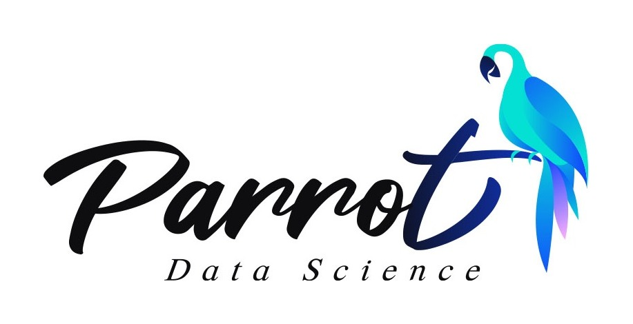

## About

**서강대학교 데이터 사이언스 학회 PARROT**은 데이터 사이언스에 관심 있는 학생들이 모여 학습 네트워크를 만드는 교내 학회입니다. 데이터 사이언스에 관심 있는 서강대학교 학생이라면 누구나 함께할 수 있습니다.

학기와 방학 동안 **기초 파이썬부터 머신러닝, 딥러닝(CNN, RNN, LSTM, Transformer)** 까지 폭넓은 교육 세션이 열리고, 마음이 맞는 학회원끼리 시각화, NLP 같은 데이터 스터디를 합니다. 세션과 스터디에서 배운 내용으로 여러 프로젝트를 진행하며, 데이터 사이언스라는 공통 관심사 위에서 함께 성장하는 것을 목표로 합니다.

> **왜 Parrot인가요?** 앵무새의 학습 방식이 인공지능이 학습하는 방식과 가장 비슷하다는 연구가 있습니다. 인공신경망의 구조를 연구하는 데에도 앵무새의 뇌 연구가 많은 도움이 된다고 합니다.

## My PARROT

데이터 사이언스에 관심이 생겨 2026년 3월 학회에 들어왔습니다. 1학기에는 학회원으로 ML·DL 프로젝트와 데이터톤에 참여하며 세션에서 배운 모델을 직접 써 봤고, 학회 생활을 더 열심히 하고 새로운 프로젝트도 더 많이 만들어 보고 싶어 8월부터 **부학회장**을 맡고 있습니다.

부학회장으로서는 다른 학회와 함께하는 연합 프로젝트를 기획했습니다. 기계공학 학회 **MECA**와는 로봇팔·산불 감지 드론을, 화학공학 학회 **PRIME**과는 반도체 PVD 증착률 예측을 진행했습니다. 운영진이 **먼저 직접 프로젝트를 해 보고**, 그 과정을 바탕으로 학회원들이 따라 할 수 있는 가이드라인을 만들었습니다. 또 졸업생과 재학생이 만나는 쉐어링데이(홈커밍데이)를 총괄하고 행사 웹사이트를 직접 만들었고, 1학기에 참가자로 나갔던 연합 데이터톤 앵날다쏘의 제3회 대회는 운영진(기획팀)으로 준비했습니다.

## 2026-1

- ML 프로젝트 — 인기 있는 기사 예측 (최종 발표)
- DL 프로젝트 — 냉장고, 전설이 되다 (팀장)
- 중앙대 × 서강대 연합 데이터톤 (앵날다쏘)
- 로봇팔 — PARROT × MECA (소프트웨어팀)

## 2026-2

- 반도체 PVD 증착률 예측 — PARROT × PRIME (총괄, 소프트웨어팀)
- 산불 감지 드론 — PARROT × MECA (소프트웨어팀)
- PARROT Lv.2 스터디 — 데이터 분석·머신러닝, 시계열 데이터 학습
- 제주 AI 에이전트 공모전 — 프론트엔드 (진행 중)
