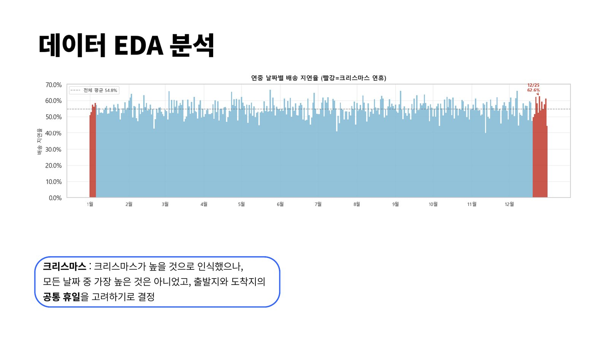
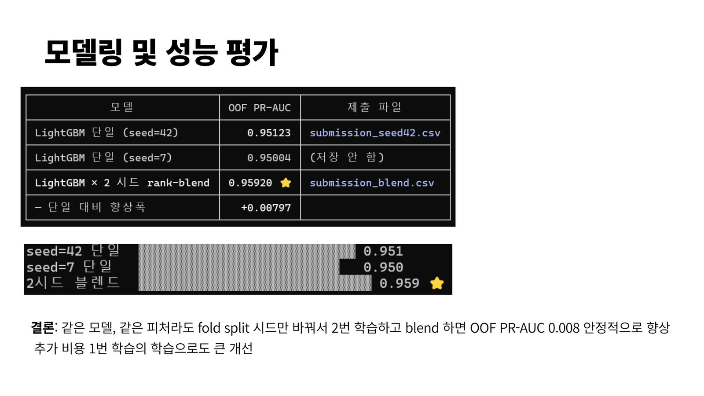
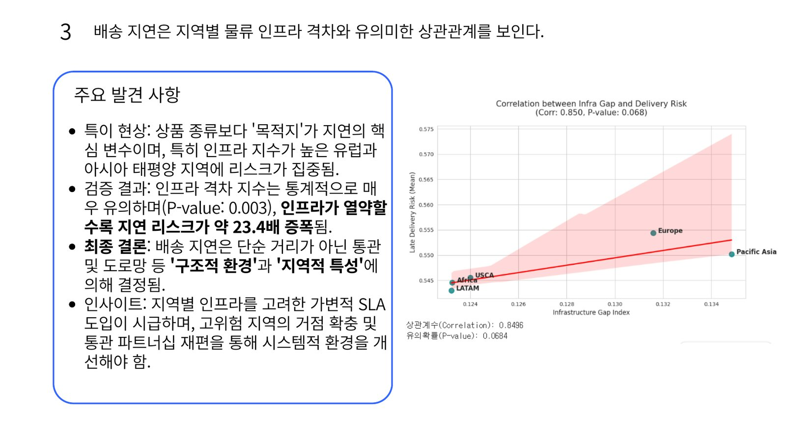

## Problem

글로벌 온라인 주문에서는 여러 요인으로 배송 지연이 생기고, 이는 고객 만족도 하락과 물류 비용 증가로 이어집니다. 주문 데이터만으로 배송 지연 가능성을 미리 예측하는 것이 목표였습니다.

## Data

2015~2018년 글로벌 e-커머스 주문 144,415건, 25개 피처(고객·주문 위치·상품·결제·할인율·수익). 각 주문의 배송 지연 위험 여부를 맞히는 이진 분류 문제로, 약 55%가 지연 위험으로 분류되어 있습니다.

## Features

- 주문 일시를 연·월·일·시·연중 일자와 시간의 sin/cos로 나눈 7개 피처
- 같은 카테고리의 3일간 주문량, 출발지·도착지 공휴일, 같은 국가/주/도시 여부
- 고객 위치 경위도 군집화 (50개 클러스터)

## Modeling

StratifiedKFold로 검증하고 LightGBM과 XGBoost를 비교했습니다. 같은 모델과 피처라도 폴드 분할 시드만 바꿔 두 번 학습해 섞었을 때 성능이 가장 안정적으로 올랐습니다.

- LightGBM 단독 0.9596 / XGBoost 단독 0.9529
- LightGBM + XGBoost 0.9604
- **LightGBM × 2 시드 0.9668** (OOF PR-AUC, 최고)

## Insights

- 카테고리별 주문 빈도와 지연율은 관계가 없었습니다. 일부 카테고리의 높은 지연율은 표본 부족에서 온 착시였습니다.
- 할인율, 주문 시기, 주문량도 지연 위험과의 관계가 약했습니다.
- 지연은 **목적지의 물류 인프라 격차**와 강하게 연결되어 있었습니다 (p = 0.003). 지역별 인프라를 고려한 가변 SLA와 고위험 지역 거점 확충을 제안했습니다.

## Next

기상·공휴일·항만 물동량 같은 외부 데이터 연동, XAI 기반 리포팅, 예측 결과를 배송 스케줄링에 바로 반영하는 실시간 파이프라인(MLOps)으로 확장할 수 있습니다.
