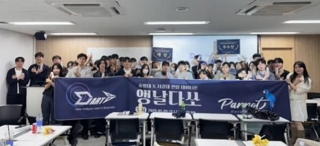

## Overview

중앙대 DArt-B와 서강대 PARROT이 함께 연 데이터톤 **앵날다쏘**에 참가했습니다. 주어진 과제는 DataCo Smart Supply Chain의 글로벌 주문 데이터로 각 주문의 **배송 지연 위험을 확률로 예측**하는 것이었습니다. 평가는 PR-AUC 점수(20점)만이 아니었습니다. 인사이트의 깊이와 스토리텔링(50점), 전처리·검증 전략의 체계성(20점)을 함께 보았기 때문에, 점수를 올리는 것만큼 "데이터에서 무엇을 읽어냈는가"가 중요했습니다.

## Problem & Data

글로벌 온라인 주문에서는 여러 요인으로 배송 지연이 생기고, 이는 고객 만족도 하락과 물류 비용 증가로 이어집니다. 그래서 주문이 들어오는 시점에 지연 가능성을 미리 알아내는 것을 목표로 잡았습니다.

데이터는 2015~2018년 글로벌 e-커머스 주문 144,415건입니다. 고객·주문 위치·상품·결제·할인율·수익 등 25개 피처가 있고 결측치는 없습니다. 각 주문의 지연 위험 여부를 맞히는 이진 분류 문제로, 약 55%가 지연 위험으로 분류되어 있습니다.

## EDA

가설을 세우고 하나씩 확인하는 방식으로 진행했습니다.

- **주문 수량:** 수량과 관계없이 고르게 분포했고, 지연과의 상관관계가 약했습니다. 다른 변수와 묶어 봐도 의미 있는 차이가 없었습니다.
- **주문 시간:** 요일·월별 차이는 작았습니다. 그런데 **낮 12시를 기준으로 지연율이 올라가는** 패턴이 보였습니다. 당일 출고 마감을 넘긴 주문이 다음 날로 밀리는 현상으로 해석했습니다.
- **휴일:** 크리스마스 지연율이 가장 높을 거라고 예상했는데, 실제로는 그렇지 않았습니다. 그래서 특정 휴일 하나가 아니라 **출발지와 도착지의 공휴일**을 함께 보기로 했습니다.

## Features

EDA에서 본 것을 바로 피처로 옮겼습니다.

- 주문 일시를 연·월·일·시·연중 일자와 시간의 sin/cos로 나눈 7개 피처
- 같은 카테고리의 3일간 주문량 (물량이 몰리는 정도)
- 출발지·도착지 공휴일 여부, 출발지와 배송지가 같은 국가/주/도시인지
- 고객 위치 경위도 군집화 (50개 클러스터)

## Insights

1. **"Golf 카테고리는 지연이 많다"는 착시였습니다.** 일부 카테고리의 지연율이 유독 높았지만, 주문 빈도와 지연율 사이에는 상관관계가 없었습니다. 표본이 적어서 생긴 통계적 착시이므로, 이 숫자만 보고 인프라 개선 우선순위를 정하면 안 된다고 결론 내렸습니다.
2. **할인·시즌·주문량은 지연에 거의 영향을 주지 않았습니다.** 할인 이벤트나 주문 폭주에도 지연 분포는 거의 그대로였습니다. 물류 시스템이 물량 변화에는 비교적 안정적으로 대응하고 있다는 뜻입니다.
3. **지연을 가르는 건 상품이 아니라 목적지였습니다.** 지역별 물류 인프라 격차가 지연과 통계적으로 유의하게 연결되어 있었습니다 (p = 0.003). 단순한 거리보다 통관, 도로망 같은 구조적 환경이 지연을 결정한다고 보았습니다.

이를 바탕으로 지역 인프라를 반영한 **가변 SLA(약속 배송일)** 도입과 고위험 지역 거점 확충, 통관 파트너십 재편을 제안했습니다.

## Modeling

- **검증: StratifiedKFold.** 모든 폴드에서 지연/정시 비율이 같게 유지되도록 나눴습니다. 144,415건 전체의 OOF 예측으로 PR-AUC를 하나로 계산했고, 폴드 간 변동은 ±0.0025로 안정적이었습니다.
- **주력 모델: LightGBM.** Order City, Order State처럼 값의 종류가 아주 많은 범주형 변수가 많았습니다. LightGBM은 범주를 타깃 평균 순으로 정렬해 최적의 분할점을 찾기 때문에 이 데이터에 잘 맞았습니다. 매 반복마다 검증 PR-AUC를 확인해서, 150라운드 동안 나아지지 않으면 학습을 멈추고 가장 좋았던 시점으로 되돌리게 해 과적합도 막았습니다.
- **비교 모델: XGBoost.** 단독 성능과 앙상블 효과를 비교하려고 함께 학습했습니다.

서로 다른 모델을 섞는 것보다, **같은 모델·같은 피처에서 폴드 분할 시드만 바꿔 두 번 학습하고 섞는 것**이 더 크게, 더 안정적으로 성능을 올렸습니다.

- LightGBM 단독 0.9596 / XGBoost 단독 0.9529
- LightGBM + XGBoost 0.9604
- **LightGBM × 2 시드 0.9668** (OOF PR-AUC, 최고)

## Why the Scores Were High

0.96대 PR-AUC는 처음엔 놀라운 숫자였지만, 저희 팀만의 결과가 아니었습니다. 대회용 데이터가 결측치 없이 이미 깔끔하게 정제·보정되어 있어서 **대부분의 팀이 비슷하게 높은 점수**를 받았습니다. 점수만으로는 팀 간 차이가 크게 나지 않는 구조였습니다.

그래서 점수를 0.001 더 올리는 것보다 두 가지에 집중했습니다. 하나는 폴드 변동성과 시드 앙상블로 "우연히 높게 나온 점수가 아님"을 보여주는 것, 다른 하나는 모델이 잘 맞힌다는 사실에서 멈추지 않고 "그래서 무엇이 지연을 만드는가"를 통계적으로 확인하는 것이었습니다. 데이터가 잘 정리되어 있을수록 차이를 만드는 건 점수가 아니라 해석이라는 걸 배웠습니다.

## Reflection

ML을 배우고 나서 처음 참가한 데이터 해커톤이었습니다. 12시간 동안 조원들과 같은 자리에 앉아 하나의 데이터만 붙잡고, 그래프를 그리고, 가설을 세웠다가 버리고, 다시 세우는 일을 계속 반복했습니다. 수업에서 모델을 배울 때와는 다르게, 실제로는 대부분의 시간이 "이 데이터가 무슨 말을 하고 있는가"를 묻는 데 쓰인다는 걸 몸으로 알게 됐습니다.

특히 주문 일시가 담긴 시간 데이터를 다루면서 **환경과 도메인 지식이 얼마나 중요한지** 실감했습니다. 12시 이후 지연율이 오르는 현상은 숫자만 봐서는 설명할 수 없었고, 물류센터에 당일 출고 마감이 있다는 걸 떠올리고 나서야 의미가 생겼습니다. 크리스마스에 지연이 몰릴 거라는 예상이 빗나갔을 때도, 물건이 출발하는 나라와 도착하는 나라의 달력이 다르다는 사실을 생각하고 나서야 피처를 다시 설계할 수 있었습니다. 같은 숫자라도 그 데이터가 만들어진 현실을 알아야 제대로 읽을 수 있었습니다.

피처를 하나씩 연결해 관계를 찾아가면서는 **데이터가 사회를 보여준다**는 걸 느꼈습니다. 처음엔 상품이나 할인 같은 주문 정보가 지연을 좌우할 거라고 생각했지만, 끝에 남은 답은 "어디로 가는가", 곧 지역 간 인프라 격차였습니다. 주문 한 건 한 건의 지연 기록이 모여서 물류망이 어느 지역에 덜 닿아 있는지를 드러내고 있었습니다. 이 데이터톤은 모델 점수보다, 데이터 너머의 현실을 읽는 법을 배운 경험으로 남았습니다.

## Next

기상·공휴일·항만 물동량 같은 외부 데이터 연동, XAI 기반 리포팅, 예측 결과를 배송 스케줄링에 바로 반영하는 실시간 파이프라인(MLOps)으로 확장할 수 있습니다.
