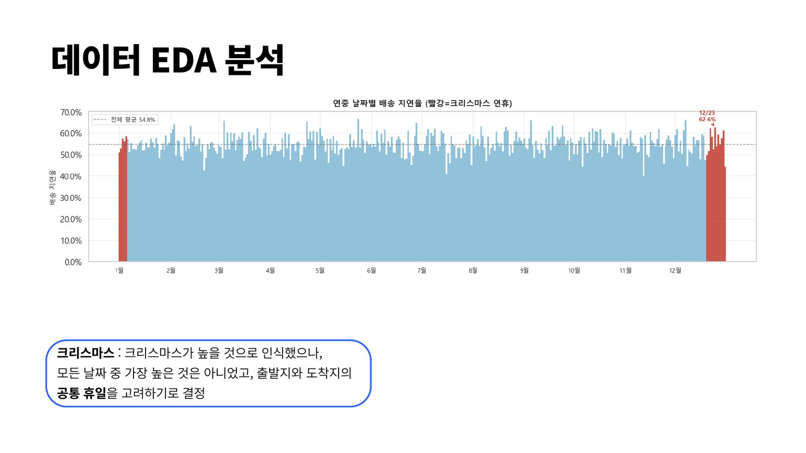
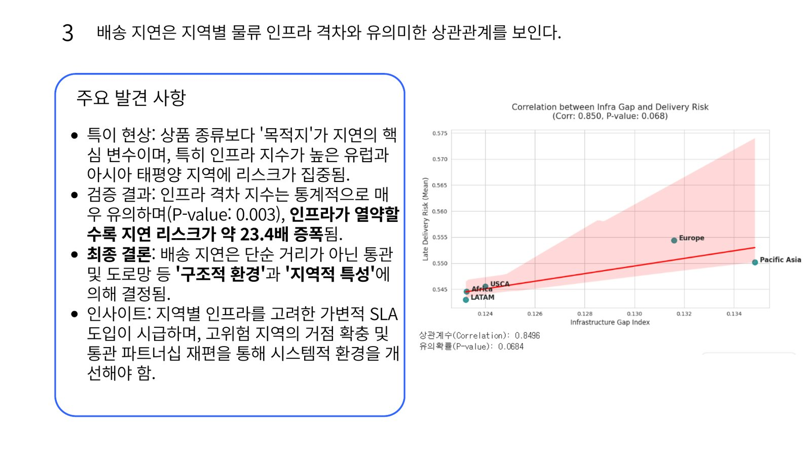
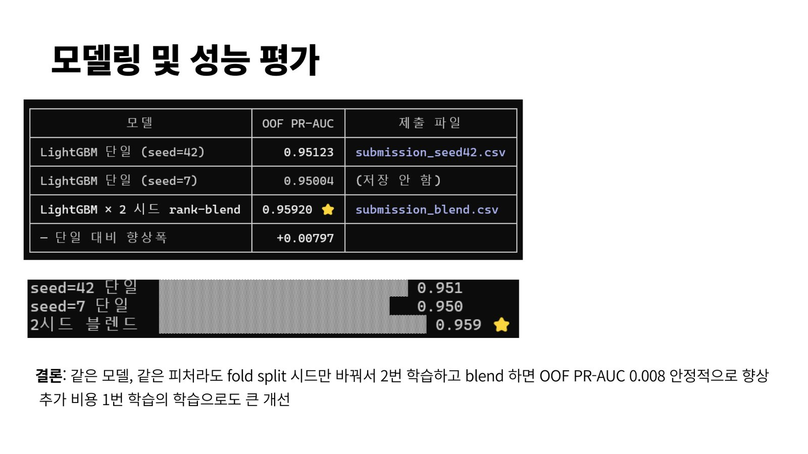

## Overview

중앙대 DArt-B와 서강대 PARROT이 함께 연 데이터톤 **앵날다쏘**(2026.05)에 참가했습니다. 주어진 과제는 DataCo Smart Supply Chain의 글로벌 주문 데이터로 각 주문의 **배송 지연 위험을 확률로 예측**하는 것이었습니다. 평가는 PR-AUC 점수(20점)만이 아니었습니다. 인사이트의 깊이와 스토리텔링(50점), 전처리·검증 전략의 체계성(20점)을 함께 보았기 때문에, 점수를 올리는 것만큼 "데이터에서 무엇을 읽어냈는가"가 중요했습니다.

## Problem & Data

글로벌 온라인 주문에서는 여러 요인으로 배송 지연이 생기고, 이는 고객 만족도 하락과 물류 비용 증가로 이어집니다. 그래서 주문이 들어오는 시점에 지연 가능성을 미리 알아내는 것을 목표로 잡았습니다.

데이터는 2015~2018년 글로벌 e-커머스 주문 144,415건입니다. 고객·주문 위치·상품·결제·할인율·수익 등 25개 피처가 있고 결측치는 없습니다. 각 주문의 지연 위험 여부를 맞히는 이진 분류 문제로, 약 55%가 지연 위험으로 분류되어 있습니다.

## EDA

가설을 세우고 하나씩 확인하는 방식으로 진행했습니다.

- **주문 수량:** 수량과 관계없이 고르게 분포했고, 지연과의 상관관계가 약했습니다. 다른 변수와 묶어 봐도 의미 있는 차이가 없었습니다.
- **주문 시간:** 요일·월별 차이는 작았습니다. 그런데 **낮 12시를 기준으로 지연율이 올라가는** 패턴이 보였습니다. 당일 출고 마감을 넘긴 주문이 다음 날로 밀리는 현상으로 해석했습니다.
- **휴일:** 크리스마스 지연율이 가장 높을 거라고 예상했는데, 실제로는 그렇지 않았습니다. 그래서 특정 휴일 하나가 아니라 **출발지와 도착지의 공휴일**을 함께 보기로 했습니다.

## Features

EDA에서 본 것을 바로 피처로 옮겼습니다.

- 주문 일시를 연·월·일·시·연중 일자와 시간의 sin/cos로 나눈 7개 피처
- 같은 카테고리의 3일간 주문량 (물량이 몰리는 정도)
- 출발지·도착지 공휴일 여부, 출발지와 배송지가 같은 국가/주/도시인지
- 고객 위치 경위도 군집화 (50개 클러스터)

## Insights

1. **"Golf 카테고리는 지연이 많다"는 착시였습니다.** 일부 카테고리의 지연율이 유독 높았지만, 주문 빈도와 지연율 사이에는 상관관계가 없었습니다. 표본이 적어서 생긴 통계적 착시이므로, 이 숫자만 보고 인프라 개선 우선순위를 정하면 안 된다고 결론 내렸습니다.
2. **할인·시즌·주문량은 지연에 거의 영향을 주지 않았습니다.** 할인 이벤트나 주문 폭주에도 지연 분포는 거의 그대로였습니다. 물류 시스템이 물량 변화에는 비교적 안정적으로 대응하고 있다는 뜻입니다.
3. **지연을 가르는 건 상품이 아니라 목적지였습니다.** 지역별 물류 인프라 격차가 지연과 통계적으로 유의하게 연결되어 있었습니다 (p = 0.003). 단순한 거리보다 통관, 도로망 같은 구조적 환경이 지연을 결정한다고 보았습니다.

이를 바탕으로 지역 인프라를 반영한 **가변 SLA(약속 배송일)** 도입과 고위험 지역 거점 확충, 통관 파트너십 재편을 제안했습니다.

## Modeling

- **검증: StratifiedKFold.** 모든 폴드에서 지연/정시 비율이 같게 유지되도록 나눴습니다. 144,415건 전체의 OOF 예측으로 PR-AUC를 하나로 계산했고, 폴드 간 변동은 ±0.0025로 안정적이었습니다.
- **주력 모델: LightGBM.** Order City, Order State처럼 값의 종류가 아주 많은 범주형 변수가 많았습니다. LightGBM은 범주를 타깃 평균 순으로 정렬해 최적의 분할점을 찾기 때문에 이 데이터에 잘 맞았습니다. 매 반복마다 검증 PR-AUC를 확인해서, 150라운드 동안 나아지지 않으면 학습을 멈추고 가장 좋았던 시점으로 되돌리게 해 과적합도 막았습니다.
- **비교 모델: XGBoost.** 단독 성능과 앙상블 효과를 비교하려고 함께 학습했습니다.

서로 다른 모델을 섞는 것보다, **같은 모델·같은 피처에서 폴드 분할 시드만 바꿔 두 번 학습하고 섞는 것**이 더 크게, 더 안정적으로 성능을 올렸습니다.

- LightGBM 단독 0.9596 / XGBoost 단독 0.9529
- LightGBM + XGBoost 0.9604
- **LightGBM × 2 시드 0.9668** (OOF PR-AUC, 최고)

## Why the Scores Were High

0.96대의 PR-AUC는 높은 수치지만, 대회에서 제공된 데이터가 결측치가 거의 없고 이미 상당 부분 정제와 보정이 되어있었어서 다른 팀들도 비슷하게 높은 점수를 기록했습니다. 즉, 점수 자체만으로는 팀 간 차이를 설명하기 어려운 환경이었습니다.

이를 파악한 뒤에 점수를 소폭 높이는 것보다 두 가지를 검증하는 데 집중했습니다. 첫째, 폴드별 성능 변동과 시드 앙상블을 통해 높은 점수가 특정 데이터 분할이나 초기 설정에 따른 우연한 결과가 아닌지 확인했습니다. 둘째, 모델의 예측 성능을 확인하는 데서 그치지 않고, 실제로 어떤 요인이 배송 지연과 관련되어 있는지 통계적으로 살펴보았습니다. 데이터가 잘 정제되어 있어 모델 점수만으로 차이를 만들기 어려울수록, 결과의 안정성을 검증하고 데이터가 담고 있는 현실을 해석하는 과정이 중요하다는 것을 배웠습니다. 다른 팀이 파나마 운하라는 물류 환경을 배경으로 데이터를 설명한 것도 인상 깊었습니다. 같은 데이터라도 어떤 도메인 지식과 맥락을 연결하느냐에 따라 결과를 전달하는 방식이 달라질 수 있다는 점을 확인했습니다.

## Reflection

ML을 배운 뒤 처음 참가한 데이터 해커톤이었습니다. 12시간 동안 팀원들과 같은 자리에 앉아 하나의 데이터를 붙잡고, 그래프를 그리고, 가설을 세웠다가 버리고, 다시 세우는 과정을 반복했습니다. 수업에서 모델을 배울 때와 달리 실제 분석에서는 모델을 적용하는 일만큼이나 데이터가 무엇을 말하고 있는지 질문하는 데 많은 시간이 필요하다는 것을 체감했습니다.

특히 주문 일시가 담긴 시간 데이터를 다루면서 **데이터를 제대로 해석하려면 그 데이터가 만들어진 환경과 도메인에 대한 이해가 필요하다**는 것을 배웠습니다. 12시 이후 지연율이 높아지는 현상은 숫자만으로는 설명하기 어려웠지만, 물류센터의 당일 출고 마감 시간을 떠올리고 나서야 그 의미를 이해할 수 있었습니다. 크리스마스에 지연이 집중될 것이라는 예상이 빗나갔을 때도 마찬가지였습니다. 상품이 출발하는 국가와 도착하는 국가의 공휴일이 서로 다를 수 있다는 점을 고려하면서 시간 관련 피처를 다시 설계할 수 있었습니다. 데이터에 나타난 패턴을 그대로 받아들이기보다, 그 현상이 발생한 현실적인 이유를 함께 살펴야 한다는 것을 알게 되었습니다.

피처를 하나씩 연결하고 변수 간 관계를 살펴보면서는 **데이터가 사회의 구조를 보여줄 수 있다**는 점도 인상 깊었습니다. 처음에는 상품이나 할인과 같은 주문 정보가 배송 지연에 큰 영향을 미칠 것이라고 예상했습니다. 하지만 분석을 이어가며 주목하게 된 것은 주문이 향하는 지역이었습니다. 지역별 지연 양상을 살펴보면서 배송 지연이 개별 주문의 문제가 아니라, 지역에 따라 다르게 형성된 물류 인프라와도 연결될 수 있다는 점을 발견했습니다. 주문 한 건 한 건의 기록이 모여 지역 간 물류 환경의 차이를 드러낼 수 있다는 사실이 흥미로웠습니다. 이 데이터 해커톤은 모델의 점수를 높이는 데서 그치지 않고, 데이터 너머에 있는 현실의 구조를 읽어 보는 경험으로 남았습니다.

## Next

이번 분석을 외부 환경 데이터와 연결해 배송 지연의 원인을 더 입체적으로 살펴볼 수 있습니다. 기상 정보, 국가별 공휴일, 항만 물동량 등을 추가하면 기존 주문 데이터만으로 설명하기 어려웠던 지연 요인을 보완할 수 있습니다. 나아가 XAI 기반 리포팅으로 예측 결과에 영향을 미친 요인을 사용자에게 설명하고, 예측 결과를 배송 스케줄링에 반영하는 실시간 파이프라인으로 확장할 수 있습니다.
