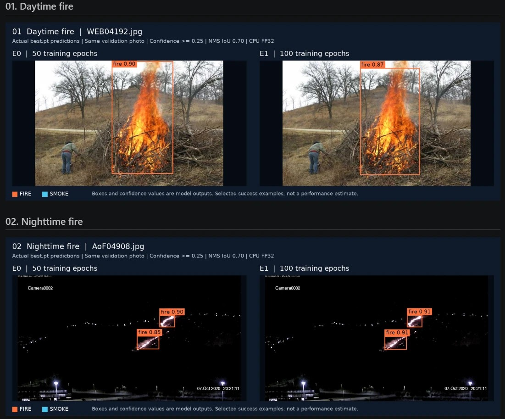
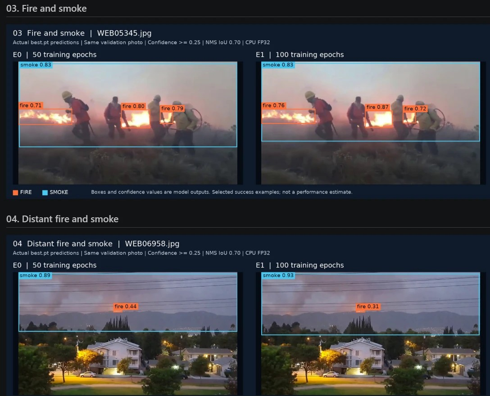
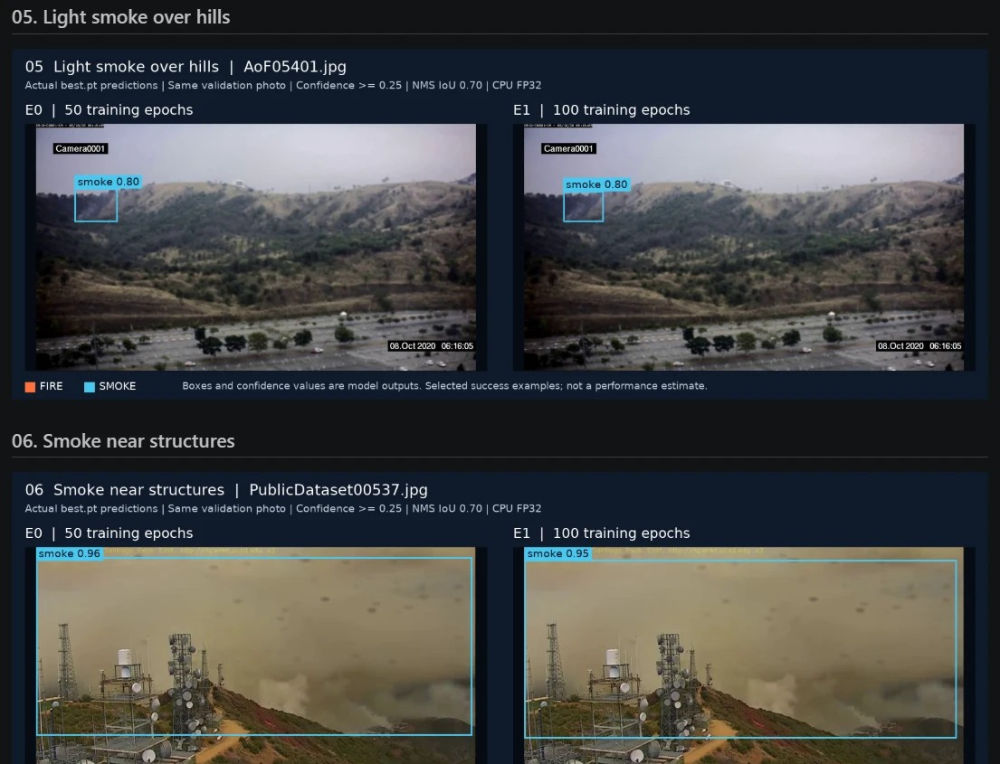
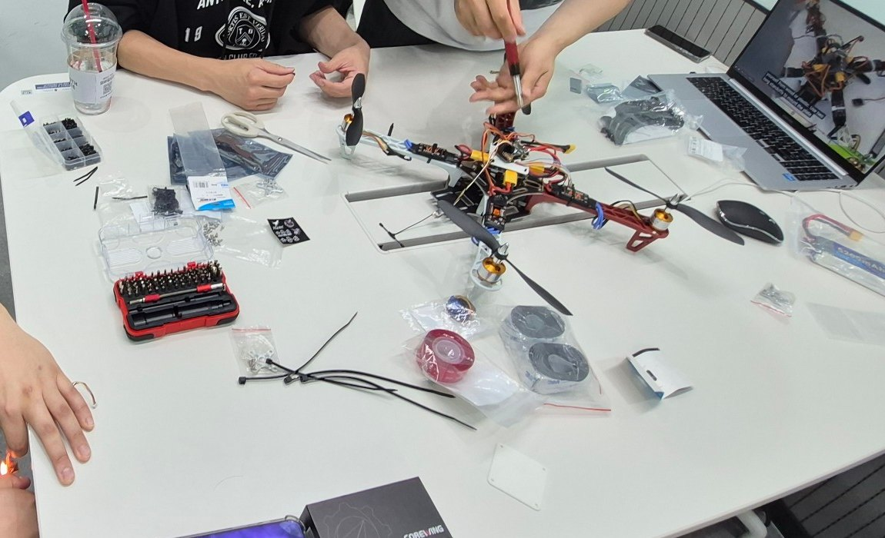

## Overview

**현재 진행 중인 프로젝트입니다.** 아래는 지금까지 진행한 내용이며, 결과가 나오는 대로 이어서 업데이트할 예정입니다.

데이터사이언스 학회 PARROT과 기계공학 학회 MECA가 함께하는 연합 프로젝트입니다. 두 학회가 화재를 찾는 AI와 드론 기체를 함께 만들어, 하나의 드론으로 완성해 가고 있습니다.

YOLOv8n 모델로 이미지 속 불꽃과 연기를 탐지하고, 어떤 학습 조건에서 탐지 성능이 좋아지는지 확인하는 프로젝트입니다. 모델 하나를 학습시키는 데서 그치지 않고, 학습 횟수 · 학습률 · 데이터 증강 · 입력 해상도를 바꿔 가며 성능과 처리 비용이 어떻게 달라지는지 분석하는 것이 핵심입니다. 이렇게 고른 모델을 드론에 연결해, 화재 지점에 소화 페이로드를 투하하는 것까지가 목표입니다.

YOLO는 이미지에서 물체의 종류와 위치를 함께 찾아내는 모델입니다. 그중 YOLOv8n은 비교적 가벼운 모델이라, 드론처럼 연산 자원이 제한된 환경에서 쓸 가능성을 고려해 골랐습니다. 우선은 저장된 이미지와 영상으로 학습과 평가를 진행합니다.

## Planning

운영진으로 프로젝트를 기획하면서, 드론 항공 시점의 통제 소각 영상인 FLAME 데이터셋과 YOLOv8m으로 화재 탐지 예시를 먼저 만들어 보았습니다. 데이터 구성부터 학습, 스마트폰 영상을 노트북으로 받아 프레임마다 탐지하는 실시간 추론까지 직접 해 보며 흐름을 잡았고, 이 예시를 조원들이 참고할 수 있도록 공유했습니다.

## Data

화재·연기 탐지용 공개 데이터셋인 [D-Fire](https://github.com/gaia-solutions-on-demand/DFireDataset)를 사용합니다. 총 21,527장으로, 불꽃과 연기가 있는 이미지뿐 아니라 둘 다 없는 이미지도 들어 있습니다. 불꽃과 연기가 없는 이미지가 필요한 이유는, 모델이 평범한 장면을 화재로 잘못 판단하지 않는지 확인해야 하기 때문입니다.

공식 분할 목록을 기준으로 데이터를 나눴습니다.

- **학습 13,776장** — 모델이 불꽃과 연기의 특징을 배우는 데 사용
- **검증 3,445장** — 학습 조건을 비교하고 좋은 모델을 고르는 데 사용
- **테스트 4,306장** — 최종 모델을 확정한 뒤 성능을 평가하는 데 사용

학습 전에는 이미지와 정답 라벨이 제대로 짝지어져 있는지, 박스 좌표에 오류가 없는지, 분할 사이에 중복 이미지가 없는지 검사했습니다. 발견한 라벨 오류는 원본을 그대로 두고 따로 보정본을 만들어 처리했습니다.

## Experiments

1. **기본 모델** — COCO로 사전학습된 YOLOv8n을 D-Fire에 맞게 50 epoch 추가 학습해, 이후 실험의 기준을 만듭니다.
2. **학습 횟수 비교** — 다른 조건은 그대로 두고 50 epoch와 100 epoch를 비교해, 더 오래 학습하면 좋아지는지, 학습 데이터에만 지나치게 맞춰지지는 않는지 확인합니다.
3. **학습 조건 비교** — 학습률, 밝기·채도와 Mosaic 같은 데이터 증강, 입력 해상도를 하나씩 바꿔 봅니다. 한 번에 하나의 조건만 바꿔 성능 변화의 원인을 분명히 합니다.
4. **좋은 조건 조합** — 검증 데이터에서 효과가 있었던 조건들을 묶어 새 모델을 학습합니다. 모든 실험은 같은 COCO 사전학습 가중치에서 새로 시작해 비교를 공정하게 유지합니다.
5. **최종 평가** — 검증 결과로 최종 모델과 탐지 기준값을 확정한 뒤 테스트 데이터로 평가합니다. 테스트 결과를 보고 학습 조건을 다시 고르지 않는 것이 중요합니다.

평가는 탐지 위치와 종류의 정확성을 함께 보는 **mAP50-95**를 주요 기준으로 삼고, 실제 불꽃을 놓치지 않는지 보는 **Fire Recall**과 화재가 없는 이미지에서의 **오탐지**도 함께 확인합니다. 정확도뿐 아니라 학습 시간, 추론 속도, GPU 메모리 사용량도 재서 성능을 높이는 데 드는 비용까지 분석합니다. Hugging Face에 공개된 화재·연기 탐지 모델을 참고 기준으로 씁니다.

같은 검증 사진에서 50 epoch(E0)와 100 epoch(E1) 모델이 실제로 예측한 결과입니다. 성능을 추정한 값이 아니라, 모델이 잘 잡아낸 예시를 고른 것입니다.

## Drone

소프트웨어 팀이었지만 드론 조립에도 함께 참여했습니다. 프레임과 모터, 변속기, 배터리를 연결하고, 모터와 프로펠러가 제대로 도는지 확인한 뒤 운동장에서 첫 시험 비행을 했습니다.

## Pipeline

탐지 모델을 실제 드론 제어와 연결하기 위해, 전체 흐름을 이렇게 구상했습니다.

- **YOLO 모델** — 영상에서 불의 위치를 찾음
- **노트북 제어 코드** — 탐지 결과로 이동·투하 명령을 만듦
- **ESP32** — 명령을 무선으로 받아 비행 컨트롤러(FC)와 서보에 전달
- **FC (INAV)** — 설정에 따라 균형을 잡고 명령대로 이동
- 투하는 FC를 거치지 않고 노트북 → ESP32 → 서보로 바로 전달

통신은 휴대폰 핫스팟에 노트북과 ESP32를 함께 접속시키는 방식으로 하고, 서보는 켜질 때 항상 닫혀 있다가 투하 명령을 받았을 때만 한 번 열리도록 해 연결이 끊겨도 멋대로 열리지 않게 했습니다.

**자동 투하 조건**은 AI가 '불'이라고 꽤 확신할 때(confidence 0.5 이상부터 시작), 그 상태가 1초 이상 이어질 때만 투하하고, 한 번 투하하면 다시 잠그는 방식입니다.

실험은 두 단계로 나눴습니다.

- **1차 실험** — 사람이 불 근처까지 조종하고, 투하만 자동으로. 모델 확인 → 투하 장치 단독 확인 → 탐지와 투하 연결 → 드론 장착(프로펠러 없이) → 실제 비행(빈 장치 → 가벼운 더미 → 물 조금) 순서로 진행하며, 불이 있을 때와 없을 때의 점수, 높이별 탐지, 투하 성공·실패·오탐 횟수, 떨어진 위치가 불에서 얼마나 벗어났는지를 기록합니다.
- **2차 실험** — 화면에 불이 보이면 불을 화면 가운데로 맞추도록 자동으로 이동한 뒤 자동 투하. 영상 지연 때문에 드론이 불을 지나쳤다가 흔들릴 수 있어, 천천히 조금씩 움직이고 불을 놓치면 바로 멈추도록 설계합니다.

지금은 1차 실험을 앞두고 있습니다.

## Role

- 운영진으로 프로젝트를 기획하고, 조원들이 참고할 화재 탐지 예시를 먼저 만들어 공유
- 소프트웨어 팀으로 데이터 전처리와 모델링에 참여
- 드론 조립과 시험 비행에 함께 참여
- 탐지 모델과 드론 제어를 잇는 파이프라인과 단계별 실험 계획을 구상해 팀에 공유
