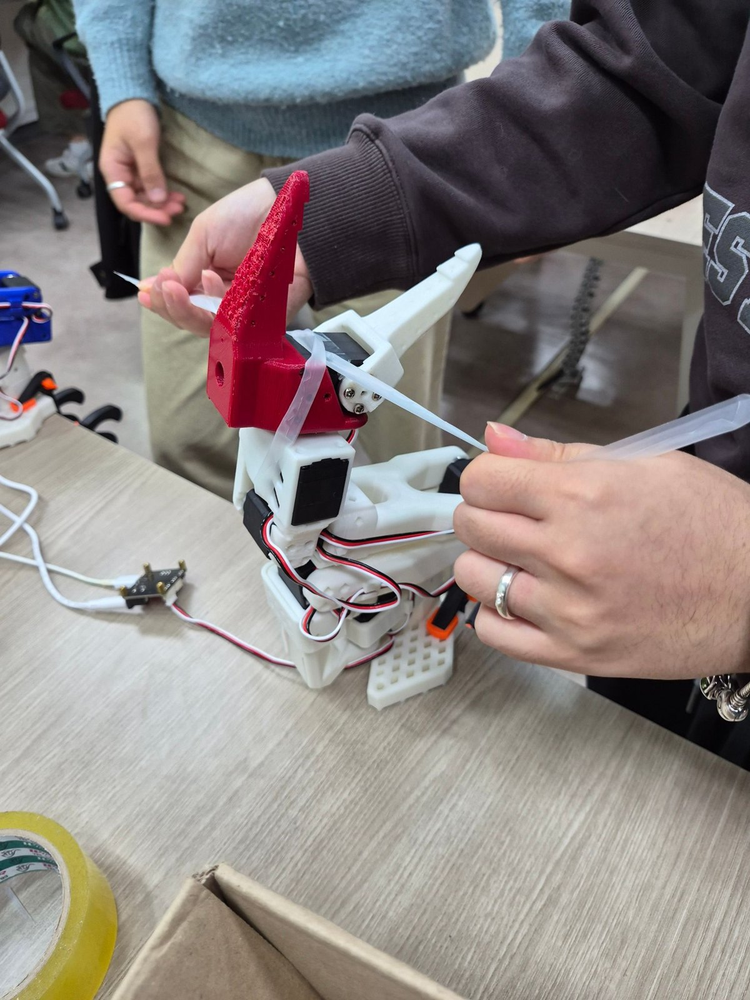
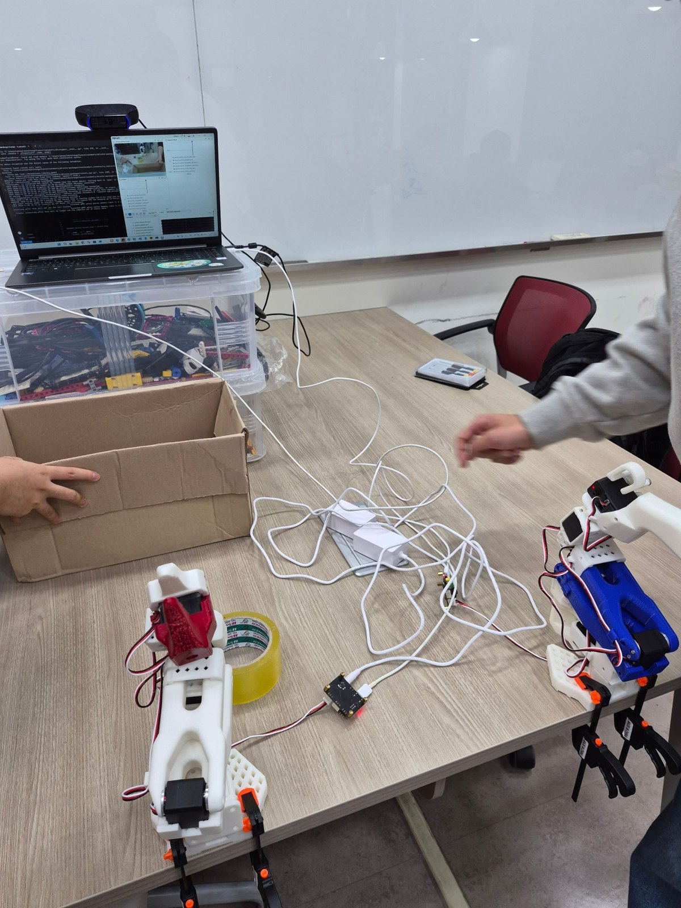
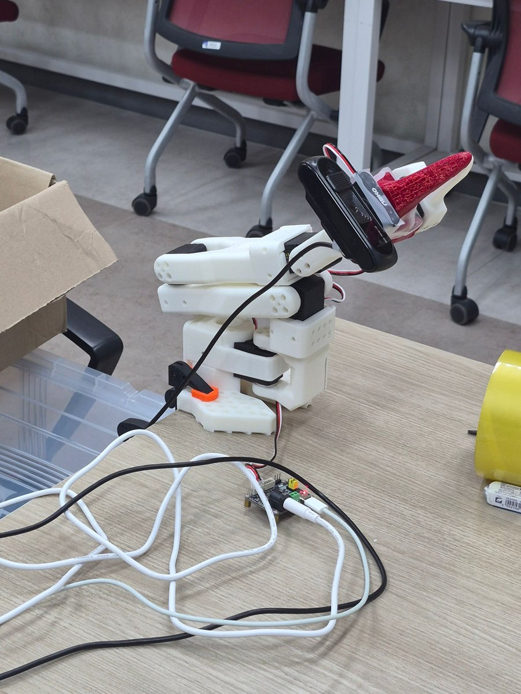
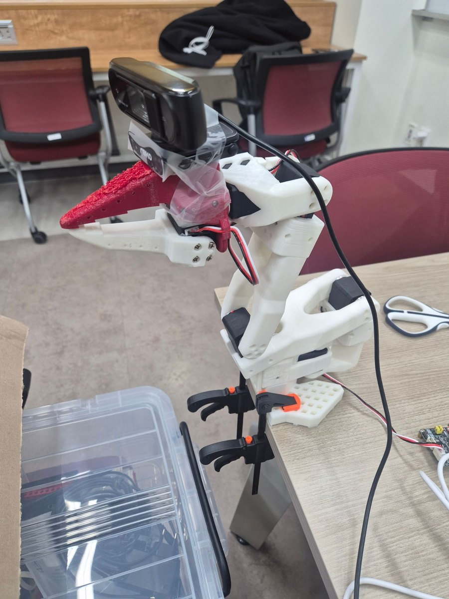
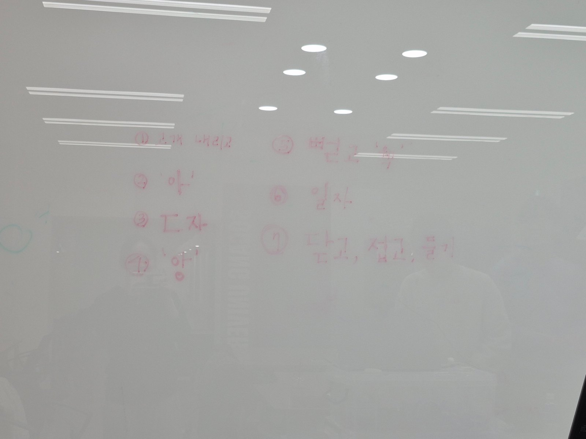
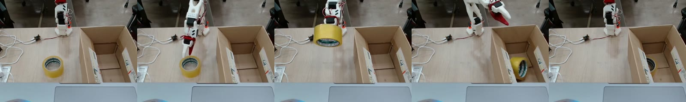

## Overview

데이터사이언스 학회 PARROT과 기계공학 학회 MECA가 연합해, 로봇 팔을 직접 만들고 사람의 시연을 보고 배우게 하는 과정을 처음부터 끝까지 진행했습니다. 목표는 로봇이 카메라로 책상 위의 노란 테이프와 바구니를 인식하고, 사람의 시연을 딥러닝 모델로 학습해 **스스로 테이프를 집어 바구니에 넣게 하는 것**이었습니다.

- 로봇: SO-101 팔로워 + 리더 (사람이 리더를 움직이면 팔로워가 그대로 따라 움직임)
- 학습: LeRobot의 ACT(Action Chunking with Transformers)
- 작업 문장: *Grab the yellow tape and put in the basket*

## Build

공개된 [SO-ARM100](https://github.com/TheRobotStudio/SO-ARM100) 설계를 참고해, 서강대학교 메이커스랩에서 팔의 부품을 모두 직접 3D 프린팅했습니다. 출력한 부품을 조립하고, 관절마다 들어가는 모터 6개를 하나씩 연결했습니다.

조립과 모터 연결을 마친 뒤, 사람이 리더 팔을 움직이면 팔로워가 그대로 따라 움직이는지부터 확인했습니다. 아직 학습하기 전의 모습입니다.

## Why ACT

ACT 논문을 참고해, 왜 이 방법을 쓰는지부터 정리했습니다.

- **물리 모델링 대신 시연을 보고 배운다** — 마찰이나 물체 모양을 수식으로 모델링하는 대신, 카메라 이미지와 현재 관절 상태를 보고 다음 동작을 바로 예측합니다(End-to-End Imitation Learning). 작업마다 모델을 새로 세울 필요가 없어 단순하고 실용적입니다.
- **한 걸음씩 예측하면 오차가 쌓인다** — 다음 한 동작만 계속 예측하면 작은 오차가 걸음마다 누적되고, 사람의 시연도 매번 속도와 궤적이 달라 학습이 어렵습니다.
- **그래서 동작을 묶음으로 예측한다(Action Chunking)** — 앞으로 K걸음의 동작을 한 번에 예측해, 오차가 쌓일 틈을 줄입니다.
- **사람마다 다른 시연은 CVAE로** — 같은 상황에서도 다른 시연의 '스타일'을 잠재 변수로 따로 학습하고, 실행할 때는 그 값을 0으로 두어 가장 평균적인 동작을 냅니다.
- **겹쳐서 매끄럽게(Temporal Ensemble)** — 매 순간 새로 예측한 동작들을 가중 평균해, 움직임을 부드럽게 이어 갑니다.

## First attempt

처음에는 모두 처음 해 보는 일이라, 사람마다 시연하는 방향도 시간도 제각각이었습니다. 그렇게 학습한 로봇은 테이프 쪽으로 움직이기만 할 뿐, 집지는 못했습니다. 무엇이 문제였는지 하나씩 따져 봤습니다.

1. **영상의 65%가 정지 화면** — 녹화 시간을 넉넉히 잡다 보니 멈춰 있는 장면이 대부분이었고, 로봇은 '가만히 있는 법'을 배웠습니다.
2. **카메라 위치** — 카메라를 로봇 손목에 달았더니 시작 자세에서 바구니가 보이지 않았습니다. 카메라가 한 대라면 위에서 내려다보는 3인칭 시점이 더 중요했습니다.
3. **캘리브레이션 오류(추정)** — 모터 하나가 인식되지 않거나 각도 설정이 어긋나 있었습니다.

## Second attempt

실패 원인을 하나씩 고쳐 다시 시작했습니다.

- **캘리브레이션 다시 하기** — 모터 6개가 모두 인식되는지 확인하고, 초기값과 최소·최대 각도를 새로 잡았습니다. 오차가 11도 안쪽으로 줄어 전보다 안정적으로 움직였고, 인식되지 않던 모터 문제도 해결했습니다. 윈도우에서도 카메라와 모터가 모두 정상으로 동작하는 것을 확인했고, 케이블은 데이터 전송이 되는 C to C 케이블이면 된다는 것도 알게 되었습니다.
- **카메라 고정** — 앞쪽 위에서 약 45°로 내려다보게 두고, 테이프 위치와 바구니, 그리퍼가 한 화면에 모두 보이게 했습니다. 클램프로 고정해 녹화부터 실행까지 절대 옮기지 않았고, 조명도 일정하게 유지했습니다.
- **녹화 설정** — 30fps, 640×480. 에피소드는 최대 30초, 실제 작업은 15~20초를 목표로 하고 끝나면 바로 다음으로 넘겼습니다. 세션이 끝나면 정지 프레임 비율이 15% 아래인지 확인했습니다.
- **시연을 매번 같게** — 시작 자세를 하나로 정하고, 잡는 방식도 매번 같게 했습니다. 바닥에 마스킹 테이프로 테이프 위치와 바구니, 시작 자세를 표시했고, 실패한 시연은 바로 버리고 다시 찍었습니다.

원 논문은 물체 위치를 5곳으로 바꿔 가며 각 10번씩, 총 50개의 시연(각 8~12초)을 권장합니다. 저희는 먼저 한 위치에서 10번 이상 찍어 학습해 보는 것을 목표로 했습니다.

녹화는 "Recording episode" 신호가 나오면 바로 잡기 → 넣기 → 시작 자세로 돌아오기까지 시연하고, 리셋 시간에는 테이프를 표시한 자리에 다시 놓는 흐름으로 진행했습니다.

## Results

15개 시연과 30개 시연으로 각각 학습한 모델을 실제 로봇에서 비교했습니다.

- **15개 시연 모델** (chunk 100, 50k step) — 한 화면으로만 녹화. 실물 로봇에서 성공
- **30개 시연 모델** (chunk 30 · 50 · 100, 100k step) — 녹화 도중 카메라가 약 35px 움직여 두 화면이 섞임. 성공 모델에는 미치지 못함

시연이 두 배 많은 30개 모델보다, 한 화면으로 깨끗하게 찍은 15개 모델이 실제로 작업에 성공했습니다. 성공한 뒤에는 학습 때와 달리 테이프를 세워 둬도 알아보고 집을 수 있을지 궁금해서 따로 시험해 봤습니다.

- 학습: ACT 기본 설정(ResNet18, CVAE), A100 1장에서 50k step 약 35분
- 실행: 윈도우 노트북 CPU에서 한 번에 40초. 예측에 0.1~0.25초가 걸려 그동안 팔이 멈칫하므로, 예측한 동작 묶음을 끝까지 실행하도록 맞춰 끊김을 줄였습니다.

## Role

소프트웨어 팀으로 캘리브레이션과 시연 녹화, 학습과 실행을 함께 진행했고, 3D 프린팅과 조립도 같이 했습니다.

## Learnings

그동안 저는 주로 소프트웨어 쪽, 그중에서도 딥러닝에 관심을 두고 공부해 왔습니다. 화면 안에서 모델을 학습시키고 점수를 확인하는 일에는 익숙했지만, 학습한 모델로 실제 몸을 가진 로봇을 움직여 보는 것은 이번이 처음이었습니다. 부품을 3D 프린팅하고 모터를 하나씩 연결하면서, 코드가 관절 각도와 케이블, 카메라 위치 같은 물리적인 조건과 맞물려야 비로소 로봇이 움직인다는 것을 알게 되었습니다.

**모라벡의 역설**(사람에게 쉬운 일은 기계에게 어렵고, 기계에게 쉬운 일은 사람에게 어렵다)을 이번에 정말 실감했습니다. 사람에게는 눈 감고도 할 수 있는 테이프 하나 집기가, 로봇에게는 몇 달 동안 데이터와 캘리브레이션을 다듬어야 겨우 해낼 수 있는 일이었습니다. 그 과정에서 기계는 어떤 일을 맡아야 하고, 사람은 어디에 남아야 하는지를 자주 생각하게 되었습니다.

딥러닝에 관심 있는 사람으로서 가장 크게 남은 것은 데이터에 대한 감각입니다. 15개 시연 모델과 30개 시연 모델을 비교해 보니, 시연이 두 배 많은 모델보다 같은 카메라 시점과 같은 시작 자세로 깔끔하게 찍은 모델이 실제로 작업에 성공했습니다. 학습 데이터는 많이 모으는 것보다 깨끗하게 모으는 것이 더 중요하다는 것을, 실물 로봇 앞에서 직접 확인했습니다.

처음 학습한 로봇이 테이프 쪽으로 움직이기만 하고 아무것도 집지 못했을 때는 막막했습니다. 하지만 거기서 멈추지 않고, 영상의 65%가 정지 화면이었다는 것, 카메라가 바구니를 보지 못했다는 것, 캘리브레이션이 어긋나 있었다는 것을 하나씩 찾아 고쳐 나갔습니다. 한계에 부딪혔을 때 계속 도전하되, 왜 실패했는지를 먼저 따져 보는 것이 결국 성공으로 가는 길이라는 것을 배웠습니다.

무엇보다 함께한 시간이 기억에 남습니다. 1학기 중순부터 여름방학에도 꾸준히 학교에 나와 팀원들과 로봇을 만들었고, 닭을 닮은 모습에 '계봇'이라는 이름까지 붙여 줄 만큼 모두가 정을 들이며 열심히 했습니다. 그렇게 만든 계봇이 혼자 테이프를 집어 바구니에 넣었을 때, 함께 보낸 시간이 하나의 결과로 이어졌다는 것이 무척 뿌듯했습니다.
