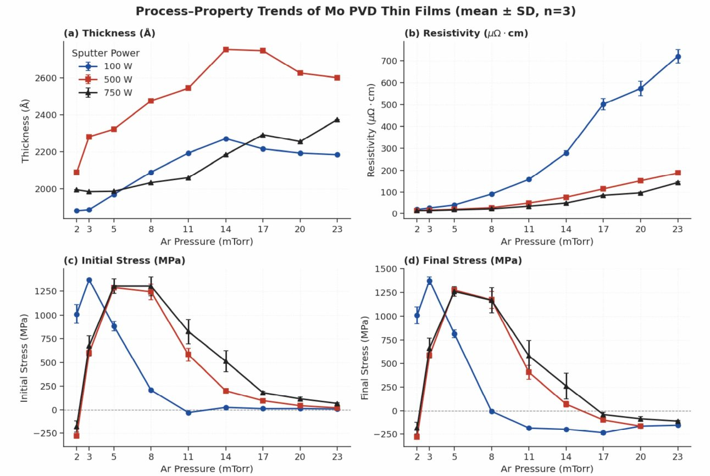
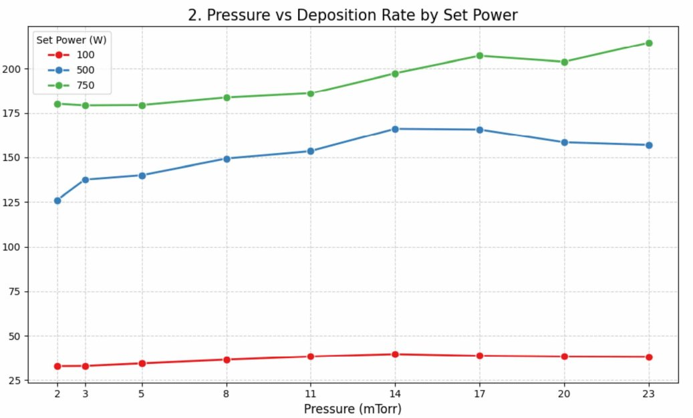
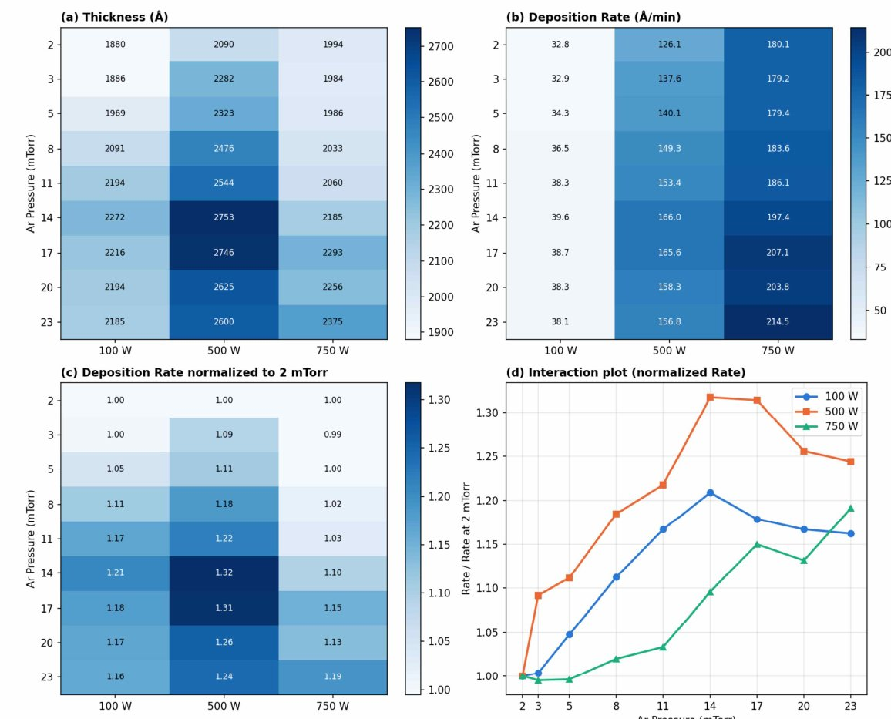
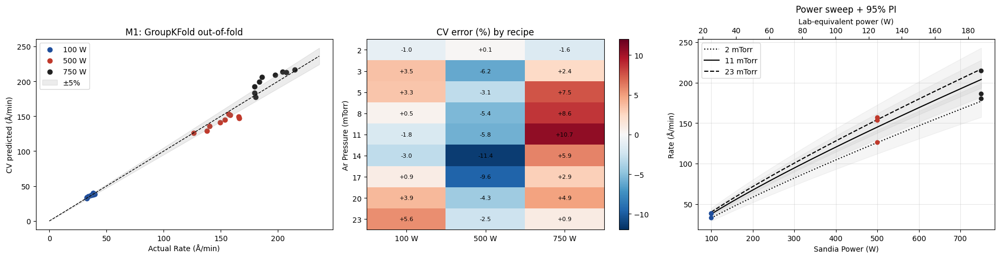
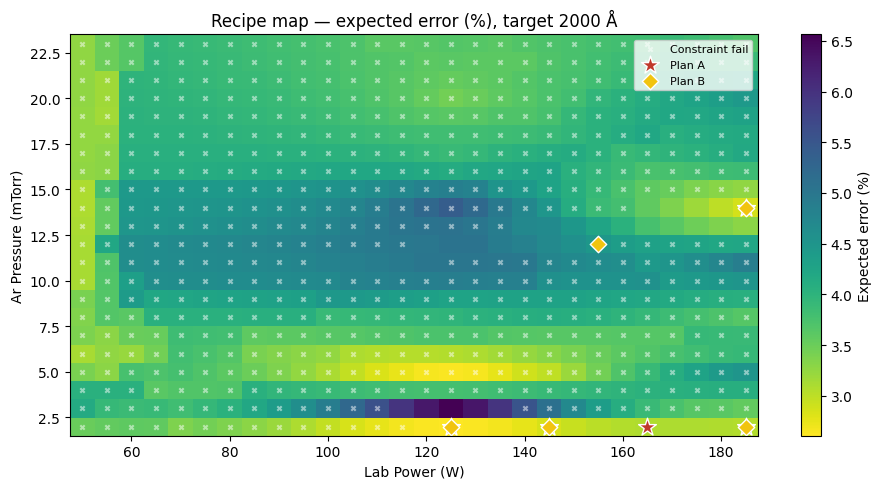

## Overview

**현재 진행 중인 프로젝트입니다.** 아래는 지금까지 진행한 내용이며, 결과가 나오는 대로 이어서 업데이트할 예정입니다.

반도체 공정에서 금속 박막을 입히는 마그네트론 스퍼터링은, 전력(Power)과 아르곤 압력(Ar Pressure)에 따라 막이 쌓이는 속도가 달라집니다. 이 프로젝트는 미국 Sandia 연구소가 공개한 Mo(몰리브덴) 스퍼터링 데이터로 **증착속도를 예측하는 모델**을 만들고, 그 예측으로 서강대학교 나노팹센터에서 실제로 증착할 레시피를 정한 뒤, 실측값과 비교하며 모델을 다듬어 가는 연구입니다.

데이터사이언스 학회 PARROT과 화학공학 학회 PRIME이 함께 진행하고 있습니다. 저는 리드이자 소프트웨어 팀으로 데이터 분석과 모델링을 맡고 있습니다.

## Research flow

1. **데이터 이해 (EDA)** — 공정 메커니즘을 기준으로 데이터가 상식적인 경향을 보이는지부터 점검
2. **모델 비교와 선정** — 정확도와 함께 물리적으로 말이 되는지를 기준으로 10개 모델 비교
3. **PRIME 검수 → 수정** — 공정 전문가 관점의 피드백을 받아 모델 수정(v1.5)
4. **Round 1 레시피 설계** — 모델로 실험할 레시피를 고르고, 공통 실험 조건의 예측값 제출
5. **실측 비교 → 보정 → Round 2** — 지금 이 단계를 앞두고 있습니다

## 1. Data

Sandia의 공개 데이터는 100 · 500 · 750 W, 2~23 mTorr 조건의 27개 레시피(레시피마다 웨이퍼 3장)입니다. 분석을 시작하기 전에 '정상이라면 이래야 한다'는 체크리스트를 증착 메커니즘을 근거로 먼저 정하고, 데이터를 그 기준에 비춰 봤습니다.

- 사전에 정한 정상 경향 17개 중 **16개를 충족**했습니다.
- Stoney 식을 거꾸로 풀어 곡률 · 두께 · 응력 기록이 서로 맞는지 행마다 점검했고, 오류 후보는 지우지 않고 표시만 해 두었습니다.
- 웨이퍼 3장은 한 번에 함께 증착되어 두께를 공유하므로, 분석 단위를 81행이 아니라 **27개 레시피**로 정했습니다.
- 증착속도는 설정 Power보다 실측 Power(V×I)에 더 비례했고, 압력의 효과는 Power에 따라 모양이 달랐습니다(Power × Pressure 상호작용). 고압에서는 비저항이 10~37배까지 커져, 빨리 쌓인다고 좋은 조건은 아니었습니다.

## 2. Model

10개의 후보(물리식 · 통계 · 머신러닝)를 같은 기준으로 비교했습니다. 정확도만 보지 않고, Power가 커지면 증착속도도 커지는지, 곡선이 매끄러운지, 데이터에 없던 Power에서도 일관된지 같은 **물리적 관문**을 먼저 통과해야 후보로 남겼습니다.

- **MLP** — 전체 정확도는 좋았지만 실제로 쓸 2 mTorr에서 오차가 7~8%였고, 시드에 따라 예측이 흔들렸습니다.
- **2차 다항식** — 중간 압력에는 강했지만 2 mTorr 오차가 8.7%였고, Power² 항을 검증할 방법이 없었습니다.
- **M1 Power-law** (`Rate = A × Power^b × Pressure^c`) — 레시피를 고를 저압 구간에서 가장 정확했고(1.2%), 새 Power로도 검증할 수 있으며, 계수 3개라 설명과 재현이 쉬워 최종 모델로 골랐습니다.

학습한 식은 **Rate = 0.648 × Power^0.839 × Pressure^0.083** 입니다. 학습에 쓰지 않은 레시피를 맞히는 교차검증에서 **R² 0.983, 평균 오차 6.3 Å/min(상대 오차 4.4%)** 였고, 같은 레시피의 웨이퍼가 학습과 검증에 나뉘어 들어가지 않도록 데이터 누수도 따로 점검했습니다.

## 3. Feedback

모델을 혼자 만들고 끝내지 않고, 화학공학 학회 PRIME 팀과 주고받으며 다듬고 있습니다. PARROT이 모델과 예측값을 정리해 보내면, PRIME이 공정 관점에서 검수 의견을 주고, 그 의견을 반영해 다시 보내는 흐름을 처음부터 정해 두었습니다.

첫 검수에서 받은 의견은 두 가지였습니다.

- **압력 효과** — 압력이 커진다고 증착속도가 계속 커지지는 않아서, power-law가 압력 효과를 다 담지 못할 수 있다는 의견. 실제로 쓸 저압 구간은 오차가 작아 그대로 두되, 중간 압력 이상은 따로 보완하기로 했습니다.
- **장비 환산** — 두 장비의 타겟 크기만으로 전력밀도를 맞추면 부족하고, 실제 증착속도는 웨이퍼까지 도달한 양으로 정해진다는 의견. 타겟과 웨이퍼 사이 거리(T/S distance) 같은 장비 구조를 반영한 보정계수 K를 넣고, 실측값으로 K를 다시 맞추도록 바꿨습니다.

의견을 받은 다음 날 새벽에 수정한 **v1.5**를 보냈습니다. 2~4 mTorr는 M1을 그대로 쓰고, 5 mTorr 이상은 M1이 남긴 오차를 가우시안 프로세스(GP)로 보정하는 하이브리드로, 중간 압력 구간의 오차를 **7.0% → 2.7%**로 줄였습니다. 데이터가 없는 Power에서는 하이브리드도 나아지지 않는다는 한계도 함께 공유했습니다. 이후 비대면 브리핑으로 결과를 같이 확인하고 레시피를 제출했고, 서로 시험 일정과 통학 시간까지 맞춰 가며 의견을 계속 나누고 있습니다.

## 4. Round 1

v1.5로 서강대학교 나노팹센터 장비에서 2000 Å을 증착할 **추천 레시피 Top 5**를 골랐습니다. 다섯 개 모두 막 품질(비저항 · 응력) 기준을 통과하는 가장 낮은 압력인 2 mTorr로 고정하고, Power는 110 · 125 · 140 · 155 · 188 W로 서로 15 W 이상 떨어뜨려 서강대 장비의 Power 의존성을 다음 라운드에서 보정할 수 있게 했습니다. 그중 125 W와 188 W는 Sandia 500 · 750 W와 전력밀도가 같아, 장비 환산 계수를 직접 확인하는 기준점으로 삼았습니다.

이어서 두 학회가 함께 정한 **공통 실험 조건 6개**의 예측값과 95% 범위를 냈습니다. 팀원 셋이 각자 돌린 값이 모두 같은 것을 확인한 뒤 공유했고, 보정계수 K가 실측 전 추정값이라는 점과 200 W 두 조건이 학습 범위 밖이라는 점을 함께 표시했습니다.

- 100 W / 16 mTorr — 34.7 Å/min (31.7~38.0)
- 200 W / 16 mTorr — 59.5 Å/min (55.9~63.3)
- 100 W / 3 mTorr — 30.0 Å/min (26.8~33.6)
- 200 W / 3 mTorr — 53.7 Å/min (47.8~60.2)
- 150 W / 8 mTorr — 45.9 Å/min (42.0~50.1)
- 125 W / 8 mTorr — 41.2 Å/min (39.4~43.0)

## Next

지금은 나노팹센터에서 나올 **Round 1 실측값을 기다리고** 있습니다. 앞으로는 이렇게 이어 갈 계획입니다.

1. Round 1 실측값으로 보정계수 K와 압력 · Power 보정값을 다시 맞춤
2. 여러 압력의 실측 결과를 반영해 압력 효과를 더 정확히 담은 다음 모델로 **Round 2** 레시피를 설계하고 실험
3. Round 2 실측값과 예측을 비교해 모델이 실제 장비에서도 맞는지 검증
4. 최종적으로, 조건을 넣으면 증착속도와 필요한 증착 시간을 바로 알려 주는 **시뮬레이션 툴**로 정리
