## Overview

Sogang Intelligence의 논문 스터디입니다. KAIST AI 대학원 정지혁 선배님이 이끄는 스터디에서 공학 대학원생·학부생분들과 함께 최신 논문을 읽고 돌아가며 발표합니다. 스터디는 매주 열리고, 저는 격주로 발표를 맡고 있습니다. 지금 제가 공부하고 있는 분야는 **생성(Generation)** 과 **증강 LLM(Augmented LLM)** 이고, 그 흐름에 맞춰 다섯 편의 논문을 세 번에 나눠 발표했습니다.

1. **RAPO** — 관계 그래프에서 모델이 잘 아는 표현을 찾아 텍스트-비디오 프롬프트를 재구성 (Generation)
2. **VISTA** — 생성한 영상을 직접 보고 비평해 프롬프트를 스스로 고치는 비디오 생성 에이전트 (Generation)
3. **NapMem** — 에이전트가 구조화된 기억을 능동적으로 탐색하는 방법 (Memory-augmented LLM)
4. **Search Arena** — 검색이 붙은 LLM에 대한 실제 사용자의 선호 (Search-augmented LLM)
5. **ShareChat** — 실제로 공유된 대화로 본 서비스별 LLM 사용 방식

처음에는 여러 에이전트가 협력해 카드뉴스를 만드는 멀티 에이전트 시스템(MAS)을 연구했지만, LLM 분야의 기초부터 먼저 다지기로 하면서 지금의 스터디 방향으로 옮겨 왔습니다.

## Talk 1 — Beyond Simple Prompts (RAPO · VISTA)

**RAG와 피드백 루프를 통한 Text-to-Video 고도화.** 두 논문이 같은 문제를 서로 다른 시점에서 푸는 방식이라, 한 발표에서 묶어 비교했습니다.

### 문제 — 짧은 프롬프트와 비디오 모델 사이의 격차

사용자는 "사람이 스쿠터를 탄다"처럼 짧고 추상적으로 입력하지만, 비디오 생성 모델은 시각적 완성도·움직임·일관성을 살리려면 훨씬 구체적인 프롬프트가 필요합니다. 핵심 과제는 **텍스트와 고차원 시공간 비디오 생성 모델 사이의 의미 격차를 줄이는 자동 프롬프트 최적화**입니다.

기존 방법에는 두 가지 한계가 있었습니다.

- **한 번에 LLM으로 다시 쓰기** — 비디오 모델이 무엇을 표현하기 어려워하는지 모른 채 텍스트만 늘립니다. 길고 복잡해진 프롬프트가 오히려 성능을 떨어뜨리기도 합니다.
- **결과를 보지 않음** — 영상을 확인하지 않고 프롬프트를 고정하기 때문에 모션 왜곡, 프레임 튐 같은 시각적 결함을 고칠 수 없습니다.

그래서 T2V 프롬프트 고도화는 **생성 전 지식 보강(RAPO)** 과 **결과 기반 수정(VISTA)** 이 함께할 때 완성된다는 관점으로 두 논문을 읽었습니다.

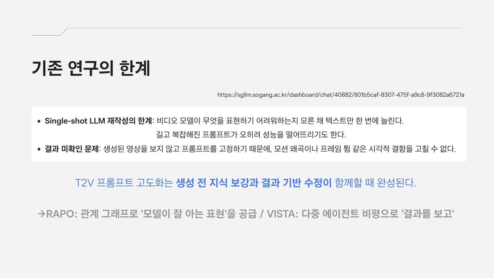

### RAPO — Retrieval-Augmented Prompt Optimization

**생성 전에 개입합니다.** 텍스트 단계에서 모든 처리가 끝나고, 목표는 프롬프트를 비디오 모델의 학습 데이터와 같은 어휘·문장 형식·길이에 맞추는 것입니다.

1. **단어 보강** — 학습 프롬프트로 만든 관계 그래프(장면 → 주체·행동·분위기)에서 관련 수식어를 검색해 붙이고("on a city street", "wearing a helmet"), Refactoring LLM이 문장을 다시 구성합니다.
2. **지시문 재작성** — 동시에 LLM이 사용자 입력을 바로 다시 씁니다.
3. **선택** — Discriminator LLM이 두 결과 중 더 나은 프롬프트를 골라 T2V 모델로 보냅니다. Refactoring·Discriminator LLM은 LLaMA 3.1에 LoRA로 파인튜닝했습니다.

결과는 LaVie 총점 80.89% → 82.38%, **다중 객체 37.71% → 64.86%**, Latte 총점 77.03% → 79.97%, 다중 객체 29.55% → 52.78%였습니다. 흥미로운 점은 **길게 쓰면 손해**라는 것입니다. GPT-4로 다시 쓰면 LaVie 총점이 오히려 79.69%로 떨어졌고(human action은 95.80% → 83.80%), 프롬프트 길이가 학습 데이터 분포에 가까울 때 성능이 가장 높았습니다.

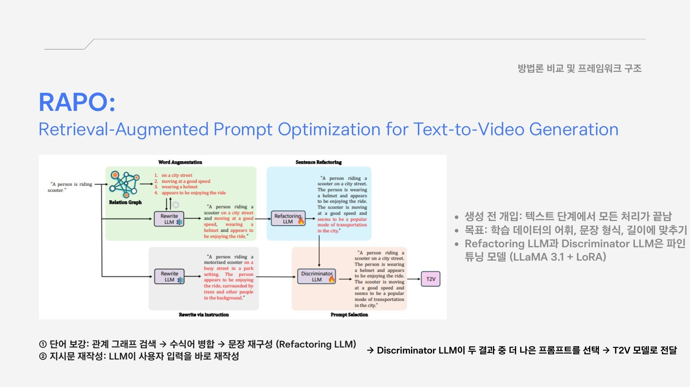
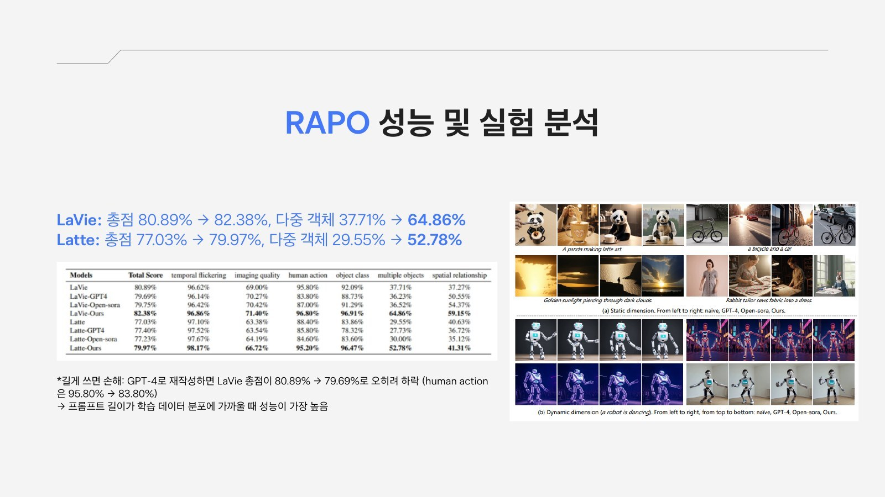

### VISTA — A Test-Time Self-Improving Video Generation Agent

**생성 후에 개입합니다.** 만든 영상을 직접 보고 프롬프트를 고치며, 별도 학습 없이 상용 모델(Veo 3 + Gemini 2.5 Flash)에 그대로 적용합니다.

1. **구조화 기획** — 장면마다 9개 속성으로 프롬프트를 설계합니다.
2. **이진 토너먼트** — 후보 영상을 둘씩 비교해 가장 좋은 영상을 고릅니다.
3. **다차원 멀티 에이전트 비평(MMAC)** — 시각·음향·문맥 세 차원에서, 일반 판사(+)와 적대적 판사(−)의 의견을 메타 판사가 저울질하는 삼항 비평을 합니다.
4. **프롬프트 수정** — Deep Thinking Prompting Agent가 6단계 추론으로 프롬프트를 고치고 다음 반복으로 넘어갑니다.

반복할수록 승률이 꾸준히 올라 single-scene은 35.5 → 45.9, multi-scene은 37.8 → 46.3이 되었고, VSR·VSR++·Rewrite·VPO와 1:1로 비교한 모든 회차에서 앞섰습니다. 20회 반복 시 VSR++가 36.1%에서 요동칠 때 VISTA는 57.1%까지 꾸준히 올랐습니다. 사람 평가에서는 **66.4%가 VISTA 결과를 선호**했고, 약한 모델(Veo 2)에서도 효과가 있었습니다. 반면 일반 판사만 쓰면 multi-scene 승률이 17.2%로 무너지고 적대 판사만 쓰면 18.8%에서 멈춰, **두 판사를 함께 쓰는 구성**이 핵심이었습니다.

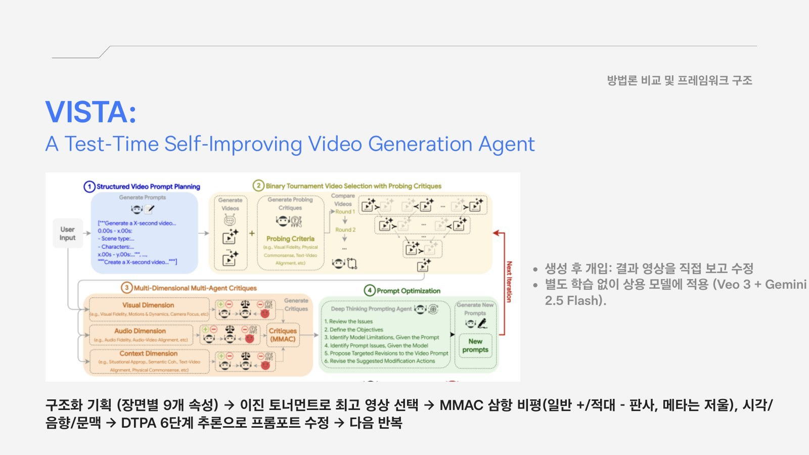
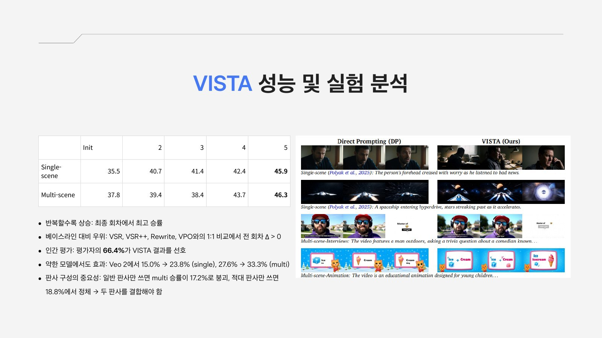

### 두 논문 비교와 한계

- **개입 시점** — RAPO 생성 전 / VISTA 생성 후(반복)
- **결과 영상 확인** — RAPO X / VISTA O
- **학습 필요** — RAPO 학습 프롬프트 DB + 파인튜닝 / VISTA 불필요
- **적용 대상** — RAPO 학습 데이터를 아는 모델(LaVie, Latte) / VISTA 블랙박스 상용 모델(Veo 3)
- **평가** — RAPO VBench 등 정량 벤치마크 / VISTA MLLM 판정 + 인간 평가
- **비용** — RAPO 낮음 / VISTA 높음

실험 모델과 평가 방식이 달라 수치는 직접 비교할 수 없습니다. 기존 베이스라인은 결과를 보지 않아(Rewrite, VPO) 물리 법칙 위배를 놓치거나, 피드백이 얕아(VSR) "매우 성공적"이라고 평가한 영상의 이동 방향 오류도 못 잡았습니다. 두 논문의 한계도 분명했습니다.

- **RAPO의 적용 범위** — 대상 모델의 학습 프롬프트 DB와 LLM 2개 파인튜닝이 필요해, 학습 데이터가 비공개인 상용 모델에는 쓰기 어렵습니다.
- **VISTA의 비용** — 반복 1회에 영상 약 28개, 토큰 약 70만 개를 씁니다.
- **MLLM 평가의 신뢰성** — 같은 결과도 판정 모델에 따라 승률이 45.9%에서 93.3%까지 달라졌고, 최적화와 판정을 모두 Gemini가 맡아 자기 선호 편향 가능성도 있습니다.

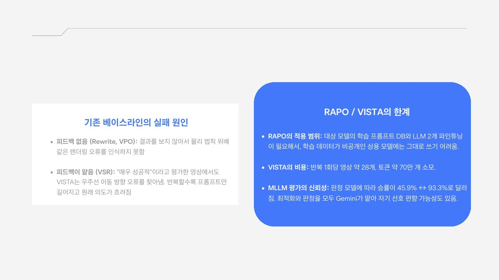

### My Insight — 두 방식을 하나의 루프로

두 논문은 경쟁 관계가 아니라 **서로의 빈자리를 채운다**고 봤습니다. RAPO는 결과를 보지 못하고, VISTA는 매번 처음부터 비싸게 시작합니다. 그래서 제가 실제로 AI 영상을 만들 때 쓸 수 있는 파이프라인으로 둘을 엮어 제안했습니다.

1. **사전 기획 (RAPO 방식)** — 사용자 입력으로 프롬프트 DB를 검색해 장면별로 구조화된 프롬프트를 만듭니다.
2. **생성** — 실제 영상 생성 도구(힉스필드)로 후보 영상을 여러 개 만듭니다.
3. **사후 비평 (VISTA 방식)** — 토너먼트로 고르고 시각·맥락을 비평해 프롬프트를 고칩니다. 판정 기준은 작업 목적에 맞게 직접 정의합니다.
4. **축적** — 이긴 프롬프트를 DB에 저장해 다음 사전 기획의 검색 재료로 씁니다.

이렇게 하면 상용 모델의 학습 데이터를 몰라도 RAPO처럼 "모델이 잘 아는 표현"을 내 작업 안에서 점점 쌓을 수 있고, VISTA의 비싼 반복도 회차가 쌓일수록 줄일 수 있습니다. 판정 모델에 따라 결과가 크게 흔들린다는 한계를 봤기 때문에, 판정 기준을 사람이 정하도록 남겨 둔 것도 의도한 부분입니다.

## Talk 2 — NapMem

**From Passive Retrieval to Active Memory Navigation: Learning to Use Memory as a Structured Action Space.** 기억을 단순히 검색해 오는 지식 창고가 아니라, 에이전트가 **직접 움직이며 탐색하는 행동 공간**으로 다루는 논문입니다.

### 문제 — 수동적 검색의 한계

"갤럭시 S22와 델 XPS 13 중 무엇을 먼저 샀지?" 같은 질문에, 기존 시스템은 기억을 한 번 검색해 넘겨줄 뿐이라 "사용자가 둘 다 가지고 있다"는 정보만으로는 답하지 못합니다. NapMem 에이전트는 기억 도구로 원본 대화까지 찾아 내려가 "XPS 13은 1월 28일 주문·2월 25일 도착, S22는 2월 20일 수령"이라는 증거를 확인하고 답합니다.

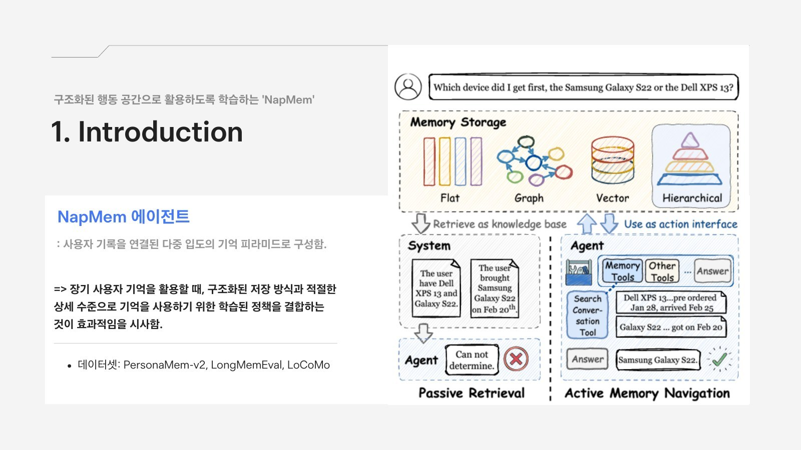

### 방법 — 기억 피라미드와 능동 탐색

사용자 기록을 **입도(granularity)가 다른 4단계 기억 피라미드**로 구성합니다.

- **원본 대화(Raw Conversations)** — 증거 수준의 검증용
- **기억 기록(Memory Records)** — 간결한 사실과 선호를 유형별로 정리
- **주제 트랙(Topic Tracks)** — 세션을 넘나드는 주제별 집계
- **사용자 프로필(User Profile)** — 안정적인 사용자 수준 정보

에이전트는 Read File, Get/Search Records, Get/Search Conversation 같은 기억 도구로 피라미드를 오르내리며 중간 증거를 확인하고 답을 정교하게 다듬습니다. 어떤 수준까지 내려갈지를 정하는 **정책을 학습**하는 것이 핵심이고, PersonaMem-v2, LongMemEval, LoCoMo로 실험했습니다.

### 결론과 한계

장기 사용자 기억을 쓸 때는 **구조화된 저장 방식**과 **적절한 상세 수준을 고르는 학습된 정책**을 함께 써야 효과적이라는 것이 결론입니다. 한계로는 세 가지를 짚었습니다.

- **실제 환경과의 괴리** — 기존 벤치마크로는 실제의 다양하고 복잡한 개인화 요구를 다 담지 못합니다.
- **프라이버시와 삭제** — 개인정보 보호와 '잊혀질 권리'에 대한 구체적인 대응이 없습니다.
- **규모에 따른 검증** — 모델 크기에 따라 최적의 기억 접근 전략이 어떻게 달라지는지 추가 분석이 필요합니다.

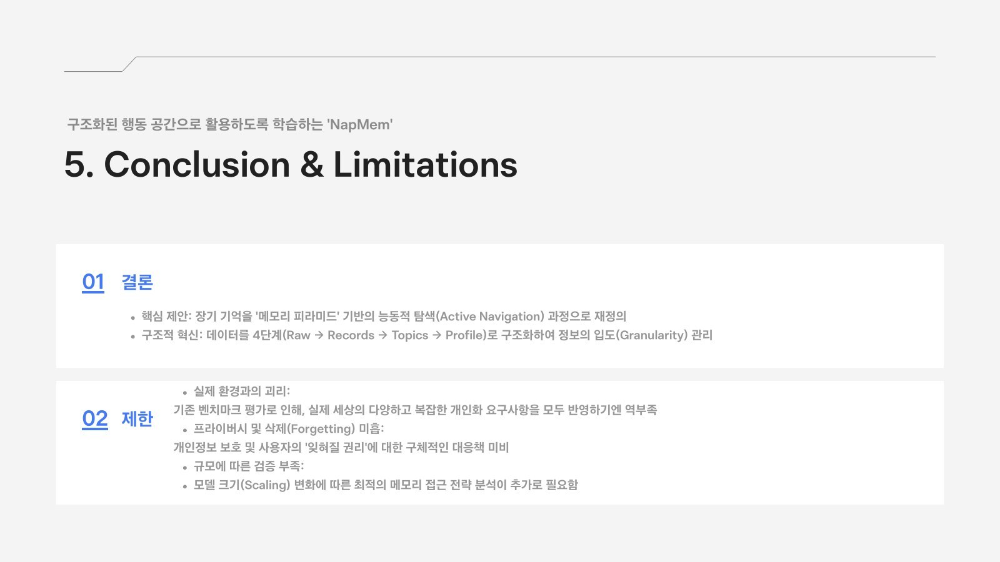

### My Insight

기억이 많아질수록 "무엇을 기억하느냐"보다 **"어디까지 꺼내 보느냐"** 가 중요하다는 점이 가장 인상 깊었습니다. 요약된 프로필만 보면 빠르지만 틀릴 수 있고, 원본 대화까지 내려가면 정확하지만 비쌉니다. 사람도 기억이 헷갈릴 때 메모나 대화 기록을 다시 찾아보듯, 에이전트가 확신이 없을 때만 더 아래 층으로 내려가게 하는 것이 개인화 AI의 현실적인 설계라고 느꼈습니다. 동시에 기억을 더 깊이 쌓을수록 잊혀질 권리를 어떻게 보장할지가 기술보다 먼저 답해야 할 질문이 된다고 생각했습니다.

## Talk 3 — Search Arena · ShareChat

**실제 사용자는 AI를 어떻게 쓰는가.** 벤치마크가 아닌 실제 사용 데이터를 다룬 두 논문을 함께 읽고, 세 가지 질문으로 발표를 구성했습니다.

- **Q1.** 사용자는 어떤 답을 좋아하는가? — Search Arena
- **Q2.** 서비스마다 사용 방식은 어떻게 다른가? — ShareChat
- **Q3.** 두 데이터는 무엇을 보여 주고 무엇을 놓치는가? — 두 논문 비교

### Search Arena (ICLR 2026)

**배경.** SimpleQA(4,326개)나 BrowseComp(1,266개)는 단일 언어·단일 턴에 짧은 정답만 평가해, 실제 검색 사용을 담지 못했습니다. Search Arena는 71개 언어, 멀티턴을 포함한 **대화 24,069개와 사용자 투표 12,652개**를 모았습니다.

**사용자 의도.** 검색 질문 중 **사실 조회는 19.3%** 뿐이었습니다. 나머지는 정보 종합, 분석, 추천, 설명, 창작처럼 더 복합적인 요청이었습니다.

**방법.** 익명의 두 답변을 비교하는 쌍대 투표를 Bradley-Terry 모델로 분석해 모델 강도와 답변 특성의 계수를 추정했습니다. 전문가와 사용자의 판단 일치율은 68%로, 무작위(50%)보다는 높지만 주관성이 남아 있어 인과가 아닌 관련성으로만 해석했습니다.

**결과.**

- 사용자는 **길고(β=0.334) 인용이 많은(β=0.209)** 답을 선호했습니다.
- 그런데 **주장을 지지하는 인용(0.29)과 무관한 인용(0.27)의 계수가 거의 같았습니다.** 인용이 정확한지보다 인용이 있다는 사실 자체가 선호에 영향을 줄 수 있다는 뜻입니다.
- 검색의 효과는 질문마다 달랐습니다. 사람 평가에서 Search Arena는 검색 선호 40% vs 비검색 29%(p=0.009)였지만 Text Arena에서는 차이가 없었고, 사실 조회에서는 두 환경 모두 검색이 유리했지만 텍스트 처리에서는 비검색이 유리한 경향이 있었습니다. 시험 점수로 봐도 SimpleQA는 검색이 도움이 됐고 ArenaHard에서는 비검색이 더 높았습니다.

**한계.** 투표는 정답이 아니라 선호입니다. 사실성과 인용-주장 일치도를 함께 재는 객관적 지표, 사람의 선호를 근사하는 오프라인 자동 평가, 언제 검색하고 언제 내부 지식에 기댈지 정하는 검색 정책이 향후 과제로 남았습니다.

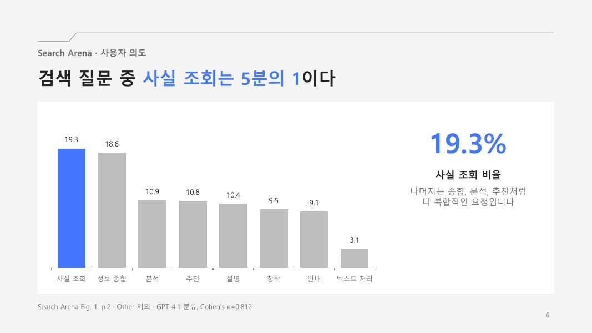
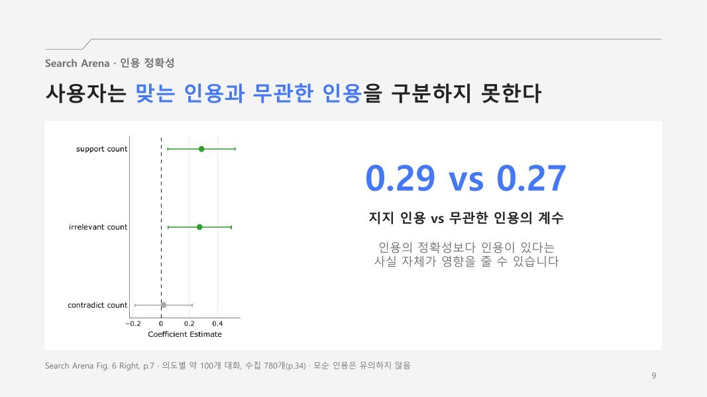
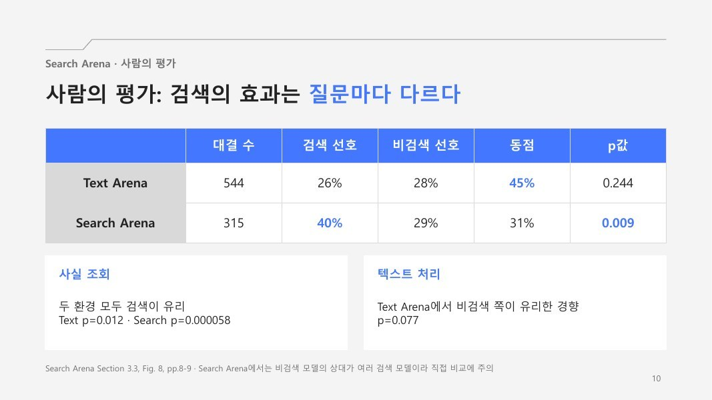

### ShareChat

**데이터.** 사용자가 공유 URL로 공개한 실제 대화 **142,808개(660,293턴)** 를 2023년 4월부터 2025년 10월까지 모았습니다. WildChat, LMSYS-Chat-1M보다 대화가 길고(평균 4.62턴) 답변도 길며(평균 1,115토큰), 95개 언어를 담았습니다. ChatGPT·Perplexity·Grok·Gemini·Claude 다섯 서비스마다 출처, 추론 기록, 턴별 시간, 모델 버전처럼 남는 정보가 달랐습니다.

**결과.**

- **사용 주제** — 서비스마다 맡기는 일이 달랐습니다. 평균 정보 찾기 비중은 39.6%였지만 **Perplexity는 63.3%** 로 가장 높았습니다.
- **대화 완전성** — 요청이 완전히 해결된 비율은 Claude 88%, ChatGPT 83%, Gemini 77%, Grok 74%, Perplexity 67%로 달랐습니다. 다만 Claude는 표본이 작고, Perplexity의 답은 중간 단계일 수 있다는 점을 함께 짚었습니다.
- **출처 활용** — Grok은 X(40,624건)에, Perplexity는 Wikipedia·Reddit·NIH 등 여러 출처에 기댔습니다.
- **응답 시간** — 대화가 길어질수록 ChatGPT는 빨라지고(ρ=−0.427) Grok은 느려져(ρ=0.254) 정반대였습니다.

**한계.** 사용자가 공유할 대화를 직접 고르는 선택 편향, ChatGPT 70% 이상·Claude 1% 미만의 서비스 불균형, 영어 중심으로만 사람이 검증한 LLM 판정이 남아 있습니다.

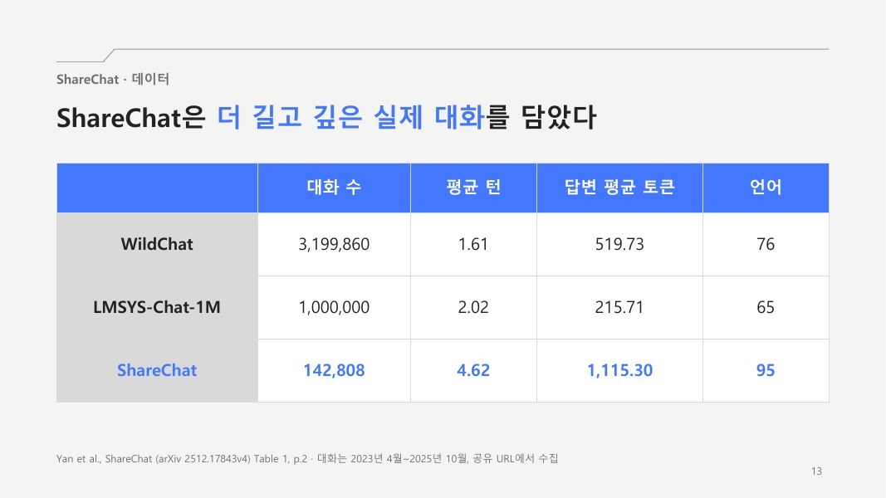
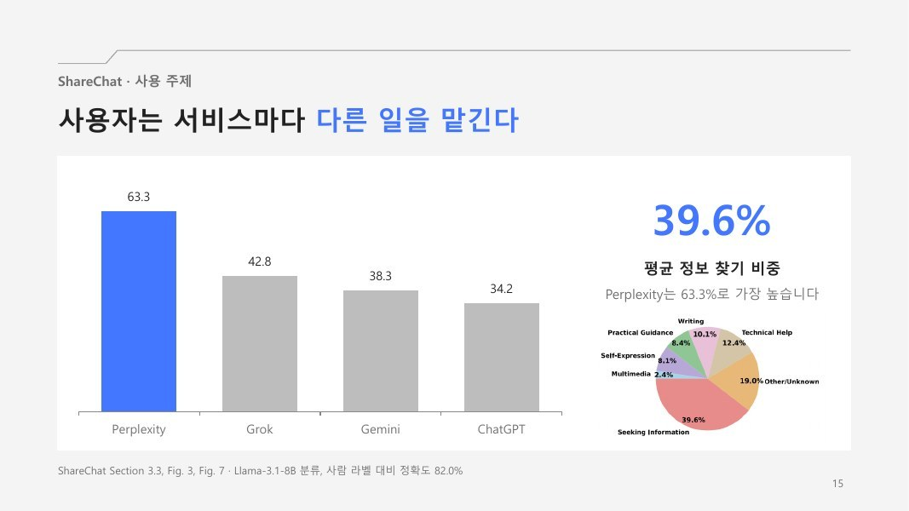

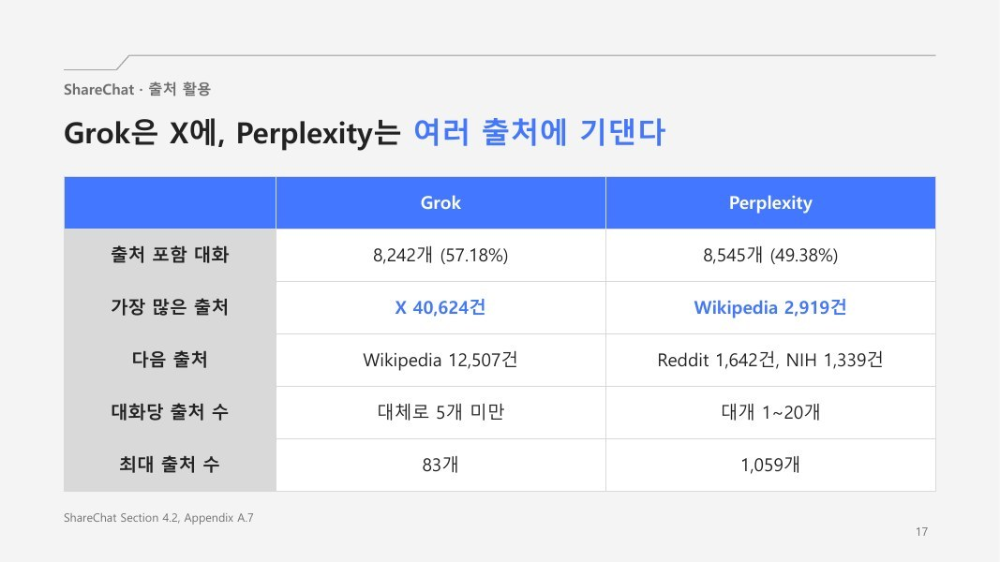

### 두 논문 비교

Search Arena는 **선호**를, ShareChat은 **서비스 맥락**을 봅니다. Search Arena는 사용자의 직접 평가라는 강점이 있지만 선호가 정답은 아니고, ShareChat은 서비스 고유 정보와 시간을 담지만 공유된 대화만 포함합니다.

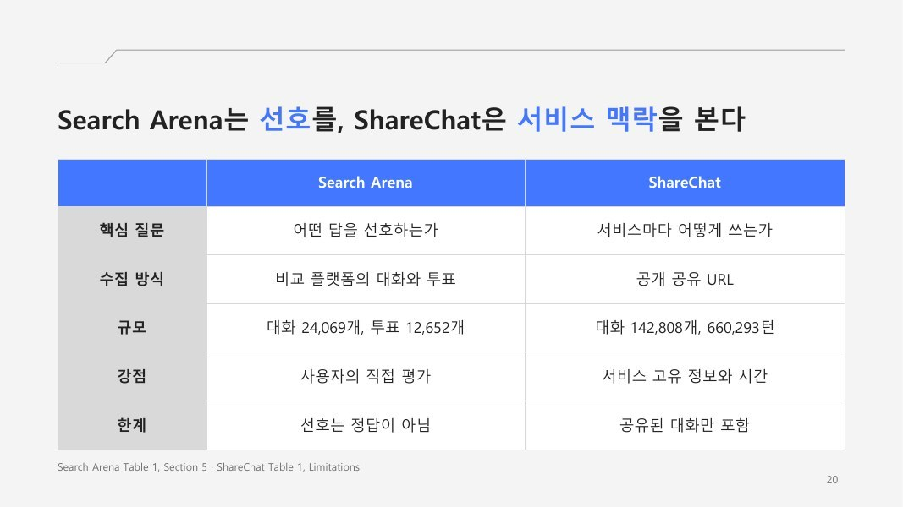

### My Insight — 입장마다 읽어야 할 결과가 다르다

같은 결과도 누구의 입장에서 읽느냐에 따라 다른 제안이 나온다고 보고, 두 가지 가설과 제안을 정리했습니다.

- **사용자 입장** — 무관한 인용에도 지지 인용과 거의 같은 점수(β=0.27)를 준다는 것은, 사용자가 **인용이 붙어 있다는 것만 보고 답을 과신**할 수 있다는 뜻입니다. 그래서 인용 개수가 아니라 **근거의 강도**를 함께 표시하자고 제안했습니다.
- **서비스 입장** — Perplexity에서 정보 찾기가 63.3%라는 것은, 서비스가 모든 사용자를 같게 가정하고 설계하면 안 된다는 뜻입니다. 사용 목적별로 기능을 설계해야 합니다.

그리고 스터디에서 함께 이야기할 논의점으로, 선호와 정답을 어떻게 함께 평가할지, 공유된 대화의 편향을 어떻게 줄일지, 서비스 목적에 맞는 평가는 무엇인지, 두 데이터를 함께 쓰면 무엇을 볼 수 있을지를 던졌습니다.

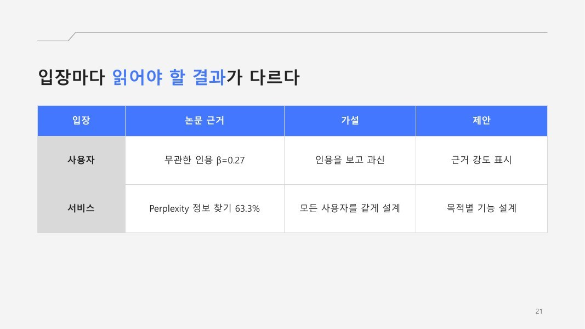
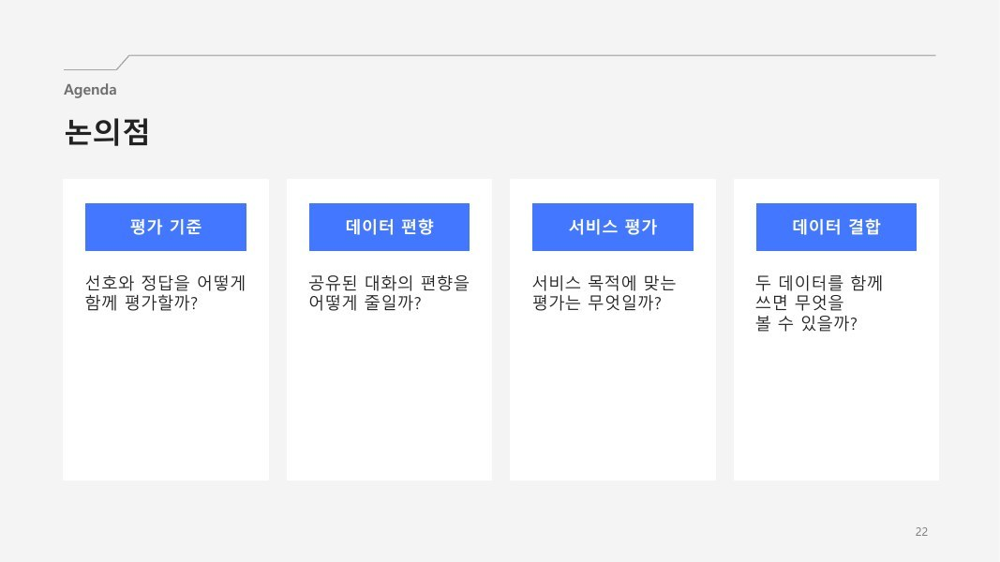

## What I'm Taking Away

다섯 편을 이어서 읽으며 공통으로 남은 생각은, 증강 LLM의 성능은 모델 자체보다 **모델에게 무엇을, 언제, 얼마나 건네느냐**에 달려 있다는 것입니다. RAPO는 생성 전에 모델이 잘 아는 표현을, VISTA는 생성 후의 비평을, NapMem은 필요한 깊이의 기억을, Search Arena와 ShareChat은 실제 사용자가 받아들이는 근거의 모습을 다뤘습니다. 그리고 그 "건네는 재료"를 평가하는 일 — 판정 모델의 편향, 투표와 정답의 차이, 공유 데이터의 선택 편향 — 이 여전히 가장 어렵다는 것도 함께 배웠습니다.
