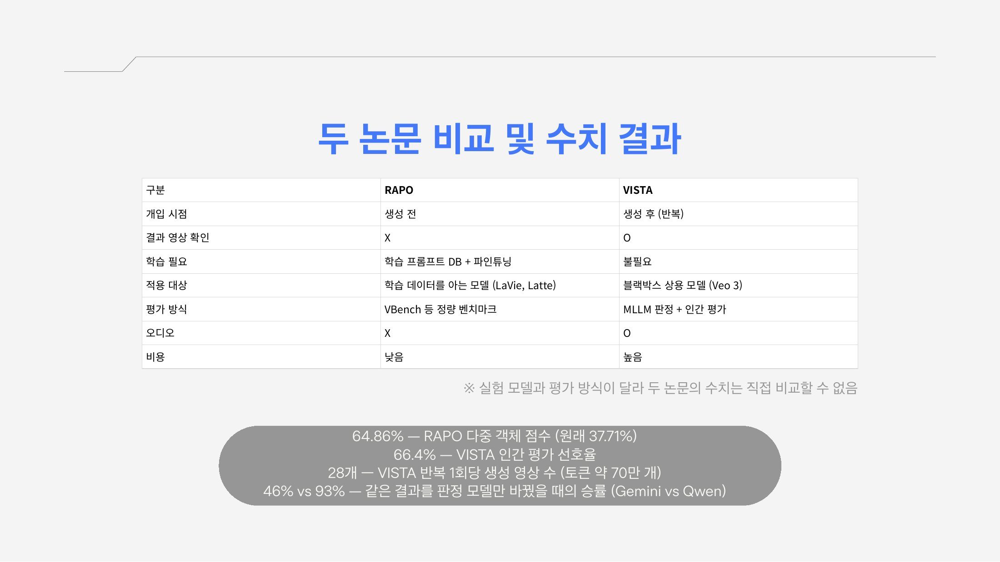
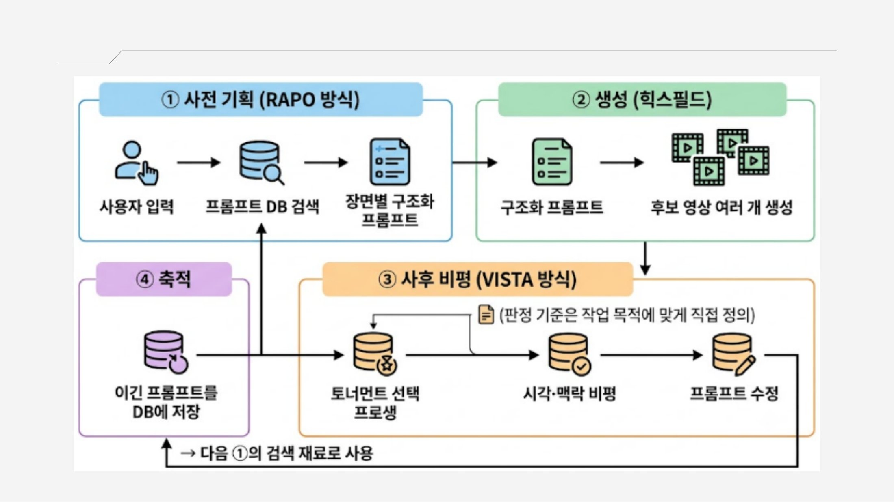
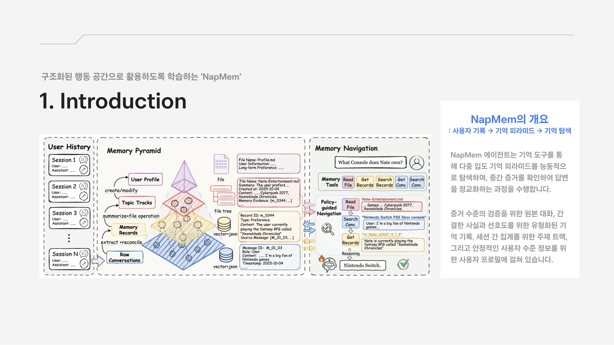
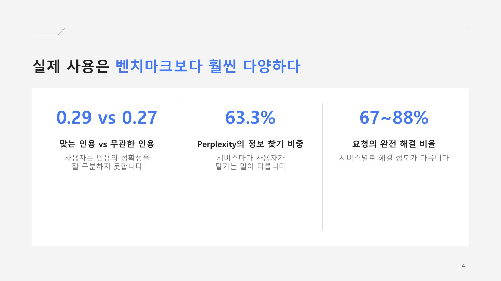
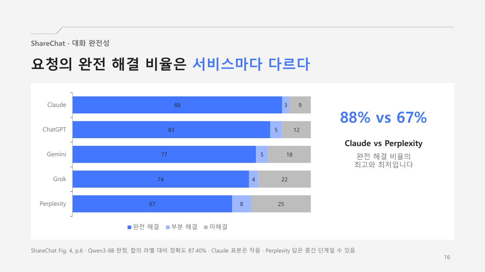

## RAPO · VISTA

**Beyond Simple Prompts: RAG와 피드백 루프를 통한 Text-to-Video 고도화.** 짧고 추상적인 사용자 프롬프트와 비디오 생성 모델 사이의 의미 격차를 줄이는 두 방법을 비교했습니다.

- **RAPO** (생성 전) — 관계 그래프에서 '모델이 잘 아는 표현'을 찾아 프롬프트를 재구성합니다. LaVie의 다중 객체 점수가 37.71% → 64.86%로 올랐고, 프롬프트 길이가 학습 데이터 분포에 가까울 때 성능이 가장 높았습니다.
- **VISTA** (생성 후) — 만든 영상을 직접 보고 시각·음향·문맥 비평으로 프롬프트를 고쳐 다시 생성합니다. 반복할수록 승률이 꾸준히 오르고, 평가자의 66.4%가 VISTA 결과를 선호했습니다.

두 방법은 개입 시점, 학습 필요 여부, 적용 대상, 비용이 서로 달라 수치를 직접 비교할 수는 없습니다. RAPO는 학습 데이터를 알아야 하고, VISTA는 반복 1회에 영상 약 28개를 만들 만큼 비용이 크며 판정 모델에 따라 승률이 크게 흔들린다는 한계를 함께 정리했습니다.

## NapMem

**From Passive Retrieval to Active Memory Navigation.** 사용자 기록을 원본 대화 → 기억 기록 → 주제 트랙 → 사용자 프로필의 4단계 '기억 피라미드'로 구조화하고, 에이전트가 이를 능동적으로 탐색하며 답을 다듬는 방법입니다. 실제 개인화 요구를 다 반영하지 못하는 벤치마크, 잊혀질 권리 같은 프라이버시 대응, 모델 크기에 따른 검증 부족을 한계로 짚었습니다.

## Search Arena · ShareChat

**실제 사용자는 AI를 어떻게 쓰는가.** 벤치마크가 아닌 실제 사용 데이터를 다룬 두 논문을 함께 읽고, 사용자는 어떤 답을 좋아하는지, 서비스마다 사용 방식은 어떻게 다른지, 두 데이터가 무엇을 보여 주고 놓치는지 세 가지 질문으로 정리했습니다.

- **Search Arena** — 검색 AI 대화 2만 4천여 건의 쌍대 투표를 분석했습니다. 사실 조회는 질문의 5분의 1뿐이었고, 사용자는 길고 인용이 많은 답을 선호했지만 **맞는 인용과 무관한 인용을 거의 구분하지 못했습니다** (계수 0.29 vs 0.27). 투표는 정답이 아니라 선호라는 한계를 짚었습니다.
- **ShareChat** — 공유 URL로 모은 실제 대화 14만여 건으로 서비스별 차이를 봤습니다. Perplexity는 정보 찾기 비중이 63.3%로 가장 높았고, 요청의 완전 해결 비율은 서비스에 따라 67~88%로 달랐습니다. Grok은 X에, Perplexity는 여러 출처에 기대는 경향이 있었습니다.

