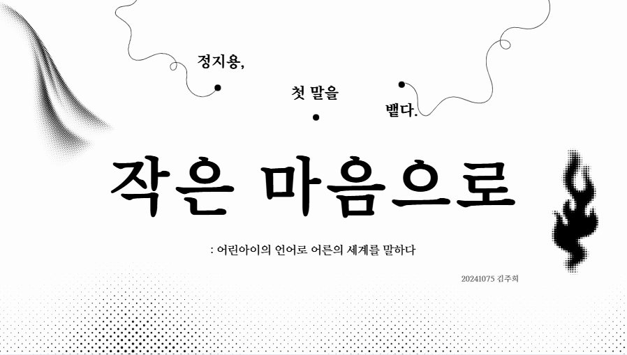
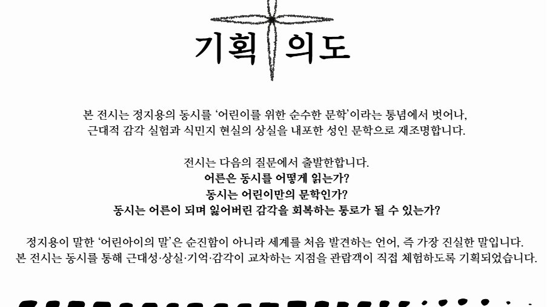
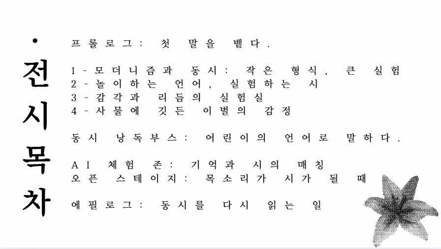
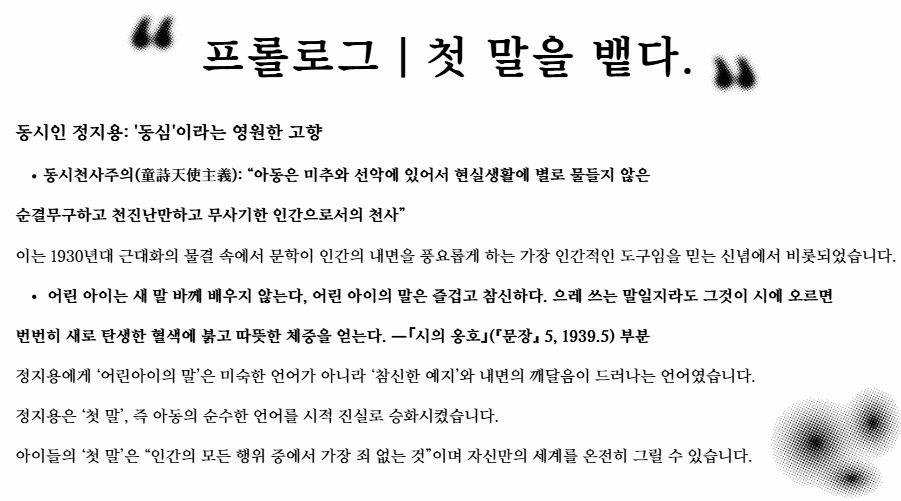
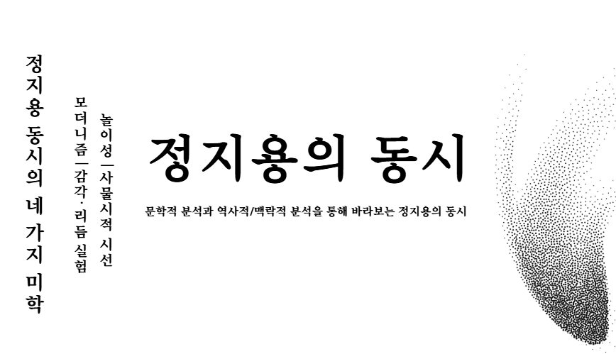
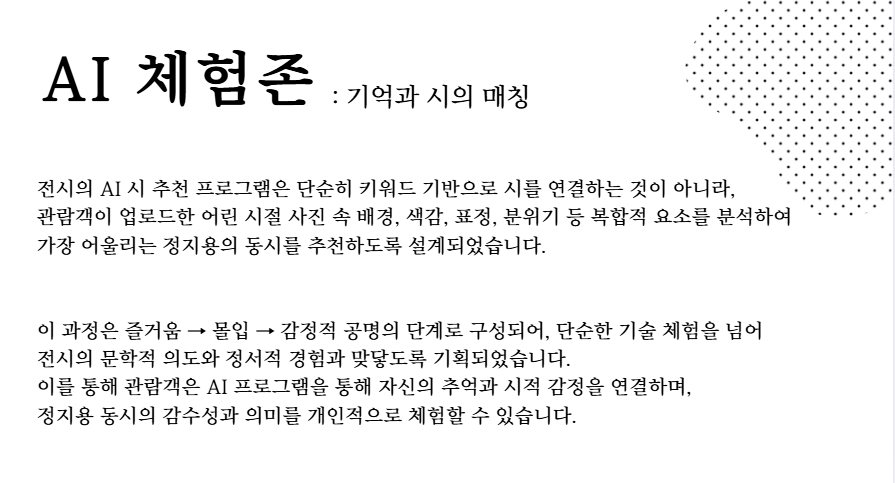
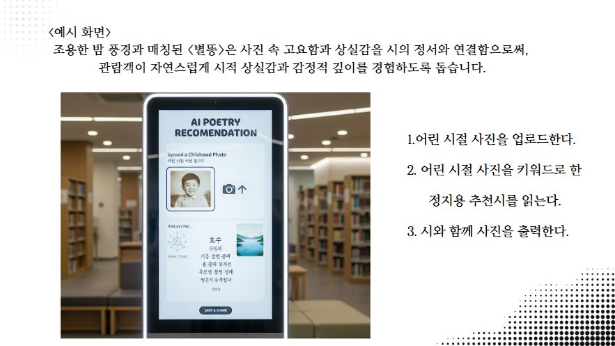
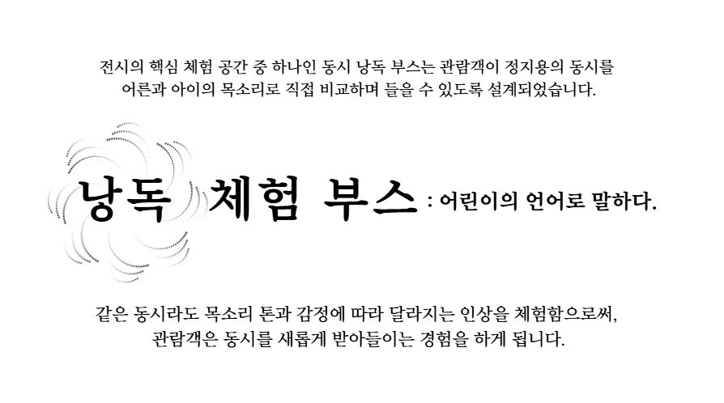

> 정지용, 첫 말을 뱉다.

## Overview

2025년 2학기 〈문학과문화콘텐츠〉 수업에서 혼자 기획한 전시 **〈작은 마음으로 : 정지용, 첫 말을 뱉다〉** 입니다. 정지용의 동시를 '어린이를 위한 순수한 문학'이라는 통념에서 벗어나, 근대적 감각 실험과 식민지 현실의 상실감을 담은 성인 문학으로 다시 읽고, 그 읽기를 관람객이 직접 체험할 수 있는 전시로 설계했습니다. 발표는 기획 의도 → 문학사적 맥락 → 전시 구성 → 교육적·연구적 의미 순서로 구성했습니다.

## Intent — '어린아이의 말'을 빌려 어른을 말하다

정지용은 1920~30년대 동요·동시 운동을 이끌며, 동심을 단순한 순수성이 아니라 **인간 정신의 핵심**으로 보았습니다. 근대 이후 '순결·무구·천진'의 존재로 다시 인식된 아이의 목소리를 통해, 정지용은 세계를 가장 죄 없이 표현하는 **'첫 말'의 힘**을 발견했습니다. 전시 〈작은 마음으로〉는 이 시적 감각을 따라, **아이의 말로 어른의 마음을 비추는 장치**를 제안합니다.

어른은 동시를 어떻게 읽는가, 동시는 어린이만의 문학인가, 동시는 어른이 되며 잃어버린 감각을 회복하는 통로가 될 수 있는가 — 이 세 질문에서 출발했습니다.

누구에게나 겨울을 거닐던 어린 시절이 있고, 그 속에는 '어린 나'라는 자아가 있습니다. 이 전시는 그 기억과 정서를 다시 불러내, **세대를 잇는 감정적 교류**와 **잊고 있던 어린 자아의 회복**을 경험하는 공간을 만들고자 했습니다. 동시와 동요를 매개로 어린이와 어른 모두가 참여하고 공감할 수 있는 세대 교류 예술 공간을 마련해, 어린이에게는 문학과 예술에 다가서는 입구를, 어른에게는 유년기의 순수한 감성과 기억을 되살리는 시간을 주고 싶었습니다.

특히 구전 문학의 전통과 그로부터 이어진 동시 문학의 역사적 맥락을 다시 비추고, 말과 노래로 이어져 온 우리 문학의 아름다움을 현대적 관점으로 재해석해 과거와 현재를 잇는 문화적 연속성을 확인하고자 했습니다. 문학·음악·시각 예술을 결합한 융합형 전시로, 동시의 언어적 표현과 동요의 정서적 울림을 여러 감각으로 체험하며 '어린아이였던 나 자신'과 다시 만나는 포용적인 예술 공간을 지향했습니다.

## Context — 근대성, 식민지, 상실

**정지용 동시의 문학적 의의.** 1926년 『학조』 발표를 시작으로 동시 창작이 본격화되었고, 1927년 조선동요연구협회가 창립되면서 근대 동요·동시 운동의 전환점을 맞았습니다.

**정지용 동시의 특징.** 정지용의 동시에서는 동심, 근대적 감각, 식민지 현실이 교차합니다. 김학동은 이를 "망향가이자 망국민의 서러움을 달래는 영혼의 노래"라고 불렀습니다. 아이의 말처럼 보이지만 그 안에는 상실·고독·이별·망향 같은 어른의 감정이 담겨 있고, 〈산 너머 저쪽〉, 〈딸레〉, 〈말〉은 아이의 시선 속에 기억·불안·상실을 품고 있습니다.

## Exhibition — 네 가지 미학으로 다시 읽기

정지용의 동시를 네 가지 미학으로 나눠 전시를 구성했습니다.

- **모더니즘 — 〈띠〉, 〈산 너머 저쪽〉** : 공간·사물·기호의 재조립, 근대적 감각 실험. 아이의 시선 너머에 있는 '모더니스트 정지용'의 미학
- **감각·리듬 실험 — 〈홍시〉, 〈별똥〉** : "후락 딱 딱", "벼르고 벼르다" 같은 의성·의태어의 음악성, 청각과 시각 감각의 결합
- **놀이성 — 〈해바락이씨〉, 〈내 맘에 맞는 이〉** : 반복·말맛·리듬, 명명놀이와 언어의 창조성. 밝지만 실험적인 시
- **사물시적 시선 — 〈딸레〉, 〈말〉** : 인형·동물·사물의 존재를 응시하는 시선. 겉은 동심이지만 속에는 상실·죽음·이별의 정조

### 〈산 너머 저쪽〉 깊이 읽기

> 〈산 너머 저쪽〉
> 산 너머 저쪽에는
> 누가 사나?
>
> 뻐꾸기 영 우에서
> 한나절 울음 운다.
>
> 산 너머 저쪽에는
> 누가 사나?
>
> 철 나무 치는 소리만
> 서로 맞아 쩌 르 렁!
>
> 산 너머 저쪽에는
> 누가 사나?
>
> 늘 오던 바늘 장수도
> 이 봄 들며 아니 뵈네.

전시의 중심 작품으로 〈산 너머 저쪽〉을 두 갈래로 읽었습니다.

**모더니즘으로 읽기**
1. **감정·서사를 줄인 '이미지 중심의 시'** — 뚜렷한 이야기나 교훈 없이 이미지로만 구성하고, 답 없는 질문 "누가 사나?"를 반복해 의미를 열어 둡니다.
2. **감각 실험의 강화** — 뻐꾸기, 철 나무 소리 같은 청각 이미지와 "쩌 르 렁!" 같은 의성어로 언어를 실험합니다.
3. **객관적 관찰자 시점** — 화자의 감정을 줄이고 '거리두기'로 근대적인 서술 방식을 씁니다.
4. **모호함과 비현실적 분위기** — 반복될수록 공허해지는 질문이 향토적 서정이 아니라 '기묘하고 열린 공간'을 만듭니다.

**전통과 근대 사이에서 읽기**
1. **한문학적 기반의 근대시 실험** — 시경 「벌목」을 번역하는 과정에서 창작되어, 한시 언해를 근대 조선어로 다시 풀었습니다.
2. **전후기 시 세계의 연결성** — 「장수산1」과 표현이 닮아 시 세계의 일관성을 보여 줍니다.
3. **동시적 자연스러움** — 순우리말 의성어로 자연스러운 리듬을 만듭니다.
4. **전통 리듬의 활용** — 3·4음보를 섞어 어린 화자의 고독을 경쾌하게 표현합니다.
5. **근대를 넘어선 창작 의지** — 문화 이식을 넘어 한국적 현대시를 만들려는 시도, 곧 시 쓰기가 근대를 극복하는 실천이었습니다.

## Space — 관람형 존 → AI 체험 존 → 비디오 월 → 오픈 스테이지

입구에서 관람형 존, AI 체험 존, 비디오 월을 지나 오픈 스테이지로 돌아 나오는 동선으로 공간을 설계했습니다.

**관람형 존.** 모든 동시 원문을 디지털로 옮기고 QR로 작품에 바로 접근하게 했습니다. 정지용의 동시천사주의, 근대 동요운동, 문학사적 흐름을 시각 자료로 보여 주고, 같은 동시를 성인과 아이의 목소리로 비교해 들을 수 있는 **낭독 체험 부스**를 두었습니다.

## AI zone

**기억과 시의 매칭.** 관람객이 어린 시절 사진을 올리면, AI가 키워드만이 아니라 표정·배경·색감·분위기를 함께 분석해 감정과 상황이 닮은 정지용의 동시를 추천합니다. 예를 들어 자연 사진에는 〈말〉, 과일이나 놀이 사진에는 〈홍시〉, 멍한 표정이나 밤 배경에는 〈별똥〉을 연결합니다. 전시 본편 작품 외에도 〈향수〉, 〈고향〉 같은 다른 정지용의 시까지 확장 아카이브로 이어지도록 했습니다. 즐거움 → 몰입 → 감정적 공명으로 이어지도록 구성해, 관람객이 자신의 추억과 시적 감정을 연결하도록 했습니다.

실제로 추천 체험 프로토타입을 만들어 제 어린 시절 사진으로 시험해 보았습니다. 무언가를 쥐고 멍하니 앉아 있는 사진에는 〈별똥〉이, 아빠에게 안겨 웃고 있는 사진에는 〈홍시〉가 추천되었습니다.

> 〈별똥〉
> 별똥 떠러진 곳,
> 마음해 두었다
> 다음날 가보려,
> 벼르다 벼르다
> 인젠 다 자랐오.

> 〈홍시〉
> 어저께도 홍시하나.
> 오늘에도 홍시하나.
>
> 까마귀야. 까마귀야.
> 우리 남게 웨 앉었나.
>
> 우리 오빠 오시걸랑. 맛뵈라구 남겨 뒀다.
>
> 후락 딱 딱 훠이 훠이!

## Reading booth & Open stage

**어린이의 언어로 말하다.** 같은 동시라도 목소리 톤과 감정에 따라 인상이 달라지는 것을 체험하도록, 관람객이 정지용의 동시를 어른과 아이의 목소리로 직접 비교해 들을 수 있는 낭독 부스를 설계했습니다.

부스는 두 층위의 감정을 체험할 수 있도록 공간과 음향을 나눴습니다. 한 공간에서는 아이의 목소리만 또렷하게 들려 순수한 동심을 집중해서 느끼고, 다른 공간에서는 아이의 목소리를 잔향처럼 배경에 깔고 어른의 목소리를 메인 오디오로 겹쳐 들려줍니다. 어린아이의 순수함과 어른의 복잡한 감정이 교차하고 화해하는 느낌을 자연스럽게 체험하도록 했습니다.

마지막 **오픈 스테이지**에서는 관람객이 AI에게 추천받은 동시를 직접 낭독합니다. 녹음된 목소리는 실시간 그래픽으로 시각화되어, 관람객의 낭독이 전시장 스크린에 함께 기록됩니다. 다른 사람의 목소리로 읽힌 '첫 말'들이 쌓이며 전시가 완성되는 구조입니다.

### Demo

세대의 목소리가 맞닿아 동시를 읽는 낭독 부스와, 어린 시절 사진으로 시를 추천하는 시스템(초안)을 시연한 영상입니다.

## Meaning

- **문학사적 의미** — 1920~30년대 동시·동요 운동의 전개를 확인하고, 정지용 동시의 근대성과 감각 실험을 다시 발견합니다.
- **교육적 의미** — 동시를 통해 세대 간 정서적 공감이 가능하고, '어른이 동시를 다시 읽는 경험' 자체가 감수성을 회복하는 장치가 됩니다.
- **아카이브적 의미** — 체험 기록과 낭독 기록을 디지털 아카이브로 남겨, 전시가 끝난 뒤에도 연구와 교육 자료로 다시 쓸 수 있습니다.
