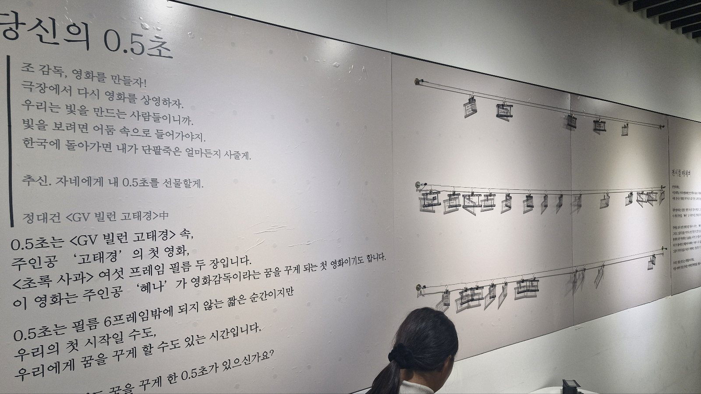
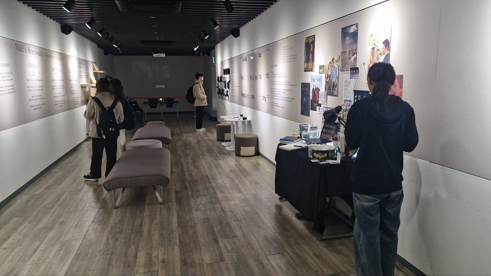
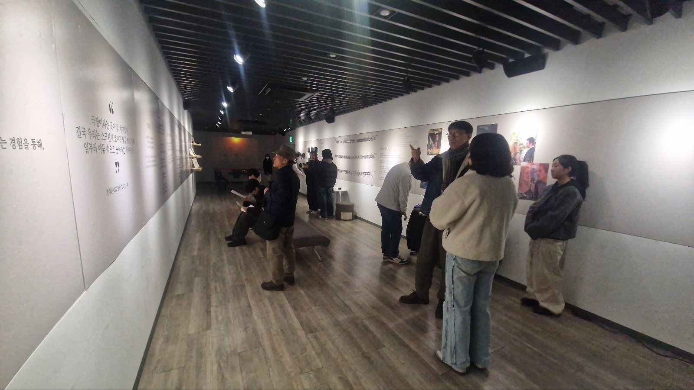
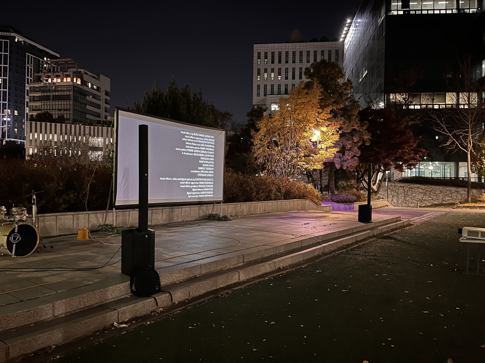
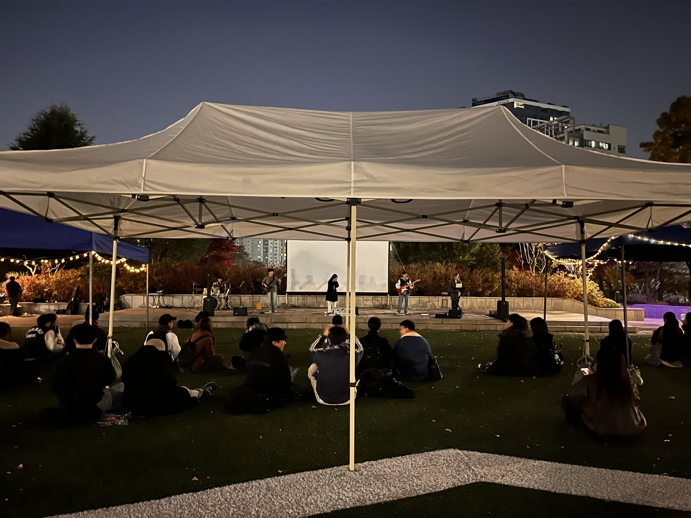
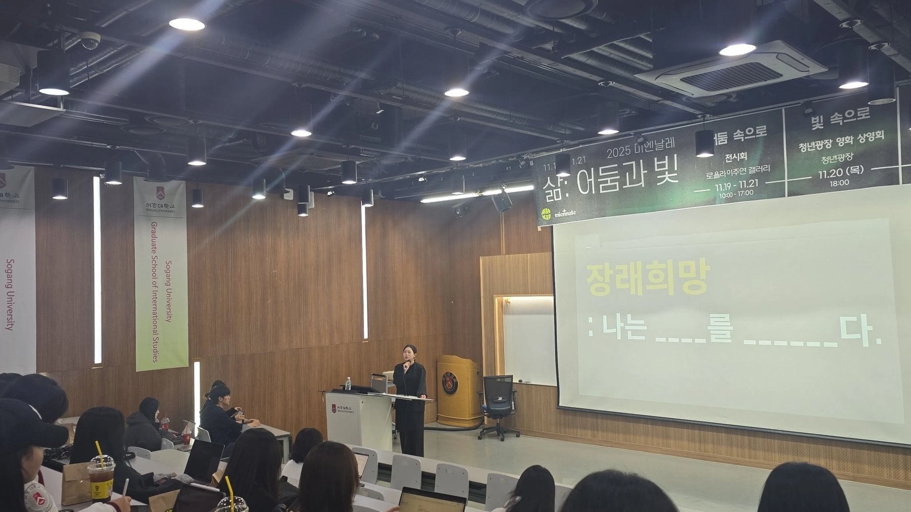
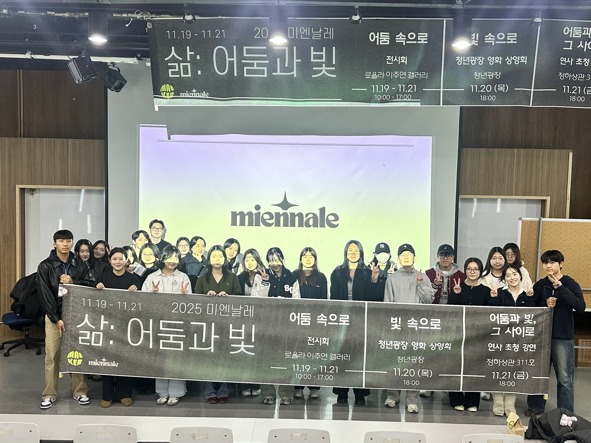

> 어둠 속으로, 빛 속으로

## Overview

미디어&엔터테인먼트학과 학생회가 주관하는 학과 공식 전공 행사 **제4회 미엔날레**를 전체 총괄했습니다. 학생들이 창작 결과물을 공유하고, 학과의 정체성을 학내외에 알리는 자리입니다. 대주제 **'삶: 빛과 어둠'** 을 사흘 동안 전시, 야외 상영회, 강연의 세 가지 형식으로 풀었습니다.

미엔날레는 2019년 개설된 우리 학과에서 2021년 손원정 교수님과 함께 작게 시작한 행사였습니다. 제가 기획을 맡은 해부터는 이 행사를 정말 열심히 준비했고, 전공생들만 참여하는 행사가 아니라 **지식융합미디어학부 사람이라면 누구나 알 정도로** 홍보와 공지에 공을 들였습니다. 그 결과 사흘 동안 약 200명이 전시와 프로그램을 찾았습니다.

## Concept — 삶 : 어둠 속으로

> 우리는 인생의 장면을 기록하고, 대화의 흔적을 담아내며, 찰나의 순간을 붙잡아왔습니다.
> 그렇게 모인 시간과 이야기들은 겹겹이 쌓여 어느덧 '삶'이라는 이름을 얻습니다.
>
> "2025 미엔날레 : 삶"은 어둠 속에서 빛을 마주하는 경험을 통해, 타인의 이야기를 발견하고, 자신의 삶을 새롭게 사유합니다.
> 어둠과 빛이 교차하는 틈에서 우리는 서로의 시간을 비추어 보며 삶의 결을 더듬고자 합니다.
> 어둠 속, 우리의 빛나는 여정에 당신을 초대합니다.

전시는 정대건 작가의 소설 **〈GV 빌런 고태경〉** 을 바탕으로 기획했습니다. 영화감독의 꿈과 고달픈 현실 사이에서 갈등하는 주인공 '혜나'처럼, 대학생은 꿈과 현실의 중간에서 고민하는 시기에 있습니다. 콘텐츠를 만드는 수많은 준비생과 지망생들 — 무모할 정도로 자기 분야를 사랑하지만 자꾸 한계에 부딪히는 사람들 — 이 지치지 않고 사랑하는 것을 계속할 수 있기를 바라는 마음을 담았습니다.

> "극장이라는 곳이 참 재미있지. 결국 우리는 스크린에 쏘아진 빛을 보기 위해 일부러 어둠 속으로 들어가는 거 아닌가."
> — 정대건, 〈GV 빌런 고태경〉

## 1 · Into the dark

**전시 〈어둠 속으로〉** — 11.19–11.21, 로욜라도서관 이주연갤러리. 빛을 보기 위해 일부러 어둠 속으로 들어가는 극장처럼, 창작자가 마주한 '어둠의 순간'을 시각화했습니다. 전시는 다섯 개의 공간으로 이어집니다.

**① M&E : 기술과 이야기, 그 사이의 가능성** — 학과 소개. 미디어&엔터테인먼트학과는 기술의 진보와 예술의 상상력이 만나는 지점에서 새로운 문화와 산업의 미래를 탐구합니다. AI와 데이터, 디지털 미디어를 현대 사회의 언어이자 창작의 토대로 배우는 **MEDIA**, 영화·방송·공연처럼 사람과 사회를 비추는 콘텐츠에서 이야기의 힘을 배우는 **ENTERTAINMENT**. "기술이 단단한 뼈대를 세운다면, 예술은 그 위에 따뜻한 숨결을 더합니다."

**② M&E's directionality** — 학과가 만들어 가는 세상의 방향을 세 단어로 정리했습니다.

- **VISION 시선** (#MEDIA #CREATIVITY) — AI, 데이터, 메타버스 같은 디지털 기술로 새로운 미디어 콘텐츠를 기획하고, 사람들의 시선을 이해하고 설계하는 학과
- **IMMERSION 몰입** (#ENTERTAINMENT #CONTENTS) — 스토리텔링과 인터랙티브 설계로 관객이 콘텐츠에 완전히 몰입하는 경험을 창조하는 학과
- **INNOVATION 혁신** (#TECHNOLOGY #NEW MEDIA) — AI, 가상인간, 메타버스로 미디어 콘텐츠와 엔터테인먼트 경험을 새로운 방식으로 구현하는 학과

**③ 미엔날레 공모전** — '어둠과 빛'을 주제로 열린 공모전의 작품들. 미엔만의 시선으로 탄생한 작품들이 어둠을 뚫고 빛으로 나아가는 순간을 담았습니다.

**④ 참여형 전시 〈당신의 0.5초〉** — 소설 속 고태경은 혜나에게 "자네에게 내 0.5초를 선물할게"라는 편지를 남깁니다. 0.5초는 고태경의 첫 영화 〈초록 사과〉의 여섯 프레임 필름 두 장이자, 혜나가 영화감독을 꿈꾸게 된 순간입니다. 필름 6프레임밖에 되지 않는 짧은 순간이지만 우리의 첫 시작일 수도, 꿈을 꾸게 하는 시간일 수도 있습니다. 관람객에게 **"여러분에게도 꿈을 꾸게 한 0.5초가 있으신가요?"** 라고 묻고, 각자의 0.5초를 남기게 했습니다.

**⑤ 전시를 마치며** — 마지막 공간에는 작가의 말과 전시기획팀의 편지를 두었습니다.

> 우리는 빛을 만드는 사람들이니까요, 어둠 속에서 만난 우리는 어쩌면 함께 빛을 만들 수 있지 않을까요?

## 2 · Into the light

**야외 상영회 〈빛 속으로〉** — 11.20, 청년광장. 창작자가 만든 '빛'을 함께 바라보는 자리로, 소모임 밴드 공연, 미엔날레 공모 선정작 단편영화 상영, 〈이터널 선샤인〉 상영을 이어 진행했습니다.

## 3 · Between

**연사 초청 강연 〈어둠과 빛, 그 사이로〉** — 11.21, 정하상관. 마지막 날에는 먼저 **미엔날레 공모전 수상작 시상식**을 열고, 이어서 동문 연사 초청 강연을 진행했습니다.

> 우리는 그 '삶'을 바라보기 위해 어둠 속으로 스스로 걸어 들어가며, 우리의 '삶'은 빛을 통해 세상에 전달됩니다. 그리고 우리는 어둠과 빛의 경계에서 '삶'을 전달하는 "Director"로서 존재합니다.

연사는 〈스트리트 푸드 파이터〉부터 〈서진이네〉, 〈콩콩밥밥〉, 〈채널 십오야〉까지 만든 **에그이즈커밍의 이영경 PD**(학과 동문)였습니다. 변화무쌍한 미디어 환경 속에서도 콘텐츠는 결국 웃음으로 귀결될 수 있다는 것을 보여 주고, 재미와 함께 전하고 싶은 메시지를 담기 위해 끊임없이 고민하며 사람들에게 친근하게 다가가는 PD입니다. 강연 제목은 **〈재밌는 이야기를 만드는 재미없는 이야기〉** 로, 재미있는 콘텐츠 뒤에 있는 제작 과정과 고민을 들려주었습니다.

## Role

전체 총괄로서 디자인, 기획, 영상, 회계팀을 이끌었습니다. 전시 콘셉트와 공간 구성을 잡고, 전시·상영회·강연 세 프로그램의 흐름을 설계했으며, 학과 안팎에 행사를 알리는 홍보와 공지를 챙겼습니다.

## Reflection

미엔날레를 준비하며 처음으로 **미디어를 직접 만들고, 그것을 전시라는 형태로 사람들 앞에 내놓는 일**을 끝까지 해 봤습니다. 트레일러 영상과 전시 글, 참여형 공간과 굿즈까지 — 머릿속에만 있던 '삶: 빛과 어둠'이라는 생각이 하나씩 손에 잡히는 형태가 되어 가는 과정이었습니다. 제 작업 아카이브의 이름인 **POIESIS — 사유를 형태로, 가능성을 현실로** 라는 말을 처음으로 실감한 작업이기도 합니다.

전시를 기획하면서 미디어가 결국 **사회를 배우는 창**이라는 것도 알게 됐습니다. 〈GV 빌런 고태경〉의 혜나를 따라가다 보니, 제 주변의 수많은 준비생과 지망생들 — 자기가 좋아하는 것 때문에 아파하는 사람들 — 이 보였습니다. 한 편의 소설에서 시작한 전시가 동료들의 이야기가 되고, 관람객이 남긴 '0.5초'들이 다시 서로의 이야기가 되는 것을 보며, 미디어를 만드는 일은 결국 사람과 사회를 이해하는 일이라는 것을 배웠습니다.

작은 학과 행사로 시작한 미엔날레를 학부 모두가 아는 행사로 키우고 싶었고, 어둠 속으로 들어와 준 200명의 관람객 덕분에 그 바람이 조금은 빛이 되었다고 생각합니다.
