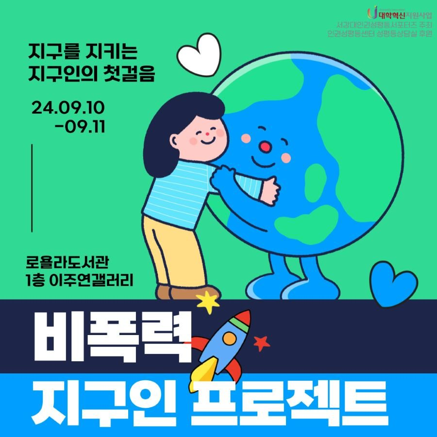
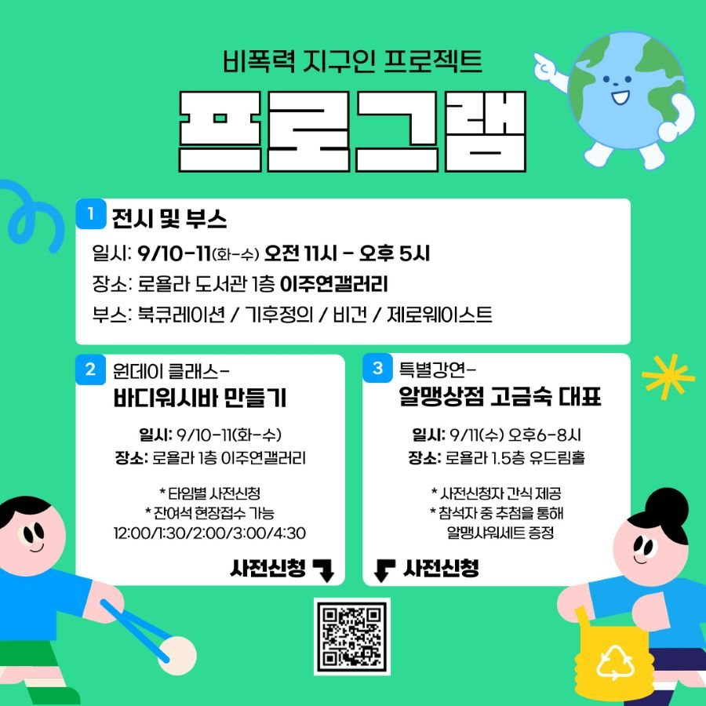
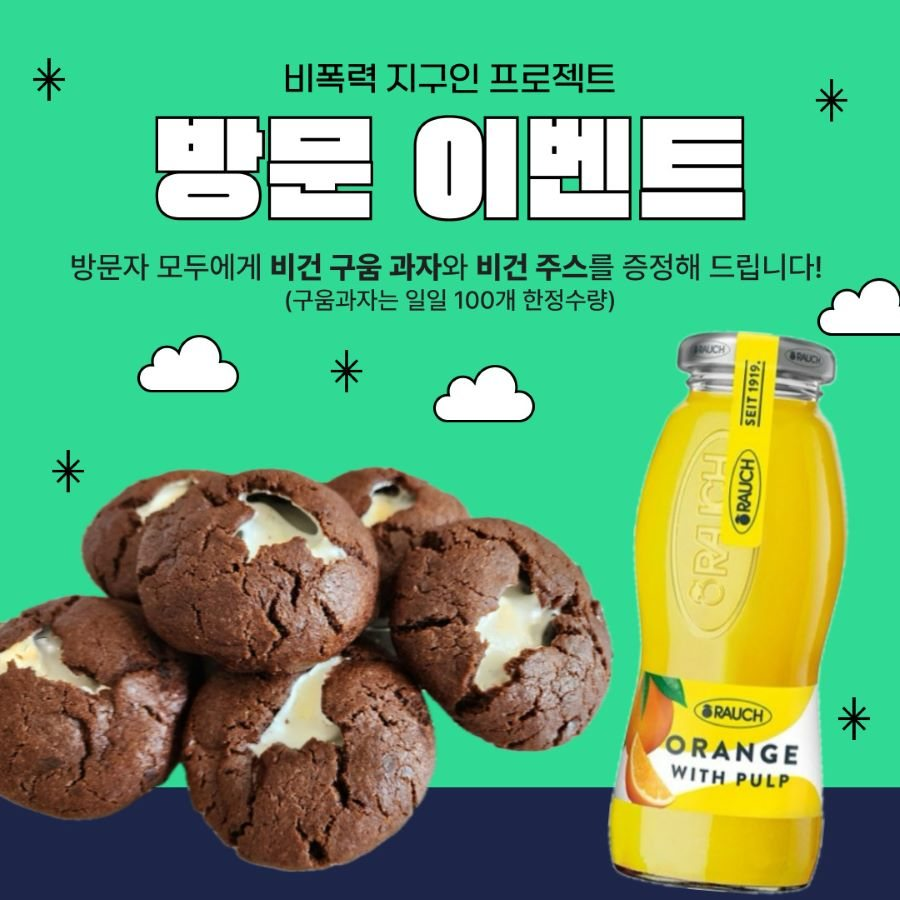

## Overview

2024년 여름방학 동안 서강대학교 인권·성평등센터의 **전후자 장학금 서포터즈**(인권 부문)로 활동하며 **'비폭력 지구인'** 을 주제로 지구 온난화 속에서 소외되는 인권을 조사하고, 참여형 전시와 강연을 열었습니다. 사람과 동물, 지구를 향한 폭력을 일상에서 줄이는 방법을 직접 경험하는 행사로, 이틀 동안 **231명**이 부스를 찾았습니다.

지구인이라면 누구나 환경에 속해 살아갑니다. 그래서 '누구나' 속해 있는 **지구인**을 주제로 잡아, 비건이나 여성 인권처럼 예민하게 받아들여지기 쉬운 문제에도 부담 없이 다가설 수 있도록 했습니다.

## Program

1. **전시와 부스** — 북큐레이션, 기후정의, 비건, 제로웨이스트 (로욜라도서관 이주연갤러리). 기후정의 전시는 **정세랑 작가의 소설**을 바탕으로, 소설 속에 그려진 기후 정의를 살펴보는 방식으로 꾸몄습니다.
2. **원데이 클래스** — 바디워시바 만들기 (시간대별 사전 신청)
3. **특별강연** — 알맹상점 고금숙 공동대표 초청 강연 (U-Dream Hall). 여성환경연대에서 활동하며 유해물질과 건강, 생리대 유해물질 문제, 화장품 미세플라스틱 사용 금지 등 다양한 환경 문제를 해결해 온 분으로, 기후변화로 여성들이 마주하는 어려움과 일상에서 쉽게 실천할 수 있는 제로웨이스트 방법을 이야기해 주셨습니다.

준비는 역할을 나눠 진행했습니다.

- **체험 부스 조사** — 제로웨이스트 비누 만들기 같은 체험 활동의 재료 가격과 소요 시간, 일반 제품과 제로웨이스트 제품의 차이
- **퀴즈·전시 자료 조사** — 기후 × 인권 × 젠더로 전하고 싶은 이야기, 관련 자료와 영상 내용 정리
- **굿즈 조사** — 주제와 어울리면서도 소장하고 싶은 키링·굿즈와 가격
- **비건 간식 조사** — 쉽게 볼 수 있는 비건 과자·음료와 가격, 비건에 대한 설명 (전시 활용)

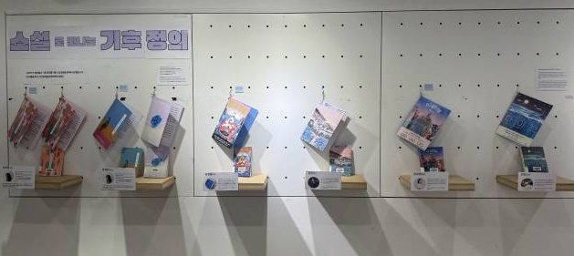
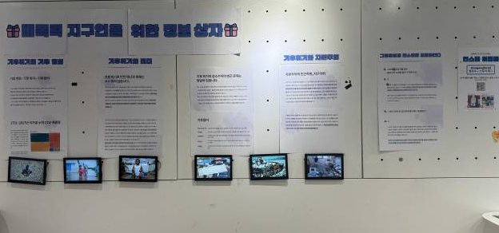
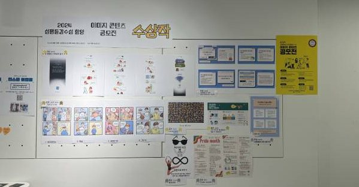
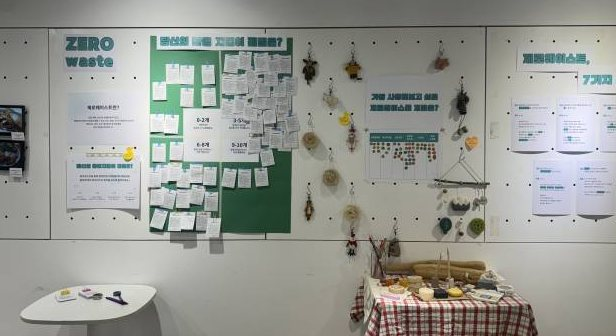

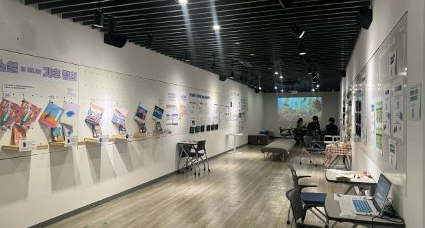
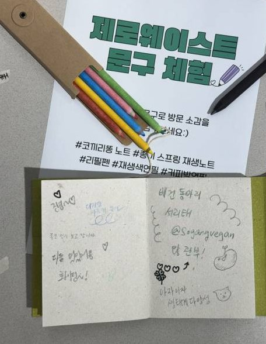
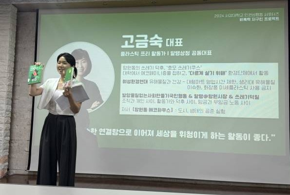

## Events

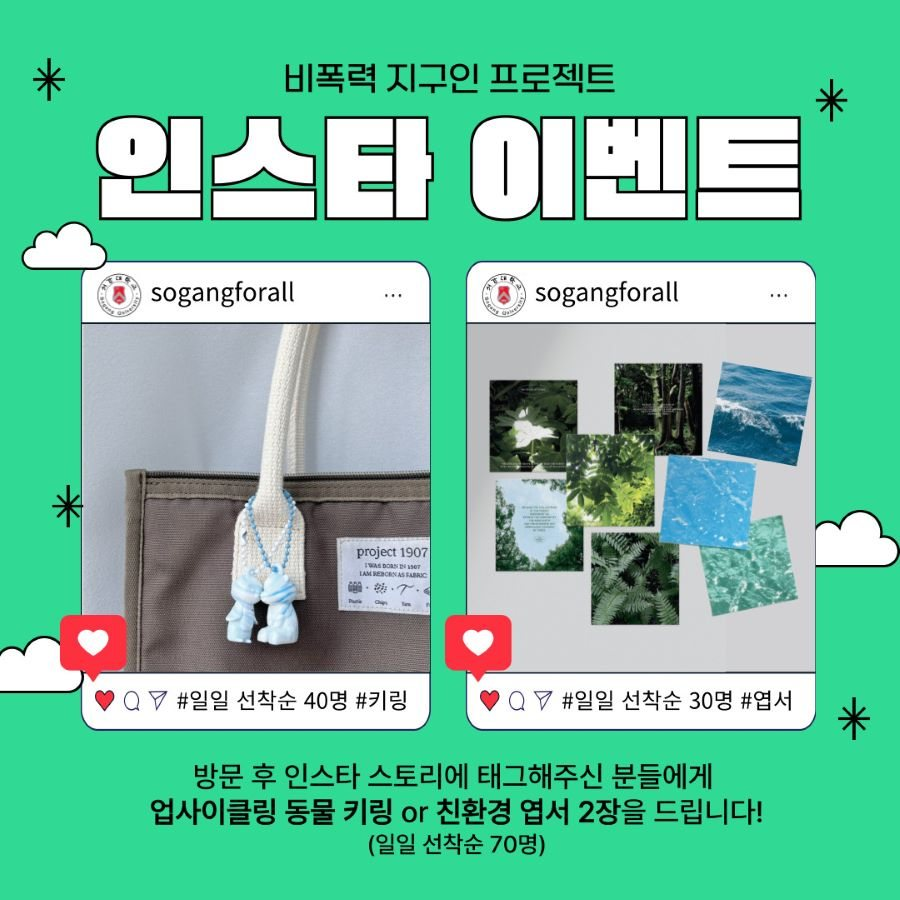
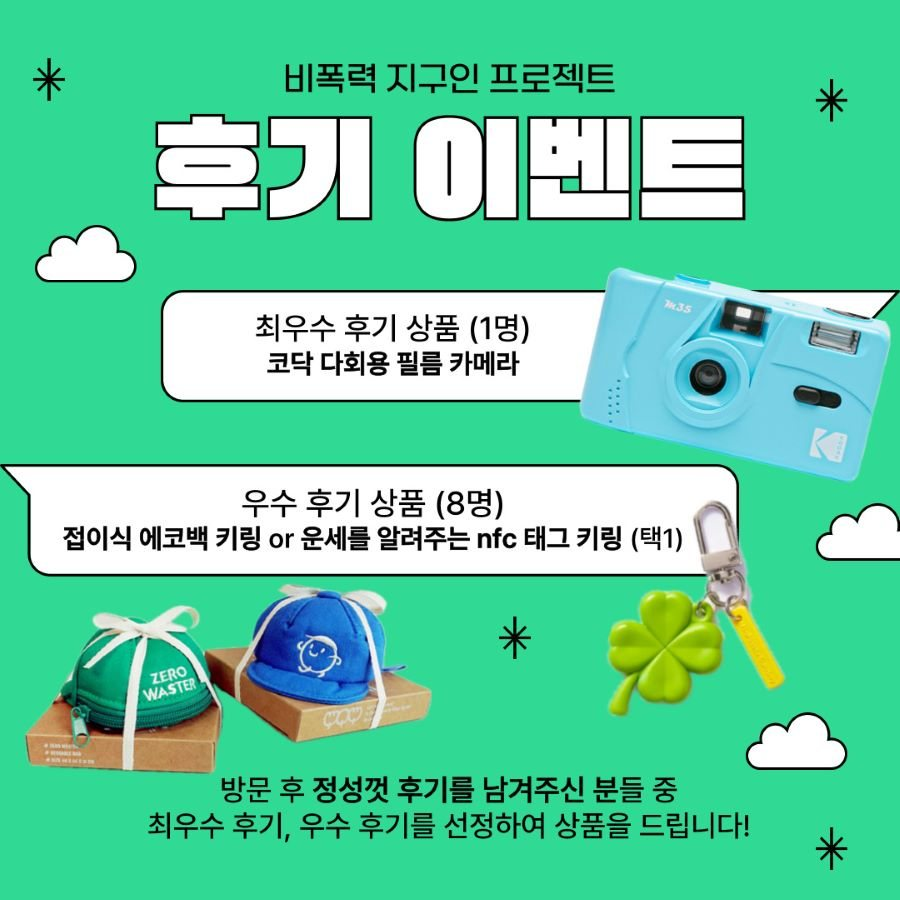
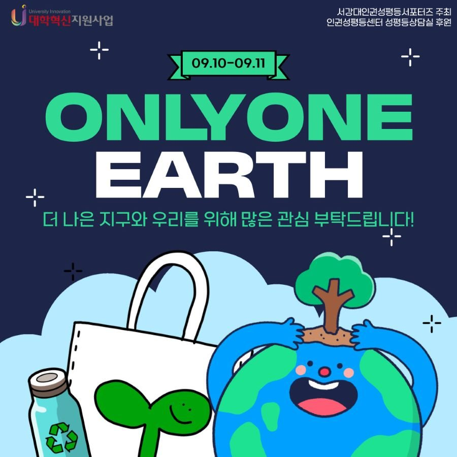

## Role

- **체험 부스 담당** — 제로웨이스트 체험 활동을 조사하고 부스를 꾸렸습니다. 재료 가격과 소요 시간을 따져 원데이 클래스(바디워시바 만들기)와 체험 구성을 정하고, 일반 제품과 제로웨이스트 제품이 어떻게 다른지 관람객이 직접 비교해 볼 수 있게 했습니다.
- **디자인** — 홍보용 카드뉴스(프로그램, 방문 이벤트, 인스타·후기 이벤트)와 전시장에 걸린 전시 패널들을 만들었습니다.

## Reflection

학창 시절 제 꿈은 **도서관 설립자**였습니다. 정보가 넘쳐나는 시대에도 공유된 정보를 제대로 활용하지 못하거나, 아예 정보를 받지 못하는 사람들이 있습니다. 정보화 시대를 넘어 뉴미디어 시대를 살아가는 지금, 그런 정보 소외 계층도 '누구나' 누려야 할 **정보권**과 교육권을 누리게 하고 싶었습니다. 그래서 다양한 권리를 배우고 싶어 서포터즈 인권 부문에 지원했습니다.

활동 전 여러 인권을 공부하며 제 좁은 시각을 돌아보게 됐습니다. 정책을 세우고 데이터를 쌓아 두기만 하면 정보 소외 문제가 해결될 거라는 생각은 어렸습니다. 정보를 누리기에 앞서 사람으로서, 동물로서, 혹은 지구(환경)로서 누려야 할 권리들이 아직 충분히 인식되지 않았고, 그 위에서야 정보권도 제대로 설 수 있다는 것을 알게 됐습니다.

그래서 누구나 다가설 수 있는 '환경'이라는 주제로 '누구나'의 인권 이야기를 풀었습니다. 비건, 여성 인권처럼 민감한 키워드도 일상의 단어로 남아, 사람들이 서로의 권리를 존중하고 존중받기를 바랐습니다. 지구인으로서, 여성으로서, 대학생으로서, 노동자로서 — 어떤 자리에 있든 생명체라는 존재로서 **누구나** 그 권리를 인정받고 함께 배려하는 사회가 되어야 한다고 생각합니다.

방학부터 2학기 초까지 이어진 이 활동은, 정보권이 존중받는 사회를 만들고 싶다는 제 꿈을 더 넓은 권리의 그림 안에서 다시 보게 해 준 시간이었습니다.
